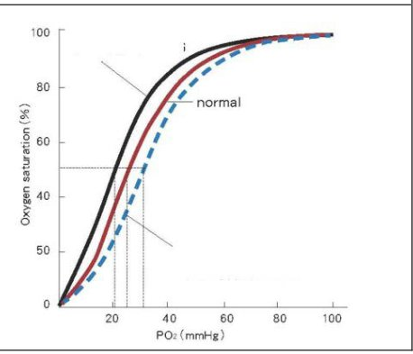
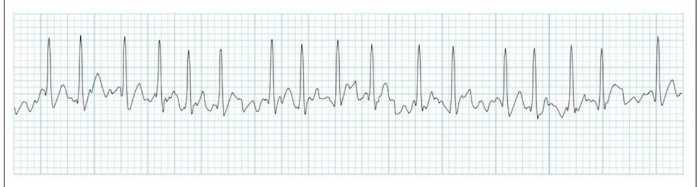
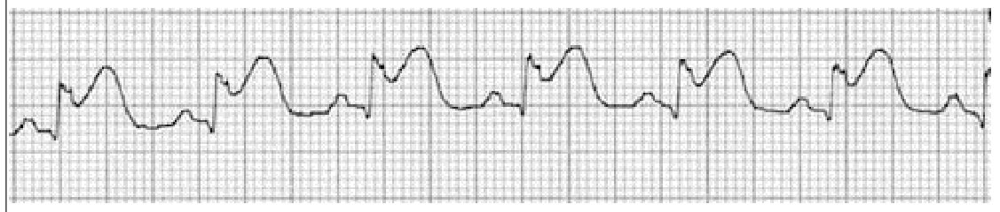
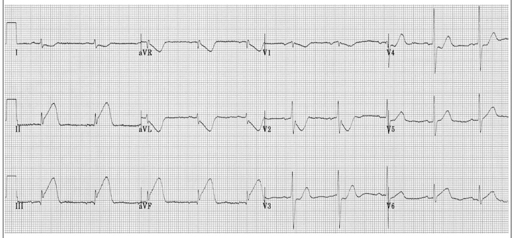
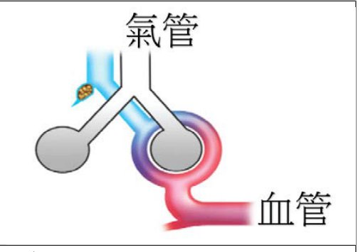
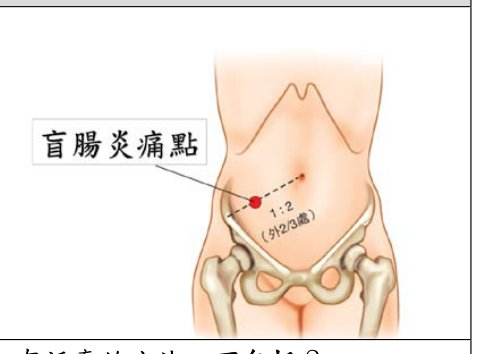
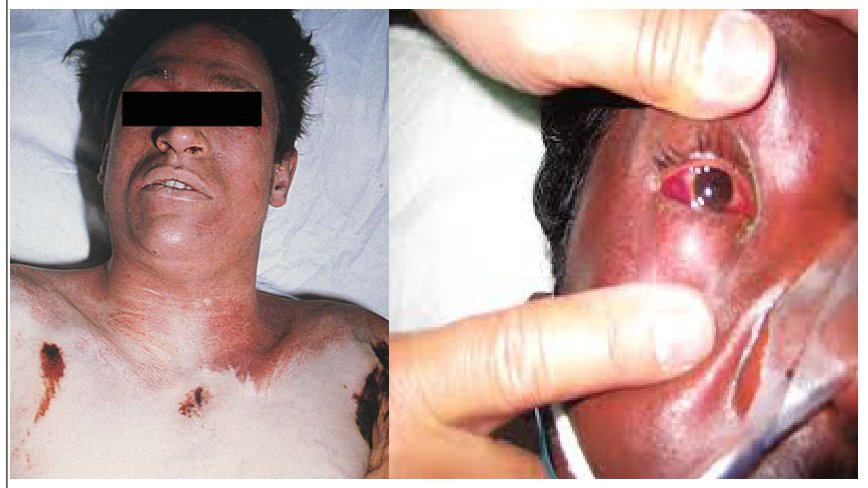
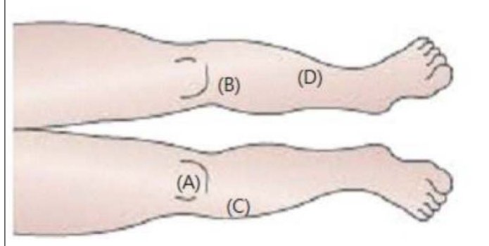
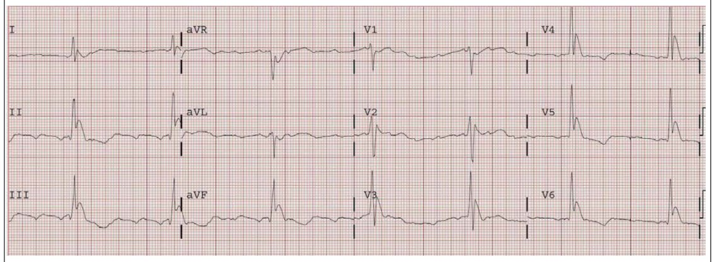

# 108 年度高級救護技術員甄試筆試 題目卷

> 單選題，共 100 題。答案在 [`答案_108-114年.md`](答案_108-114年.md)，作答完再對。

### 1. 今天醫療指導醫師至您的分隊，先與隊員座談討論救護案例，然後參與正在進行的分隊心肺復甦術抽測講評、之後他又檢查本月的車廂內錄影急救過程，並且將發現的問題寫成醫療指導記錄交給承辦人及回傳救護科。請問在上述過程中，這位醫師進行了哪些模式的醫療指導？

- (A) 即時性與回溯性。
- (B) 前瞻性與即時性。
- (C) 前瞻性與回溯性。
- (D) 前瞻性、即時性與回溯性。

### 2. 當遇到救護倫理的困境時，我們可以假想「如果自己是病患、是否能接受這樣的處置與建議」，這種方法叫作？

- (A) 無私試驗。
- (B) 普及試驗。
- (C) 答辯試驗。
- (D) 自主試驗。

### 3. 下列何者是屬於緊急醫療救護「過程面」的指標？

- (A) 救護人員對單位的滿意度與離職比例。
- (B) 派遣中心報案電話中主訴創傷與非創傷的比例。
- (C) 缺血性胸痛病患接受到院前心電圖檢查的比例。
- (D) 社區心肺停止的病患在到院前即恢復自發性循環的比例。

### 4. 中央衛生主管機關公告之公共場所，購置自動體外心臟電擊去顫器後，應送衛生主管機關備查後，轉登錄於哪一個單位？

- (A) 縣(市)政府衛生局。
- (B) 鄰近之急救責任醫院。
- (C) 衛生福利部網站。
- (D) 縣(市)消防機關之救災救護指揮中心。

### 5. 對於減少頸椎之二次傷害，將脊椎固定(Spinal Immobilization)改為脊椎減移(Spinal MotionRestriction)。是符合「醫療照護品質」之哪一面向？

- (A) 有效(Effective ness)。
- (B) 安全(Safety)。
- (C) 傷病患為中心(Patient-centeredness)。
- (D) 效率(Efficiency)。

### 6. 有關病人自主權利法，以下何者為是？

- (A) 於中華民國108 年1 月6 日公布，於公布後三年實施。
- (B) 病患的相關病情應告知病患。病患未明示反對時，亦得告知其關係人。
- (C) 病患若要簽署預立醫療決定，需要在制式意願書上正式簽名就能生效。
- (D) 僅限於末期病患適用。

### 7. 品管有許多執行方式以及手法。若要觀察各品管特性隨時間變異之情形，比較適合使用那一種品管手法？

- (A) 柏拉圖。
- (B) 查核表。
- (C) 散布圖。
- (D) 管制圖。

### 8. 以下針對氣管內管相關的敘述何者為非？

- (A) 小於8 歲的兒童因為環狀軟骨段的氣管較寬大，所以一定要選擇有氣囊的氣管內管。
- (B) 兒童的會厭軟骨較為細長柔軟，不易控制，故常使用直式葉片。
- (C) 若插管太深，通常是進入右側支氣管。
- (D) 潮氣末二氧化碳濃度可以用來評估插管是否正確置於氣管中。

### 9. 體重150 公斤身高160 公分男性OHCA 救護，欲進行氣管插管，以下何者擺位最適當？

- (A) 墊高肩部。
- (B) 墊高頸部。
- (C) 墊高頭部。
- (D) 墊高胸部。

### 10. 承上題，墊高原則以下何者最適當？

- (A) 下巴對肩線。
- (B) 耳垂對肩線。
- (C) 嘴角對肩線。
- (D) 喉結對肩線。

### 11. 承上題，嘗試插管兩次失敗，以下何者最適當？

- (A) 抽吸後再次嘗試插管。
- (B) 擺位後再次嘗試插管。
- (C) 抽吸後放置口咽呼吸道。
- (D) 選擇放置聲門上呼吸道。

### 12. 細胞的發電機是指？

- (A) 核糖體(ribosome)。
- (B) 粒線體(mitochondria)。
- (C) 溶小體(lysosome)。
- (D) 高基氏體(Golgi apparatus)。

### 13. 右圖為氧合血紅素飽合度與動脈血氧分壓的關係圖，有關此圖的敘述何者為非？

- (A) 此圖用來解釋內呼吸的生理作用。
- (B) 曲線右移時，代表氧氣易釋放至組織。
- (C) 體溫增加、血中PH 上升時，曲線會往右移。
- (D) 血中二氧化碳分壓下降、血中2-3-DPG 濃度下降，曲線會往左移。

### 14. 55 歲男性，早上九點在公司開會，突然出現眼睛無法對焦，看東西會出現複視的現象；然後接著自己右臉有麻木的感覺，想喝水卻發現自己連吞口水都會嗆到；趕緊請求119 送醫，您9 點30 分至現場，評估後發現病患的辛辛那提中風指標皆呈現陰性反應，下列敘述何者為非？

- (A) 此病患仍可能為腦中風，須通報醫院啟動中風小組並送至可以施打血栓溶解劑的醫院。
- (B) 「眼睛無法對焦，看東西會出現複視」，有可能是第三、四、六對的腦神經當中，有某些神經受影響。
- (C) 「右臉有麻木的感覺」，應該是第七對腦神經有受影響。
- (D) 「連吞口水都會嗆到」，有可能是第九對腦神經有受影響。

### 15. 呼吸作用的過程包括下列四個步驟：換氣作用→外呼吸→循環→內呼吸；四個步驟中，任一發生問題，皆可以誘發其相對應的疾病；有關疾病與呼吸四步驟的配對，下列配對何者為非？

- (A) 肺栓塞–外呼吸。
- (B) 一氧化碳中毒–內呼吸。
- (C) 張力性氣胸–外呼吸。
- (D) 嚴重氣喘發作–換氣作用。

### 16. 78 歲男性求救，突然感到嚴重胸部不適而打119 求救，你到現場發現她有發紺、胸痛及休克現象，似乎快要窒息。此時問診相關症狀，形成臆斷錯誤的配對是？

- (A) 沉重壓迫感、心臟被捏住感：心絞痛。
- (B) 突發性撕裂般疼痛感：主動脈剝離。
- (C) 持續性疼痛：心包膜炎。
- (D) 胸骨後灼熱感：肺栓塞。

### 17. 詢問病史時，常用OPQRST 口訣來釐清主要症狀特徵，下列選項錯誤的是？

- (A) O(Onset/Origin)：症狀發生的時間與當時狀況。
- (B) Q(Quality)：症狀的特性。
- (C) S(Sensitivity)：症狀所代表疾病的陽性比例。
- (D) R(Region/Radiation)：症狀的發生部位，有無轉移痛。

### 18. 下列身體理學檢查結果與臆斷配對錯誤的是？

- (A) 結膜蒼白：貧血。
- (B) 鞏膜黃疸：急性肝炎。
- (C) 耳道出血：鼓膜破裂、顱底骨折。
- (D) 瞳孔不等大：嗎啡中毒。

### 19. 請問下列何種理學檢查發現與可能的相關疾病，何者為非？

- (A) Seat-belt Sign 為小腸損傷的表現。
- (B) Cullen Sign 為急性胰臟炎的表現。
- (C) Gray-Turner's sign 為後腹腔出血的表現。
- (D) Kehr Sign 為左側腎臟血腫的表現。

### 20. 關於醫病互動模式的比較，何者為是？

- (A) 指導–合作模式是一種以醫病互為中心的互動。
- (B) 共同參與模式是一種以病患和家屬為中心的互動。
- (C) 病患在送醫途中心跳停止，應先使用共同參與模式。
- (D) 主動–被動模式是醫療人員對病患的單向影響，並非互動。

### 21. 特殊的腹部診察方式，何者為非？

- (A) 移動式濁音在患者平躺及側臥時，叩診時濁音與實音的交界位置會改變。
- (B) 深觸診左下腹時會使傷病患右下腹疼痛，是為洛夫辛徵象( Rovsing's sign)。
- (C) 闌尾炎可能會有閉孔肌徵候(Obturator Sign)的出現。
- (D) 肋脊角的敲擊痛，代表後腹腔可能有出血或發炎。

### 22. 你深夜出勤一件路倒的案件，到達現場時病患渾身酒味，意識對痛有反應，暢通呼吸道後發現呼吸型態快且每次都進行深度換氣，下列敘述何者為是？

- (A) 此種呼吸稱為陳施氏呼吸(Cheyne-Stokes respiration)。
- (B) 病患可能是橋腦損傷，要檢查是否有頭部外傷。
- (C) 病患可能為高血糖引起的代謝性鹼中毒，要驗血糖。
- (D) 病患可能為喝到假酒，要搜尋四周是否有喝剩的酒。

### 23. 下列關於病史詢問的技巧，何者為是？

- (A) 因救護現場環境因素及時間有限，一般會用專一性的問句來迅速獲得臨床上最重要的病史訊息。
- (B) 重複病患的句尾幾個字會打斷病患的思路，而且會讓病患有不被尊重的感受，應盡可能避免。
- (C) 澄清(clarification)的目的在於對病患含糊的描述加以釐清。可依程度量化的問句常會誤導病患對於症狀的描述。
- (D) 鼓勵病患描述病情的方式並不限於言語，適時的點頭，或是眼神接觸都可以達到順勢引導的效果。

### 24. 60 歲女性兩週前剛因為左側股骨頸骨折開刀出院，回家後持續臥床休息。兩天前開始呼吸不順、胸痛、今日下床有昏厥跌倒被119 送來醫院。理學檢查發現病人血壓90/50 mmHg、心跳 106/分、血氧 88%、頭部和前胸有擦傷、兩側呼吸音清晰、無明顯心雜音、有頸靜脈鼓張。病人最有可能的診斷是？

- (A) 肺炎。
- (B) 肺栓塞。
- (C) 心肌梗塞。
- (D) 心包膜填塞。

### 25. ACLS 強調對於CPR 過程中要使用EtCO2 連續監測。關於EtCO2 數值在到院前使用的意義，何者為非？

- (A) 如果EtCO2 = 0 mmHg，表示病人一定是心跳停止過久。
- (B) 如果EtCO2 < 10 mmHg，表示CPR 品質要加強。
- (C) 如果EtCO2 數值短暫下降又回昇時，可能是給予epinephrine 的影響。
- (D) 如果EtCO2 >=40 mmHg 且持續時，表示病人可能已經回復自發性循環。

### 26. 指揮中心通報某安養中心接救護案件，求救原因為意識不清。您們到現場後發現病人躺床上、看起來沒有反應、一旁護理人員已接上的心電圖監測如下，請問下列敘述何者正確？

- (A) 此病人目前為心房顫動併快速心室反應 (A.fib with RVR)。
- (B) 此病人須立刻同步整律雙向波120 焦耳。
- (C) 此病人須立刻去顫電擊雙向波150 焦耳。
- (D) 此病人須先確認脈搏。

### 27. 有關糖尿病酮酸中毒(Diabetic Ketoacidosis, DK)之常見徵象，下列何者為是？

- (A) 皮膚濕冷或出汗。
- (B) 呼吸性酸中毒。
- (C) 出現Kussmaul’s 呼吸。
- (D) 症狀發展非常快速。

### 28. 當病人發生全身立即致命性過敏反應，可考慮使用的藥物下列何者為非？

- (A) Diphenhydramine 抗組織胺
- (B) Hydrocortisone 腎上腺皮質素
- (C) Nitroglycerin 硝化甘油
- (D) Epinephrine 腎上腺素

### 29. 根據疾病管制署指出，中國大陸今(2019)迄11 月底累計確診共四例鼠疫病例，其相關之鼠疫(Plague)描述，下列何者為非？

- (A) 依疾病管制署規定鼠疫屬於第二類法定傳染疾病，應於三日內完成通報。
- (B) 鼠疫為急性、致命性的人畜共通傳染疾病，死亡率極高。
- (C) 腺鼠疫、敗血性鼠疫、肺鼠疫為臨床常見之三種主要型式。
- (D) 鼠疫有可能遭有心人士利用成為生物恐怖製劑進行攻擊。

### 30. 有關洗腎病人的血液透析不平衡症候群（disequilibrium syndrome）之描述，下列何者為是？

- (A) 最常發生於多次透析療程之後。
- (B) 可能因血液中尿素氮減少的速度比腦部慢所致。
- (C) 會出現神經症狀，如不安、意識程度降低、抽搐。
- (D) 會產生滲透壓不平衡，導致腦脫水、缺氧。

### 31. 46 歲女性，因左半邊臉突然僵硬、臉歪嘴斜，自覺中風故求救119。若她有下列何種症狀，比較像是貝爾氏麻痹而非中風？

- (A) 右側肢體無力。
- (B) 吞嚥困難、流口水。
- (C) 舌頭前三分之二味覺異常。
- (D) 前額皺紋不受影響(仍可皺額頭與皺眉)。

### 32. 您載送一名長期臥床病人到院後，被醫院告知病人可能有疥瘡。下列說明，何者為是？

- (A) 疥瘡是由寄生在真皮層中的疥蟲所引發的疾病。
- (B) 病人發癢搔抓的部位，通常由臉和軀幹開始。
- (C) 救護車上病人接觸過的物品，可以日曬處理或是用塑膠布密封靜置兩週。
- (D) 您若因接觸到疥蟲被感染的，一般來說一週內就會出現搔癢症狀。

### 33. 18 歲男性參加完學校體育課的籃球賽後感到陰囊劇烈的疼痛。病人否認有外傷或外力撞擊，下列敘述何者為是？

- (A) 突發的單側睪丸劇烈的疼痛，通常是急性副睪炎。
- (B) 給予熱敷改善循環，可以減輕疼痛。
- (C) 用手輕輕上抬疼痛側睪丸，可以緩解病人的疼痛感。
- (D) 避免睪丸壞死，須及早進行手術修復。

### 34. 55 歲肥胖男性在吃完大餐後感到腹部疼痛，下列敘述何者為是？

- (A) 若病人有發燒、黃疸與左上腹痛，即符合典型的膽管炎三徵象。
- (B) 若病人無法坐直，平躺才能緩解疼痛，合理的懷疑是急性胰臟炎。
- (C) 若病人疼痛自右下腹先發生後轉移至上腹痛，則是典型的闌尾炎表現。
- (D) 若病人有黑便伴隨全腹部的反彈痛，合理的懷疑是消化道潰瘍穿孔。

### 35. 45 歲女性病人，因酒後呼吸困難而打119 求救。您到場後發現病人意識嗜睡、呼吸急促，主訴：呼吸喘，四肢無力麻木，以及腹部不適，現場生命徵象：血壓102/66 mmHg、脈搏92/min、呼吸 28/min、血氧濃度room air 100%。此病人的後續處置何者為是？

- (A) 此病人是過度換氣症候群，只要引導呼吸或以塑膠袋罩住口鼻即可改善。
- (B) 可盡速給予含糖點滴，以排除低血糖引起的症狀。
- (C) 可給予氣管擴張劑，以改善病人呼吸喘的不適。
- (D) 需評估現場是否有其他物質或藥物引起呼吸代償的可能。

### 36. 48 歲男性病人家屬報案主訴突然昏倒，經派遣員線上評估疑似OHCA（到院前心肺停止），予以線上指導報案者施行心肺復甦術。您們到場後發現報案者正在為病人CPR，沒有使用AED。病人目前無意識且無適當呼吸，您們接上心電圖監視器顯示如下。下列處置何者為是？

- (A) 繼續心肺復甦術，盡速送醫。
- (B) 此病人為寬QRS 不穩定心律，應立即200J 去顫電擊。
- (C) 此病人為急性心肌梗塞，盡速給予Aspirin 與NTG 舌下碇。
- (D) 立即開始復甦後照護，給予人工呼吸並持續監控心律。

### 37. 承上題，病人送到醫院後恢復自發性循環(ROSC)，作12 導程心電圖如下。下列說明，何者為是？

- (A) 心肌梗塞位置在右心室下壁。
- (B) 冠狀動脈阻塞位置在左前降支冠狀動脈近端。
- (C) 心電圖顯示已併發二度二房室傳導阻滯。
- (D) 需進行右側心電圖與後側心電圖檢查。

### 38. 一名70 歲男性病人，過去病史有COPD，因突發性胸悶及呼吸困難而求救，你到現場發現病人呼吸急促，似乎快要窒息。下列敘述及處置，何者最為適當？

- (A) 呼吸速率愈快，病人嚴重程度愈高。
- (B) 若評估病人無心衰竭症候，到院前給予霧化氣管擴張劑吸入對病人有幫忙。
- (C) 若病人意識混亂或昏迷即表示病人嚴重缺氧，應儘速給予高濃度氧氣。
- (D) 若出現鼻翼搧動或是明顯的頭部上下移動伴隨急促呼吸，即表示病人呼吸動力不足。

### 39. 下列情形皆可能引發抽搐現象(seizure-like movements)，但何者為非？

- (A) 頭部外傷 head injury。
- (B) 藥物戒斷 drug withdraw。
- (C) 慢性偏頭痛 migraine。
- (D) 心室顫動 ventricular fibrillations。

### 40. 病人低血氧的原因可以來自通氣與灌流的配對異常。請問如右圖所示的通氣／灌流異常，是下列哪一個疾病的機轉？

- (A) 氣喘。
- (B) 肺栓塞。
- (C) 肺水腫。
- (D) 一氧化碳中毒。

### 41. 美國心臟醫學會與中風醫學會提出的「腦中風病人的存活復原之鏈 (stroke chain of survivaland recovery)」7D，與119 有關的 “D”，不包括？

- (A) Detection：教導民眾及時判斷腦中風的前兆。
- (B) Dispatch：派遣緊急救護系統，事先通知送至醫院。
- (C) Door：119 快速到達病人家門、執行辛辛那提與黃金時間判斷。
- (D) Delivery：119 快速將病送達適當醫院的急診處。

### 42. 下列症狀或徵象都可能暗示病人有心包膜填塞，但何者為非？

- (A) 貝克氏三症狀(Beck's triad)。
- (B) 脈搏壓變窄且深呼吸時脈搏變弱。
- (C) 12 導程心電圖出現電氣交替現象。
- (D) 吸氣收縮壓上昇與吐氣時收縮壓下降的奇脈現象。

### 43. 白血病又稱「血癌」，可以分成四類，其中最常發生在年幼兒童身上的是哪一種？

- (A) 急性淋巴性白血病(ALL)。
- (B) 慢性淋巴性白血病(CLL)。
- (C) 急性骨髓性白血病(AML)。
- (D) 慢性骨髓性白血病(CML)。

### 44. 救護技術員載送已知診斷的下列病人時，應該要配戴N95 口罩，但何者除外？

- (A) 水痘。
- (B) 麻疹。
- (C) 流行性感冒。
- (D) 開放性肺結核。

### 45. 呼吸疾病可以因為通氣、擴散或灌流問題引起。下列疾病皆是「擴散」問題，但何者除外？

- (A) 氣喘。
- (B) 肺水腫。
- (C) 肺纖維化。
- (D) 一氧化碳中毒。

### 46. 急性闌尾炎的典型臨床表徵為：食慾變差、噁心與右下腹痛點。請問此痛點的醫學名稱為？

- (A) Morrison point。
- (B) McBurney point。
- (C) Charcot point。
- (D) Zollinger-Ellison point。

### 47. 根據 ACLS 2015 建議，提高社區猝死病人 (OHCA) 存活率的方法，不包括？

- (A) 請高風險病人家中購置自動體外去顫器(AED)以備不時之需。
- (B) 請119 派遣中心在電話線上指導報案者作只壓胸的 CPR。
- (C) 請119 派遣中心善用社群軟體召喚週遭民眾協助CPR 與取得AED。
- (D) 將OHCA 病人儘量送到專責的猝死救治中心(cardiac arrest center)。

### 48. 根據 ACLS 2015 建議，病人被插入氣管內管後要確認位置的方法，不包括？

- (A) 五點聽診(auscultations)。
- (B) 潮氣末二氧化碳監測(ETCO2)。
- (C) 超音波(ultrasound)。
- (D) 胸部X-光(CXR)。

### 49. 第十版ATLS 提及外傷傷者初步評估有六大危及生命之傷害，下列何者為非？

- (A) 氣管支氣管傷害(Tracheobroncheal tree injury)。
- (B) 開放性氣胸 (Open pneumothorax)。
- (C) 連枷胸合併肺挫傷 (Flail chest and pulmonary contusion)。
- (D) 心包膜填塞 (Cardiac tamponade)。

### 50. 第十版ATLS 所做的外傷急救方式更新 ，何者為非？

- (A) 成人休克時的初始輸液治療為1 公升，小兒<40 Kg 為20mL/Kg。
- (B) 小兒張力性氣胸針刺減壓位置建議在第二肋間、鎖骨中線。
- (C) 嚴重腦傷傷者應該立即給予過度換氣降低腦壓。
- (D) 燒燙傷成人或青少年>14 歲之輸液治療為 2mL LR x Kg x %TBSA 以維持尿量0.5mL/Kg/hr。

### 51. 下列敘述有關於張力性氣胸的描述，何者為非？

- (A) 張力性氣胸傷者，血氧濃度持續無法改善，不建議立即插氣管內管治療。
- (B) 頸靜脈怒張、單側呼吸音減弱或消失、及氣管偏移到對側可以強烈懷疑張力性氣胸。
- (C) 第十版ATLS 建議成人張力性氣胸針刺減壓位置為第五肋間腋中線前方。
- (D) 身體評估會發現休克、頸靜脈怒張、以及模糊的心音。

### 52. 根據美國外科醫學會外傷委員會之現場檢傷指引，下列何者最應該直接送至創傷中心？

- (A) 懷孕36 週之孕婦，騎摩托車不慎和摩托車發生擦撞，肚子疼痛，可自行站立。
- (B) 未戴安全帽頭部撞到的地上的50 歲男子，現場GCS14 分。
- (C) 汽車相撞後，被困於車內的駕駛，現場花了將近十分鐘才脫困。
- (D) 工地工人，未做好防護措施，從三公尺高之鷹架跌落。

### 53. 45 歲男性，於地震中受困於倒塌的建築物，經過數小時後，救援隊到達現場，現場血壓70/40mmHg、心跳115/分，左大腿開放性骨折、右大腿腫脹變形、且雙下肢都對疼痛無感覺，下列敘述何者較適當？

- (A) 雙大腿骨折不會是造成患者休克的原因，需再評估是否有其他內出血。
- (B) 因雙大腿都懷疑有骨折情形，加上血壓偏低，建議使用抗休克褲來改善休克。
- (C) 開放性骨折處應嘗試加以復位再包紮，以免搬運時造成二次傷害。
- (D) 患者可能已出現腔室症候群，需考慮執行筋膜切開術。

### 54. 你接獲派遣令到火災現場進行救護，救出的男子，年約五十歲，左上臂以及背部約一半的範圍出現了二度以上的燒傷，但肢體仍可活動，意識清楚，講話聲音略帶沙啞，著急著想要回到房屋內搶救他心愛的狗，現場血壓120/60mmHg、心跳120 下/每分鐘、呼吸速度約24 下每分鐘，血氧92%，下列敘述何者最正確？

- (A) 患者血氧92%、呼吸偏快；建議給予鼻導管供給氧氣至血氧94%以上。
- (B) 根據九的法則(Rule of Nines)患者燒灼傷範圍超過20%，應送至燒傷中心處置。
- (C) 患者心跳偏快，應在患者雙上臂各建立一條靜脈輸液管路，進行輸液。
- (D) 如果患者臉上有碳粒、鼻毛有燒焦情形，可預防性先置入氣管內管。

### 55. 下列關於脊椎損傷的敘述，何者最適當？

- (A) 所謂脊髓性休克，指的是因胸椎或頸椎傷害造成的低血壓、週邊血管擴張之休克。
- (B) 交感神經過度反射症候群常見於低位脊髓損傷，與交感神經興奮、腎上腺素大量釋放有關。
- (C) 中央脊髓症候：通常是因為頸椎過度伸展所造成，下肢的麻木和無力感會比上肢嚴重。
- (D) 脊髓半切症候：症狀為受傷同側的運動功能喪失，受傷對側痛、溫覺喪失。

### 56. 50 歲機車騎士與轎車發生車禍，送至急診室，到院時呼吸困難，血氧80%，血壓70/50mmHg，右胸有大片瘀青，聽診發現右側呼吸音減弱，經初步評估後，發現右側張力性氣胸，經細針減壓以及右側胸管置入後引流出大量氣體，血壓上升回復到90/70mmHg，血氧上升到94%；呼吸狀況也改善，過五分鐘後，突然該患者又再度呼吸困難、血壓下降至70/50mmHg，此時該如何處置最適當？

- (A) 可能是胸管引流功能變差，須再放置一條胸管。
- (B) 重新追蹤胸部 X 光看管路位置是否正確。
- (C) 因生命徵象不穩定，應重新進行初級評估。
- (D) 安排電腦斷層確定是否有大量血胸或腹內出血。

### 57. 25 歲男性與人鬥毆後，在左胸被插入一水果刀，救護人員到達現場時，現場已被警察控制，接觸患者，發現刀子還插在胸前，患者意識清楚，橈動脈摸得到，血壓100/80mmHg、心跳115 下/分，最近的急救責任醫院路程約15 分鐘，下列何者敘述最適當？

- (A) 警察表示要取下刀子作為證物，在現場須將刀子取下避免破壞物證。
- (B) 即使患者橈動脈摸得到，也有休克可能，必須考慮建立靜脈管路。
- (C) 如果患者出現頸靜脈怒張，需懷疑張力性氣胸，盡快給予針刺減壓。
- (D) 胸腔創傷的傷者，建議及早正壓給氧，避免患者因缺氧而昏迷。

### 58. 44 歲男性傷者在與朋友飲酒後爭吵，跟對方打架，右手臂被酒瓶及刀子割傷，現場地上殘留大量鮮血，並持續噴血，指揮中心救護人員到現場，現場傷者臉色蒼白冒冷汗，意識對痛有反應，脈搏每分鐘140 下，血壓80/50mmHg，呼吸每分鐘30 次，現場離醫院為半小時車程，關於此傷者之處置，下列敘述何者為是？

- (A) 應立即以止血帶包紮傷者右手臂止血，但是避免組織缺氧到院前應定時鬆開。
- (B) 止血帶不建議使用兩條以上，避免增加組織壞死機會。
- (C) 盡量避免在衣物上直接打止血帶。
- (D) 目前因為止血帶止血功能良好，建議第一線使用。如果沒有，用三角巾代替效果也很好。

### 59. 在各種創傷嚴重度評估指數中，改良式創傷指數(RTS)與創傷嚴重度分數(ISS)是臨床上預測傷者存活率重要參考。請問下列傷者存活率最高的是？

- (A) RTS 分數高且ISS 分數高的傷者。
- (B) RTS 分數高且ISS 分數低的傷者。
- (C) RTS 分數低且ISS 分數高的傷者。
- (D) RTS 分數低且ISS 分數低的傷者。

### 60. 年輕男性傷者騎機車自摔。您到達現場時，傷者因為意識混亂疑似酒駕，拒絕送醫，但身上無明顯外傷，呼吸每分鐘30 下，脈搏每分鐘140 下，血壓100/50mmHg，血氧測值：93％；請問下列那些徵兆，可能代表傷者有腹內出血？

- (A) 傷者腹部視診時腹脹、並出現鼓脹的腹部表淺靜脈。
- (B) 傷者腹部扣診為鼓音，並且肚子脹痛。
- (C) 傷者腹部聽診發現幾乎沒有腸音，並且偶有金屬聲。
- (D) 傷者腹部觸診時腹部僵直、有反彈痛。

### 61. 二十歲男性，機車騎士與砂石車擦撞後倒地，你到現場發現他全身多處有肢體骨骼的創傷，關於肢體骨骼創傷的潛在風險描述，以下何者敘述何者為是？

- (A) 右小腿腫脹且異常疼痛，此現象是屬於潛在危及生命的肢體創傷。
- (B) 左前臂撕裂傷，傷口處可見骨頭，此現象是屬於潛在危及生命的肢體創傷。
- (C) 雙側大腿腫脹變形，此現象是屬於潛在危及生命的肢體創傷。
- (D) 右膝關節脫臼，右足呈現垂足(drop foot)，此現象是屬於潛在危及生命的肢體創傷。

### 62. 四十歲男性，遭巨石壓傷左小腿已經超過五小時無法脫困，你到現場協助處治，以下有關該傷者的處置敘述何者為非？

- (A) 因肢體或身體長期受到壓迫，導致受傷肌肉釋放毒性物質，引起急性腎衰竭。
- (B) 症狀可能有患肢癱瘓和深色的小便等。
- (C) 需密切監測生命徵象，每小時檢查尿量及尿液pH 值。
- (D) 血液檢查，常可見代謝性酸中毒、低血鉀、高血鈣。

### 63. 50 歲女性騎機車與小客車擦撞，到院時經評估無頸椎及呼吸道問題，意識清楚，右大腿明顯腫脹變形。血壓80/40 mmHg，脈搏130/min，血氧濃度為95%。經輸液林格氏液1000ml後，血壓60/30 mmHg，脈搏140/min，意識混亂。接下來的臨床思考及處置何者較為適當？

- (A) 傷者出血量估計約為全身血量的15-30%左右。
- (B) 盡快幫傷者備血，選擇輸注經交叉配對的血液，以免因輸血造成傷者過敏。
- (C) 安排其他檢查，積極尋找出血的原因，傷者可能不是只有右大腿骨折。
- (D) 需考慮敗血性休克，盡速給予抗生素治療。

### 64. 30 歲女性，懷孕30 週，騎機車與小客車擦撞，你到現場發現她全身多處有擦傷，右下肢腫脹變形，主訴腹部疼痛。初步生命徵象: 意識清楚，血壓100/40 mmHg，脈搏95/min，血氧濃度為99%。胎兒脈搏經胎心音機器監測為170/min。關於孕婦創傷的處置，下列敘述何者較為適當？

- (A) 一般創傷治療的優先順序與未懷孕者是不同的，到達現場確認環境安全後，需要優先評估胎兒的狀況。
- (B) 此傷者尚未出現低血容休克狀況，研判出血量不多，應該盡速上車後送。
- (C) 血氧狀況良好，不需要規則性給氧氣，以免造成孕婦肺部容易纖維化。
- (D) 該名傷者懷疑有腹腔內出血，可以執行腹腔電腦斷層檢查(高放射線劑量)。

### 65. 下列有關脊椎外傷敘述，何者為是？

- (A) 目前的臨床實證都支持，只要有脊髓損傷疑慮時，就需要固定。
- (B) 針對穿刺傷傷者，頸圈固定可能會增加死亡率。
- (C) 一旦確認頸椎受傷，就需要使用長背板協助固定，直到外科手術矯正後。
- (D) 懷疑頸椎受傷傷者，若頸部X-光片顯示無明顯骨折就可以排除受傷。

### 66. 偏遠山區的公路上發生一台遊覽車翻覆，您擔任現場檢傷官，評估現場救護能量明顯不足。目前最先被救出的下列四位傷者，處理順序為何？傷者甲、沒有意識，腸子外露。傷者乙、非常喘，無法發出聲音。傷者丙、橈動脈摸不到，下肢明顯變形出血。傷者丁、大聲嚷嚷我的兩隻腳都動不了了，快來救我。

- (A) 甲乙丙丁。
- (B) 乙丙丁甲。
- (C) 丙丁甲乙。
- (D) 丁甲乙丙。

### 67. 該車司機被脫困救出後，您發現他的外觀上半身發紺、眼睛結膜下出血、臉部很腫。外觀如下圖。請問最有可能的診斷是？

- (A) 顱內出血。
- (B) 張力性氣胸。
- (C) 外傷性窒息。
- (D) 心包膜填塞。

### 68. 第十版ATLS 所做的外傷急救方式更新，建議出血性休克時要有允許性低血壓 (permissivehypotension)的概念。關於此概念的說明，何者正確？

- (A) 對於穿刺傷傷者若運送路程短(<30 分鐘)且意識清楚橈動脈摸得到，不建議常規給予到院前輸液。
- (B) 對於評估後需要給予到院前輸液的傷者，則是以重複給予1 公升輸液後再評估的方式，直到收縮壓90~100mmHg。
- (C) 出血性休克合併腦外傷的60 歲傷者，目標血壓建議收縮壓維持≧110mmHg。
- (D) 出血性休克合併腦外傷的70 歲傷者，目標血壓建議收縮壓維持≧100mmHg。

### 69. 年輕孕婦懷孕40 週，突然感到嚴重呼吸困難而打119 求救。你到現場，發現她有發紺、胸痛及休克現象，似乎快要窒息。此時急救處置的正確作法是？

- (A) 若量到她血壓偏低，建議以休克病患之頭低腳高方式運送。
- (B) 若有需要插管，應該選用口徑較大的氣管內管 (例如7.5#或8#)。
- (C) 為增加母親心輸出量，應該要左側躺或進行子宮左推手勢。
- (D) 為了胎兒預後，若母親心跳停止，應該在心跳停止的二十分鐘內產出胎兒。

### 70. 根據2015 年版美國心臟學會新生兒急救流程，下列何者不是評估新生兒是否需要急救的條件？

- (A) 是否足月。
- (B) 羊水是否清澈。
- (C) 是否有哭或呼吸。
- (D) 肌張力是否良好。

### 71. 一名3 歲大的兒童有癲癇病史，這幾天感冒高燒不退。病童突然失去意識。你到現場發現他眼睛上吊，右臉與右手右腳不斷抽動，臉色有發紺現象。家屬說已經這樣抖動15 分鐘了。此時下列急救處置何者最應優先執行？

- (A) 打上週邊靜脈並給予適當劑量的Midazolam。
- (B) 從病童肛門塞入退燒塞劑。
- (C) 插入適當大小的鼻咽呼吸道並給予正壓呼吸。
- (D) 請家屬從病童嘴巴灌入平常服用的抗癲癇藥物。

### 72. 有關小兒存活之鏈(Chain of Survival)的施救步驟，下列何者順序正確？(1)啟動緊急應變系統(EMS) (2)施行高級小兒救命術 (3)心跳停止後的復甦照顧(4)盡快給予電擊 (5)立即給予高品質CPR (6)預防

- (A) 1 2436。
- (B) 15423。
- (C) 61523。
- (D) 65123。

### 73. 面對到院前心跳停止的兒童，若需使用骨針建立給藥途徑，請問骨針施打部位，下圖何處最為正確？

- (A) A。
- (B) B。
- (C) C。
- (D) D。

### 74. 下列狀況，何者最能解釋這張心電圖的變化？

- (A) 急性心肌梗塞。
- (B) 毛地黃中毒。
- (C) 腦出血(腦壓上升)。
- (D) 低體溫。

### 75. 請問關於低體溫，以下何者為是？

- (A) 低體溫病患，呼吸與脈博不易評估，因此應評估脈搏30-45 秒。
- (B) 凍瘡之合適處置，應該儘快乾熱回溫。
- (D) 一般中心體溫低於30∘C 以下，應該優先給與心血管藥物，緊急治療。
- (C) 竇性心博過緩之低體溫患者，應立即使用心臟節律器。

### 76. 請問關於影響溺斃病患預後之因素，以下何者為非？

- (A) 水溫。
- (B) 溺水時間長短。
- (C) 乾溺或溼溺。
- (D) 水的乾淨度。

### 77. APGAR 評分法是用於新生兒的常用評估方式，其中包含五個徵象，請問以下何者為非？

- (A) Airway (呼吸道)。
- (B) Pulse (心跳)。
- (C) Grimace (面部表情)。
- (D) Activity (活動力)。

### 78. 高山症預防藥物，請問以下何者不適合？

- (A) 丹木斯(Diamox)。
- (B) 類固醇。
- (C) 乙型阻斷劑。
- (D) 威而剛。

### 79. 下列關於孕婦的描述，何者為非？

- (A) 心輸出量及總血量在34 週時可增加30％。
- (B) 血壓在懷孕第二期會上升10～15mmHg。
- (C) 急救休克的孕婦時，需要將懷孕病患維持左側躺。
- (D) 懷孕第四個月時，子宮將會增大至肚臍附近。

### 80. 關於溺水的治療，下列敘述何者為是？

- (A) 儘早使用類固醇可改善預後。
- (B) 使用哈姆立克法，有助於將水分自肺部排出。
- (C) 無論何種溺水機轉，都應例行性頸椎固定。
- (D) 神智清楚且血氧飽和度≧95%的溺水病人，仍應建議到醫院檢查。

### 81. 下列有關人體調節熱散失的敘述，下列何者為是？

- (A) 血管是調節熱散失最重要的器官。
- (B) 液體蒸發時，周圍的溫度以及相對濕度不會影響蒸發散熱的效率。
- (C) 散熱的主要機轉：輻射、傳導、對流以及蒸發。
- (D) 在外界溫度比人體溫度高的時候，人體主要的散熱機轉為輻射。

### 82. 下列有關潛水相關急症的敘述，何者為是？

- (A) 壓力創傷(Barotrauma)為水肺潛水員最常見的傷害，與之相對應的物理定律為亨利定律。
- (B) 減壓病是因為氧氣氣泡產生在組織之間所導致，與之相對應的物理定律為波以耳定律。
- (C) 造成潛水人員死亡的主要原因是空氣栓塞，與之相對應的物理定律為道耳頓定律。
- (D) 減壓病又叫潛水夫病，與之相對應的物理定律為亨利定律。

### 83. 下列有關台灣特有毒蛇的敘述，何者為是？

- (A) 青竹絲咬傷的病人都會進展到急性腎衰竭，需要早期進行血液透析治療。
- (B) 百步蛇和龜殼花都是出血性毒蛇，也都會破壞人體的血小板以及凝血功能。
- (C) 鎖鍊蛇咬傷所造成的急性腎衰竭為不可逆性，病人終期一生皆須定時血液透析治療。
- (D) 雨傘節咬傷造成的死亡，常見呼吸肌肉癱瘓所造成的呼吸衰竭而導致。

### 84. 中年男子在海邊釣魚時，遭到釣上來的魟魚尾巴毒刺刺傷右手掌。你到現場發現他臉色蒼白冒冷汗，有休克現象，右手掌以及右前臂疼痛難當，血壓為80/60 mmHg，其餘生命徵象正常。關於該病人處置，以下敘述何者為是？

- (A) 這個病人是過敏性休克，應該要線上醫療指導請求給予epinephrine 0.5 mg 靜脈注射。
- (B) 病人應該給予靜脈注射，但輸液量不宜太多，以免對心臟造成負擔。
- (C) 右手掌以及右前臂的疼痛，可以將患肢浸泡在超過攝氏40 度的溫水，以緩解疼痛。
- (D) 若可見毒刺，切勿將其移除，以免造成大出血。

### 85. 依據事故指揮系統，以下何者不是安全官常見的任務？

- (A) 交通動線的管制與引導。
- (B) 評估現場可能的危害，提出建議。
- (C) 緊急制止危險的應變行動。
- (D) 確認毒化災應變中，各區人員穿著的個人防護裝備是否符合現場需要。

### 86. 在大型活動，關於醫療站設站計畫的原則，下列何者正確？

- (A) 醫療站的地點選擇以遮蔽場所為佳，位置最好在短時間內可到達所有活動區域。
- (B) 緊急醫療救護的規劃，應從活動開始那一刻，直到活動結束那一刻。
- (C) 醫療站型式有固定式或移動式。通常有固定式的醫療站，就不需要移動式的醫療站。
- (D) 醫療站內停留時間很短，不需要醫療紀錄單。只要有病患姓名，登記人數報備即可。

### 87. 關於事故指揮系統(ICS)計劃部門的功能，下列何者為非？

- (A) 提供現況報告。
- (B) 徵詢專家意見。
- (C) 協助制定事故執行計劃。
- (D) 保存災害復原記錄與損害記錄。

### 88. 關於毒化災現場傷患緊急處理，下列何者為非？

- (A) 污染傷口應先清洗，再以防水敷料包紮。
- (B) 傷患除污，應在設置於暖區的除污走廊內進行。
- (C) 呼吸衰竭傷患，應於熱區插管後，再送至暖區除污。
- (D) 眼睛受污染傷患，可以大量生理食鹽水用沖眼器沖洗。

### 89. 關於生物恐怖事件發生的線索，下列敘述何者為非？

- (A) 同時出現大量死亡個案。
- (B) 出現非本土流行之感染症。
- (C) 常見感染症出現在不尋常季節。
- (D) 同時出現許多相同症候群病患，尤其是抵抗力較差的老人或小孩。

### 90. 關於生物恐怖事件(Bioterrorism)，下列敘述何者為非？

- (A) 可依規劃而進行有效率的散播。
- (B) 施放的恐怖分子本身可能也受到感染。
- (C) 造成大量傷亡所需費用較低，又稱為「窮人的原子彈」。
- (D) 炭疽病、天花屬於最高優先級(A 類)可能被使用的生物戰劑。

### 91. 地震所引起的傷亡是多方面的。下列有關地震所引起的創傷與非創傷病情之描述，何者為非？

- (A) 大部份的創傷病患都只是小挫傷或是撕裂傷。
- (B) 其次常見的創傷病患是骨折與關節扭傷，很多是不需要手術治療的。
- (C) 地震所引起大量死亡的屍體沒有清理，是地震後疫病的來源。
- (D) 有相當大量之非創傷病患也會發生，例如：急性心肌梗塞、高血壓或是糖尿病的惡化或併發症的發生。

### 92. 下列有關台灣颱風造成傷亡的因素之描述，何者為非？

- (A) 風力代表的是颱風機械力量的破壞，在台灣通常是造成脆弱房屋倒塌或是物體擊傷的危害。
- (B) 雨量與颱風停留在台灣上空的時間有關，在台灣雨量可能是傷亡的主要決定因素。
- (C) 在台灣，土石流是颱風所引發的健康危機中最大的。
- (D) 海水倒灌，在台灣的沿海低窪地區，這是颱風引起傷亡的主要因素之一。

### 93. 88風災後，屏東縣萬丹鄉多處水患，爆發台灣有紀錄以來最大規模鉤端螺旋體病大流行。關於感染鉤端螺旋體症狀之描述，下列何者正確？

- (A) 屬於人畜共通感染病，主要宿主有鼠、犬、豬、牛、羊等動物，也常見人與人間直接傳染。
- (B) 無黃疸性鉤端螺旋病，會出現發燒、頭痛、肌肉痛、腹痛、腹瀉、結膜充血，死亡率相當高。
- (C) 黃疸性鉤端螺旋病，以高燒、黃疸、急性腎症衰竭、血液凝固異常、及多重器官衰竭表現。
- (D) 鉤端螺旋體可經由糞便排除達一個月或更長，因此病患的糞便須小心處理。

### 94. 下列有關START檢傷法的描述，何者為非？

- (A) 鈍傷的傷病患適用於START 檢傷法。
- (B) 八仙樂園粉塵暴燃事件的傷病患，若使用START 檢傷法，則不是那麼準確。
- (C) 郵輪觸礁的落海旅客，所受傷害除了創傷之外，也會受到低體溫和嗆入的傷害。這時候使用START 檢傷法很可能不準確。
- (D) 爆炸造成穿刺傷為主的大量傷患，以及化災的大量傷病患，也都適用於START 檢傷法。

### 95. 大型事故應變時，關於事故指揮系統的敘述，以下何者為是？

- (A) 後勤部門應設立待命區，現場剛報到而尚未指派任務的救護人員和器材，應該先在該區待命。
- (B) 後勤部門也該有服務功能，譬如工作人員受傷時，後勤醫療組應提供相關的醫療服務。
- (C) 執行部門通常是事故現場最後成立的部門，所謂謀定而後動，可避免後續事件擴大。
- (D) 執行部門在進行任務編組時，應確實掌握相同職類的人員才可以編成一組，以避免任務分派混淆。

### 96. 大量傷病患事件時，若依據START/JumpSTART 檢傷法，對傷病患進行檢傷，下列何者為是？

- (A) 65 歲男性，聽到你的呼喊，無法自行前往集合，但是可以望著你，揮揮手示意你過去攙扶他。你評估他呼吸每分鐘38 次，給予判定為中傷。
- (B) 80 歲女性，呼喊集合時，可以自行行走，但是眼神十分疲憊，你給予判定為中傷。
- (C) 7 歲小男孩，爸爸抱著，無法自行行走，呼吸每分鐘32 次，可以觸摸到脈搏，對你的叫喚有反應，判定為中傷。
- (D) 56 歲男性，癱坐地上，呼吸每分鐘26 次，微血管充填時間1 秒，可以依指令舉起右手，判定為輕傷。

### 97. 處理輻射事故緊急災害時，下列何者為是？

- (A) 我國的輻射事故主管機關為行政院環境保護署。
- (B) 考量輻射劑量對人體的影響是持續累積的，除經驗豐富之救護人員外，其他人員應避免重複派往第一線執行救護。
- (C) 輻射傷害影響人體甚鉅，經常會發生立即性的傷害，症狀經常在輻射暴露後30 分鐘內即可產生。
- (D) 災害現場，可以用輻射偵檢器檢測病患是否受到輻射物質汙染。如無輻射汙染，則以一般病患處理，無須除汙。

### 98. 個人防護裝備的分級原則應用，以下敘述何者為是？

- (A) A 級防護具備氣密性，可提供最好的呼吸防護，火場也適用。
- (B) A 級防護若採供氣的呼吸設備(SABA)，則使用時間就可不受限制。
- (C) 消防隊員穿著工作服背負自給式的呼吸設備(SCBA)，可視為達成B 級防護。
- (D) 醫院急診醫護人員通常只需達成C 級防護。

### 99. 現場經過初步除污的毒化災傷患，在後送醫院時的注意事項，以下何者為是？

- (A) 情況緊急時，可以不通知後送醫院。
- (B) 運送人員需穿著C 級或以上的防護設備。
- (C) 除頭髮外，病人應以被單包裹全身。
- (D) 運送後車輛若無明顯髒污，可直接進行其他救護任務。

### 100. 某救護現場有輻射污染的疑慮。在除汙之後，輻射應變隊偵測傷患身上沒有輻射反應，以下敘述何者為是？

- (A) 該傷患應至少會出皮膚紅、噁心、嘔吐或發燒其中之一的症狀。
- (B) 上述症狀和現場輻射源強度沒有關係，症狀是否發作與機率有關。
- (C) 該傷患可確定不曾受到輻射影響。
- (D) 救護人員處理這樣的傷患，並不會因此受到輻射曝露。

---

## 作答區

| 題號 | 1 | 2 | 3 | 4 | 5 | 6 | 7 | 8 | 9 | 10 |
|---|---|---|---|---|---|---|---|---|---|---|
| 1–10 | | | | | | | | | | |
| 11–20 | | | | | | | | | | |
| 21–30 | | | | | | | | | | |
| 31–40 | | | | | | | | | | |
| 41–50 | | | | | | | | | | |
| 51–60 | | | | | | | | | | |
| 61–70 | | | | | | | | | | |
| 71–80 | | | | | | | | | | |
| 81–90 | | | | | | | | | | |
| 91–100 | | | | | | | | | | |
