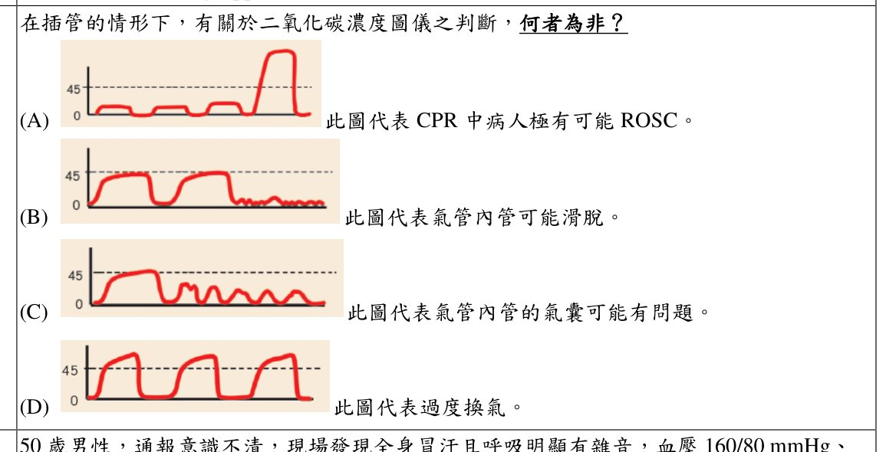
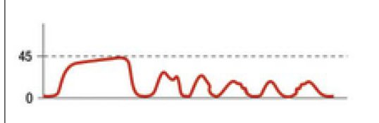
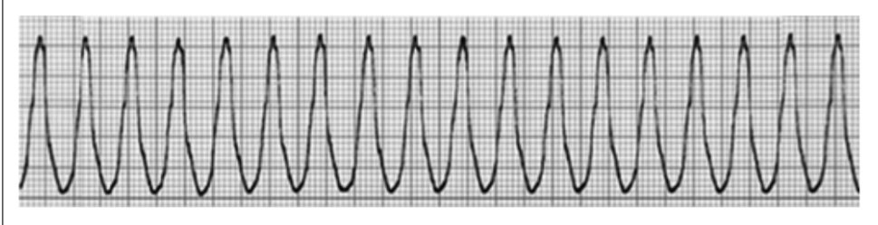
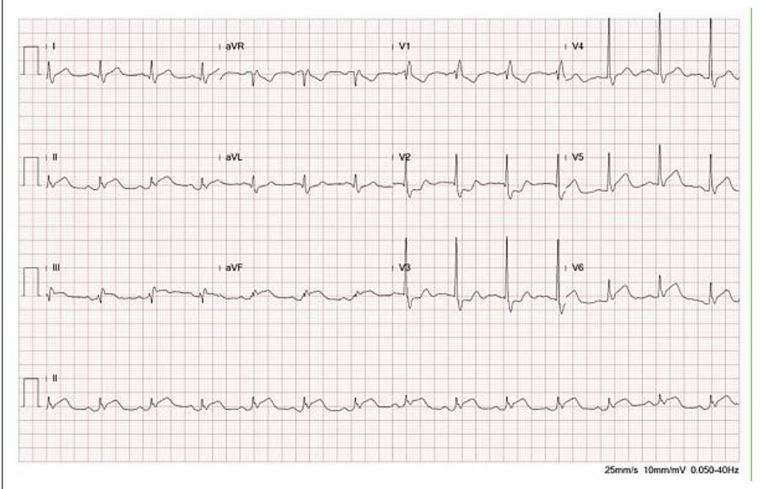
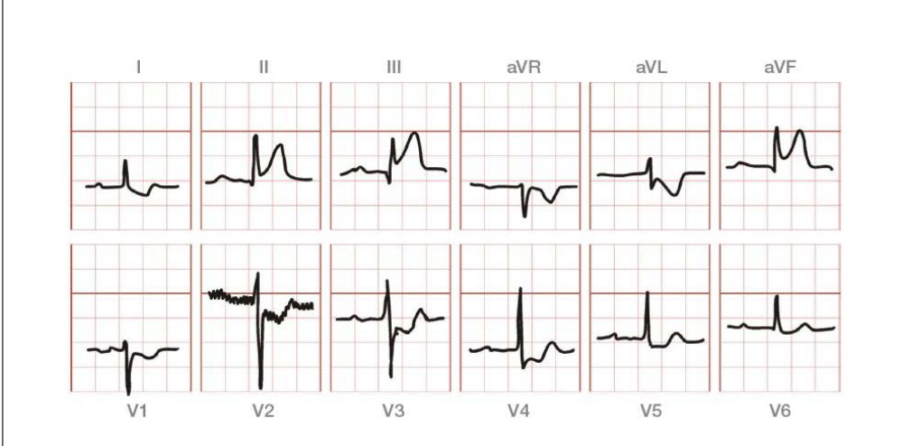
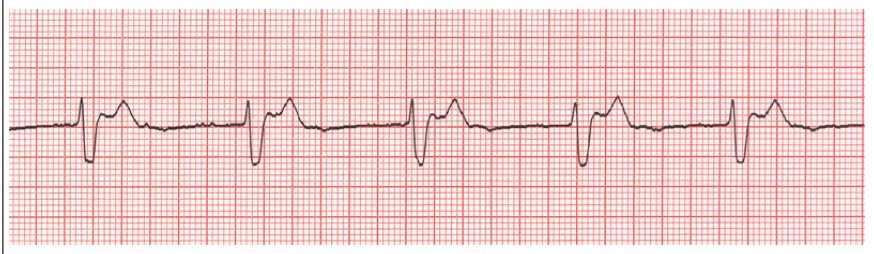

# 109 年度高級救護技術員甄試筆試 題目卷

> 單選題，共 100 題。答案在 [`答案_108-114年.md`](答案_108-114年.md)，作答完再對。

### 1. 高級救護技術員必須具備獨立思考能力，熟悉「治療5W」。在給予阿斯匹靈（Aspirin）前詢問有無腸胃道活動性出血，就是考慮到Aspirin 治療的？

- (A) Why。
- (B) When。
- (C) How。
- (D) Watch out。

### 2. 對於「創傷後壓力症（PTSD）」的描述何者為非？

- (A) 常常與其他精神疾病並存。
- (B) 常常被誤診為詐病（malingering）或環境適應反應（adjustment reaction）…等等。
- (C) 只能靠藥物治療。
- (D) 適切治療後，仍然可以重返專業，繼續為民眾服務。

### 3. 有關「保密義務」的敘述，何者有誤？

- (A) 除非病人明示或默示下，才可以告知病人配偶病人病情。
- (B) 為了使病人得到持續良好的照顧，病人的私人資訊可以與照顧病人的醫療人員分享。
- (C) 不當透露病人的隱私，在民法上有適用妨害秘密罪的疑慮。
- (D) 病人的病史、理學檢查發現，都是隱私權所保障的範圍。

### 4. 救護人員已經告知風險與必要性，但傷患仍拒絕使用頸圈。日後若發生頸神經受傷時，救護員得減少或免除其責任，這是何種法律概念?

- (A) 依法行政。
- (B) 與有過失。
- (C) 時效抗辯。
- (D) 緊急避難。

### 5. 關於救護車物品與環境的清潔消毒作為，下列何者正確？

- (A) 針具使用後應回套針蓋完整，才可丟入尖銳物品收集筒，以免噴出傷人。
- (B) 載運呼吸道傳染性疾病個案，勤務後應打開車窗使其通風至少1 小時。
- (C) 勤務結束後須以100 ppm 濃度之次氯酸鈉溶液(漂白水)擦拭車內物品環境。
- (D) 救護車內大面積清消時，應以噴灑方式使用漂白水以便能完整覆蓋清消處。

### 6. 美國心臟醫學會於2017 年發表了派遣員協助心肺復甦術（Dispatcher-assisted CPR, DA-CPR）的措施建議，下列何者為非？

- (A) 落實卓越文化，應持續施行品質進步（Quality improvement, QI）計畫。
- (B) 落實不究責文化，品管項目不應登錄 OHCA 辨識失敗之原因。
- (C) 落實醫療指導制度，應指派一位醫療指導醫師負責 DA-CPR 相關業務。
- (D) 落實獎勵制度，應辨識表現優異之派遣員並表彰其DA-CPR 成功案例。

### 7. 2013 年全球復甦聯盟（Global Resuscitation Alliance）提出改善突發性心臟停止存活的十個步驟，以下何者為非？

- (A) 實施派遣員協助心肺復甦。
- (B) 建立醫療指導醫師制度。
- (C) 應用行動科技召喚志願者急救系統。
- (D) 針對第一反應員的AED 部署計畫。

### 8. 細胞內的清道夫是指？

- (A) 核糖體（ribosome）。
- (B) 粒線體（mitochondria）。
- (C) 溶小體（lysosome）。
- (D) 高基氏體（Golgi apparatus）。

### 9. 在插管的情形下，有關於二氧化碳濃度圖儀之判斷，何者為非？

- (A)此圖代表CPR 中病人極有可能ROSC。
- (B)此圖代表氣管內管可能滑脫。
- (C)此圖代表氣管內管的氣囊可能有問題。
- (D)此圖代表過度換氣。

### 10. 50 歲男性，通報意識不清，現場發現全身冒汗且呼吸明顯有雜音，血壓160/80 mmHg、脈搏70 次/分鐘、呼吸26 次/分鐘、體溫36.5℃，血氧濃度92%，GCS: E3V4M5，雙側瞳孔大小1mm 且對光有反應。身旁有一罐名為達馬松的農藥空罐，依你對藥理學的認識，下列敘述何者為非？

- (A) 病患的血壓偏高是由於菸鹼受體（nicotinic receptor）受到毒物的作用。
- (B) 病患的瞳孔偏小是由於蕈毒鹼受體（muscarinic receptor）受到毒物的作用。
- (C) 病患全身冒汗且呼吸有雜音是由於菸鹼受體（nicotinic receptor）受到毒物的作用。
- (D) 可以給予Atropine 作為解毒劑，用以緩解毒物對呼吸道的影響。

### 11. 有關生理變化與年齡相關性，以下敘述何者為非？

- (A) 為新生兒施作巴賓斯基反射（Babinski reflex），其腳趾會往上往外翻開。
- (B) 在青春期階段其臉與身體的比例會變得接近成人。
- (C) 在成人晚期時，白血球、紅血球與血小板皆會逐漸增加。
- (D) 終點遽降現象（terminal drop）是指在生命的最後幾年，認知能力下降的現象。

### 12. 關於兒童氣管插管的描述何者為非？

- (A) 小於8 歲的兒童因為環狀軟骨段的氣管較寬大，一定要選擇有氣囊的氣管內管。
- (B) 兒童的會厭軟骨較為細長柔軟，不易控制，故插氣管內管常使用直式葉片。
- (C) 兒童喉部相對於舌根的位置較為往前往上，比成人更難直接目視。
- (D) 兒童的上呼吸道較狹窄，舌頭相對較大，容易阻塞，插管時較不容易進行。

### 13. 關於嬰兒的描述，何者為非？

- (A) 肌肉的控制發展是先從頭才到腳、且先從核心才到身體的週邊。
- (B) 嬰兒的「被動免疫」持續至出生後約六個月。
- (C) 出生一個月的嬰兒，視線會追隨物體移動。
- (D) 覓食反射( Rooting reflex) 指的是輕柔的觸碰嬰兒的臉頰或嘴唇附近，嬰兒的頭會轉向刺激的方向、嘴巴噘起。

### 14. 一名50 歲男性，山谷中溺水的OHCA 病患，你在成功建立氣管內管並接上潮氣末二氧化碳偵測器(End-tidal CO2) 5 分鐘後病患ROSC，生命徵象穩定；但在轉送途中你突然發現病患血氧濃度下降，EtCO2 波形變化如下圖。此時你該先進行什麼處置最為適當？

- (A) 可能發生低體溫，馬上量測體溫。
- (B) 聽診胃部檢查氣管內管是否進入食道。
- (C) 呼吸道阻塞，馬上給予病人氣管擴張劑。
- (D) 可能是氣囊問題，考慮更換新的氣管內管。

### 15. 下列關於各類藥物給予途徑之敘述何者正確？

- (A) 靜脈輸液的流速與留置導管的內徑呈平方正比，所以在休克病人身上應該要盡可能選擇大管徑的留置導管。
- (B) 不同藥物注射方式與皮膚呈現的角度皆不相同，例如肌肉注射應與皮膚呈90 度、皮內注射為45 度。
- (C) 骨內注射常選擇的位置為肱骨近端、脛骨近端、脛骨遠端；若為兒科病人，還可選擇肱骨遠端。
- (D) 即使吸入給藥使用方法正確，一口仍然只有10%能進入呼吸道，其餘的量會被吞下或被噴出來。

### 16. 公眾去顫系統（PAD）計畫要成功，除了經費充足與立法保護施救者外，還有四大要素，以下敘述何者為非？

- (A) 必須由醫療專業人員規畫與監督整個計畫的進行。
- (B) 加強訓練去顫器管理人員負責急救流程運作。
- (C) 與當地的緊急醫療救護系統緊密配合。
- (D) 定期的品管回顧檢討改進。

### 17. 當EMT 到達現場後，可藉由詢問患者加劇與緩解因子來釐清病情，下列何者判斷最不適當？

- (A) 60 歲阿伯凌晨在操場跑步，突然感覺胸口疼痛，休息後有稍微緩解，可能為心絞痛。
- (B) 25 歲女性到吃到飽餐廳吃了一頓大餐後，感覺四肢無力，可能是急性腦膜炎。
- (C) 70 歲男性主訴頭痛，坐姿時症狀加劇，平躺時症狀改善，可能為低腦壓性頭痛。
- (D) 50 歲男性胸口不適，坐著前傾時比較舒緩，EMT 將患者平躺時大喊痛，可能是心包膜疾病。

### 18. 下列患者均主訴呼吸困難，哪一位較不可能出現庫斯毛耳氏呼吸（Kussmaulrespiration）？

- (A) 19 歲女性，患有第一型糖尿病，因為失戀好幾天沒打胰島素。
- (B) 70 歲女性，末期腎病患者，因為去澎湖旅遊兩次沒洗腎。
- (C) 65 歲男性，抽菸45 年每天兩包菸，近日感冒後咳嗽加劇。
- (D) 50 歲男性，長期酗酒，今日喝到朋友給的酒後感到不適。

### 19. 異常呼吸音所代表的疾病何者配對最正確？

- (A) 細囉音：肺水腫、肺纖維化病變。
- (B) 哮喘（Wheezes）：肋膜積水。
- (C) 喘鳴音（Stridor）：支氣管擴張症。
- (D) 粗囉音（Coarse crackles）：肋膜炎。

### 20. 頭頸部的檢查主要依靠的是視診，以下評估訊息代表的意義何者不恰當？

- (A) 眼框周圍瘀青：顱底骨折。
- (B) 鞏膜黃疸：急性肝炎、肝硬化、肝衰竭、膽道阻塞、急性溶血。
- (C) 瞳孔固定縮小：抗乙烯膽鹼藥物中毒。
- (D) 頸靜脈怒張：右心房壓上升、胸內壓上昇、中膈腔偏移。

### 21. 某些休克的時期會出現四肢變暖的狀況，下列何者為非？

- (A) 頸椎損傷造成的休克。
- (B) 食物過敏造成的休克。
- (C) 肺部穿刺傷引起的休克。
- (D) 肺部感染引起的休克。

### 22. 勤指通知你一個中年男性騎單車自摔，你到達現場後發現病患意識不清且橈動脈微弱，血氧95%，請問以下狀況哪個最不可能解釋這種狀況？

- (A) 騎車倒地時腹部遭受重擊。
- (B) 騎到一半被虎頭蜂螫咬。
- (C) 頭部撞擊造成右側硬腦膜外出血。
- (D) 騎車到一半突發心室上心搏過速。

### 23. 脊椎保護是到院前救護非常重要的一項要求，關於脊椎檢查的敘述何者為非？

- (A) 對於意識不清的創傷患者，救護技術員應將其視為潛在性脊椎傷害患者而給予頸椎保護。
- (B) 讓患者自然站立，若發現兩側肩關節與髖關節高度不對稱，患者可能有脊椎側彎的問題。
- (C) 患者若不願意測試轉動頸椎、俯仰頭部等動作，救護技術員可協助用外力轉動患者頸椎。
- (D) 正常情況下，可以清楚定位的頸椎是第七節的脊突，且不該出現局部壓痛或腫痛。

### 24. 針對成人創傷病人，下列狀況在初步評估時，何者是最需要被立即評估及處置？

- (A) 腹部腫脹且外觀有瘀傷。
- (B) 呼吸次數每分鐘38 下。
- (C) 體溫35℃。
- (D) 昏迷指數（Glasgow Coma Scale score）為10 分。

### 25. 20 歲男性遭人持刀剌傷右腹部。目前意識為對聲音有反應、呼吸淺快無雜音，呼吸次數28/min，血壓80/40 mmHg，脈搏130/min，血氧濃度為92%，膚色蒼白濕冷。下列敘述何者較為正確？

- (A) 依據「微血管組織細胞的微循環休克」分期，傷患已達第三期瀰漫性血管內凝血。
- (B) 依據「出血性休克」分級，可推測此傷患血液中的鹼基缺乏至少是 - 6 meq/L。
- (C) 輸液選擇建議以溫暖的晶質液進行急救，首選是生理食鹽水、其次為林格氏液。
- (D) 此傷患尚不符合外傷 ABC score, 尚不需要大量輸血。

### 26. 60 歲女性，騎機車與小客車擦撞，意識嗜睡，GCS: E2V3M5。左大腿明顯腫脹變形。血壓70/40 mmHg，脈搏125/min，血氧濃度為93%。有關到院前的初步評估及處置，下列何者較為正確？

- (A) 為了保持呼吸道通暢，須立即給予口咽呼吸道（Oral pharyngeal airway）。
- (B) 評估發現氣管偏移至左側，可能為左側張力性氣胸，需考慮給予左側胸部針刺減壓。
- (C) 初評顯示傷患有休克現象，應該優先考慮出血性休克，立即給予輸液。
- (D) 神經學評估傷患四肢運動功能正常，考慮不需要施行脊椎保護。

### 27. 36 歲男性左側大腿下端遭槍擊。病人意識清楚可對答，但傷口有持續性出血，經直接加壓止血仍無法止血。有關此位病人評估及處置，您應該優先執行以下哪一項？

- (A) 找出槍傷的入口及出口，釐清受傷機轉。
- (B) 打上點滴，快速給予晶質溶液的輸液。
- (C) 維持呼吸道暢通及評估有無鼾聲雜音。
- (D) 使用止血帶，到院前不需要再間歇性鬆開。

### 28. 20 歲男性，摩托車與汽車對撞車禍，初步評估：意識狀況清楚，呼吸淺快無雜音，呼吸次數28/min，血壓70/40 mmHg，脈搏110/min，血氧濃度為96%；四肢及其他外觀無明顯大出血，喪失T10 以下部位的痛覺、冷熱感覺及運動功能。有關到院前的初步評估及傷患處置，下列何者較為正確？

- (A) 休克原因應該為神經性休克，需盡快打上點滴給予大量輸液。
- (B) 此病人可能有脊髓損傷，依症狀診斷為中央脊髓症候群。
- (C) 休克原因應該為出血性休克，可考慮超音波檢查，找出出血原因。
- (D) 此病人符合脊髓休克的定義，使用大量類固醇可有效改善神經預後。

### 29. 55 歲男性登山客，遭落石壓傷右下肢持續五小時無法脫困，關於相關評估及處置的描述，以下何者較為正確？

- (A) 此病人可能在重物被移除的數分鐘內死亡。
- (B) 應該在脫困後，迅速給予大量輸液。
- (C) 血液檢查，常可見代謝性酸中毒、低血鉀、高血鈣。
- (D) 可以使用碳酸氫鈉（Sodium bicarbonate）去酸化尿液，減少腎衰竭發生。

### 30. 有關止血帶的使用，以下描述何者為非？

- (A) 應盡早使用，為傷口止血的第一步。
- (B) 使用後，需要確認遠端摸不到脈搏。
- (C) 放在接近出血處的近心端，避開關節處。
- (D) 商品化的止血帶優於自製止血帶。

### 31. 50 歲男性，騎摩托車與汽車相撞，心跳每分鐘120 下，血壓80/50mmHg，呼吸速率每分鐘25 次；血氧90%，意識E2M5V4。理學檢查發現頸靜脈怒張，氣管無偏移，呼吸音正常，腹部無明顯壓痛，傷患吸氣時，脈搏會明顯變微弱。以下敘述何者為非？

- (A) 可給予1000 c.c.生理食鹽水灌注。
- (B) 使用超音波有助於診斷。
- (C) 此病患需送到創傷中心。
- (D) 到院後應給予胸管治療。

### 32. 50 歲男性，騎摩托車撞安全島。現場評估心跳110 下/min、血壓110/95mmHg、呼吸速率18 下/min，血氧98%，意識清醒。左膝及大腿明顯腫脹變形，左大腿上有開放性傷口一直在噴血。其它理學檢查正常。以下敘述何者為非？

- (A) 須注意遠端肢體肌肉的活動度。
- (B) 如有膝脫臼要注意脛神經受傷。
- (C) 病患為出血性休克分級Class III 的病患。
- (D) 傷口優先給予直接加壓止血。

### 33. 60 歲男性，騎摩托車與汽車相撞，現場GCS: E2V2M4，心跳每分鐘80 下，血壓80/30mmHg，呼吸速率每分鐘10 下；血氧89%、瞳孔不等大、其他理學檢查正常，以下敘述何者為非？

- (A) 到院前治療頭部外傷，著重於次發性傷害的預防。
- (B) 此病患需要給予氧氣提高血氧含量。
- (C) 病患低血壓通常不是因頭部外傷引起。
- (D) 病患符合「允許性低血壓」概念，血壓不需要處理。

### 34. 50 歲女性，體重50 公斤，從火場救出，病患右上臂、前臂及手部為環狀2 度燒傷，其前胸及前腹部亦為2 度燒傷。病患心跳每分為100 次，血壓90/50mmHg，呼吸速率每分鐘22 次；血氧98%，意識清醒。以下敘述何者為非？

- (A) 前8 小時要給予1350 c.c.乳酸林格式溶液。
- (B) 病患意識清醒，不用考慮一氧化碳中毒。
- (C) 須注意右手的遠端脈搏，可能需要筋膜切開術。
- (D) 此病患應被送往燒燙傷中心。

### 35. 40 歲男性，被發現倒臥在大樓中庭的花圃旁，意識不清、心跳每分鐘70 下，血壓80/50mmHg、呼吸速率每分鐘22 次、血氧98%、傷患兩側跟骨明顯腫脹變形。以下敘述何者為非？

- (A) 判斷受傷機轉有可能為墜樓。
- (B) 休克原因需考慮出血性休克。
- (C) 休克原因需考慮顱內出血所致。
- (D) 病患無法表示頸椎壓痛仍需進行頸椎保護。

### 36. 一位40 歲男性，騎摩托車與汽車對撞，意識清楚、主訴腹痛；心跳每分鐘120 下，血壓70/50 mmHg，呼吸速率每分鐘28 次，血氧80%，腹部明顯壓痛，其他理學檢查正常。以下敘述何者為非？

- (A) 可考慮FAST 超音波掃描肝腎交界、脾腎交界來判斷是否有腹內積血。
- (B) 依照ABC score 預測，此病患可能需要大量輸血。
- (C) 立即給予溫暖的2 公升生理食鹽水快速輸液。
- (D) 可考慮給予傳明酸（tranexamic acid）1 公克。

### 37. 關於胸部創傷敘述，下列何者為是？

- (A) 根據統計，超過一半的創傷出血性休克死亡是因胸部創傷所致。
- (B) 肋骨骨折最常見的位置為中段第4 至9 根肋骨的側面。
- (C) 針刺減壓時，為避免傷害到神經，入針位置應在肋骨下沿。
- (D) 執行胸部超音波時看到條碼徵候（barcode sign）表示傷患沒有氣胸。

### 38. 關於腹部創傷敘述，下列何者為是？

- (A) 肝臟損傷為腹部鈍挫傷中最常見的臟器損傷，約佔40~55%。
- (B) 胰臟損傷為腹部槍傷中最常見的臟器損傷，約佔40％。
- (C) 骨盆骨折約有20%為動脈出血，80％為靜脈或靜脈叢出血。
- (D) 骨盆骨折中，側面壓迫型傷害很容易造成危及生命的低血壓。

### 39. 下列關於骨骼肌肉創傷的敘述，何者為是？

- (A) 雙側股骨骨折應視為重大外傷，盡早送到創傷中心。
- (B) 脫臼傷患為避免神經血管傷害，應盡量在院前做適度的復位及牽引。
- (C) 截肢傷引起之外出血，如經止血帶成功止血，建議後送就近醫院爭取時效。
- (D) 骨骼創傷患者給予冰敷後疼痛緩解，可再根據預立醫囑給予止痛藥加強效果。

### 40. 改良式創傷指數(RTS)評估三種到院前生命徵象以判斷創傷嚴重度的工具，不包括？

- (A) 血氧飽和度 (SpO2) 。
- (B) 昏迷指數 (GCS) 。
- (C) 呼吸速率 (RR)。
- (D) 收縮壓 (SBP)。

### 41. 中年男性車禍被送到醫院時診斷為右側張力性氣胸，經細針減壓以及右側胸管置入後，血壓、血氧與呼吸狀況都獲得改善。五分鐘後，該患者突然又再度呼吸困難、血壓下降。下列敘述何者為是？

- (A) 因生命徵象不穩定，應重新進行初級評估。
- (B) 再次進行細針減壓最適當位置是右鎖骨中線第二肋間。
- (C) 先安排電腦斷層確定是否有其他內出血。
- (D) 可能胸管功能不佳，應再插上第二根胸管強化引流效果。

### 42. 有關小兒外傷之敘述，下列敘述何者為是？

- (A) 小兒發生出血性休克時應給予2 次20 ml/kg 快速推注的生理食鹽水，如無反應則需要立刻輸血。
- (B) 小兒因為身體循環血量較成人少，即使是10 %的出血量，也很容易造成血壓下降。
- (C) 2 歲以上的小兒頭部外傷若出現頭痛和嘔吐，應和家屬討論是否要安排電腦斷層。
- (D) 小兒外傷傷患出現低血容休克時，應該直接考慮建立骨針輸液以爭取時效。

### 43. 下列關於頭頸部及顏面部創傷的敘述，何者為是？

- (A) 當傷患眼睛受傷時，如有戴隱形眼鏡，應在現場將隱形眼鏡拔除以進行評估。
- (B) 一般而言，有嚴重頭部外傷的傷患，應將血氧濃度維持在100%。
- (C) 頭部外傷傷患如同時出現低血壓與低血氧，EPIC-TBI 研究顯示死亡率可增加14 倍。
- (D) 到院前頭部外傷併顱內壓升高徵象的傷患，一律需以BVM 行過度換氣以降低腦壓。

### 44. 關於藥物給予與路徑，下列何者為非？

- (A) 幫孕婦建立靜脈路徑（IV）一般建議在上半身（橫膈以上）。
- (B) 在過敏性休克的病患身上給予Epinephrine 時首選路徑為皮下注射。
- (C) Naloxone 也可以由氣管內管給藥。
- (D) 大部份的急救藥物都可以由骨內注射（IO）給予，吸收速度相當於IV 靜脈注射。

### 45. 您在救護車上監視一位病患，他的胸悶在使用舌下NTG 含片後緩解，可是EKG 監視器突然出現下圖、病患並主訴心悸，其它臨床症狀穩定（血壓正常），以下最佳處置為何？

- (A) 同步電擊 100 J。
- (B) 立即給予非同步電擊。
- (C) 給予Atropine 1 mg IV。
- (D) 可以先完成十二導程心電圖後, 注意病患情況或考慮注射Adenosine。

### 46. 下列何者心律會以「窄的QRS 波型」為最常見？

- (A) Ventricular tachycardia。
- (B) PSVT with aberrant conduction。
- (C) Multifocal atrial tachycardia。
- (D) Torsade de pointes。

### 47. 80 歲女性跌倒後右側股骨頸骨折，因為家屬不願開刀便回家臥床休養，三天後凌晨突發性胸痛與喘，血氧下降、但呼吸音正常。下列關於此情況，何者正確？

- (A) 根據病人因骨折臥床的病史，這次有很高機會是肺靜脈栓塞。
- (B) 心電圖檢查，最常見者是竇性頻脈，S1Q3T3 出現機率小。
- (C) 標準診斷工具為心臟超音波，可見左心室膨大、左心室肥厚。
- (D) 臨床上診斷不易，會搭配Troponin 來決定是否做影像檢查。

### 48. 到院前腦中風病人的評估，下列何者正確？

- (A) FAST 的FAS 部分為手部下垂，臉下垂及口齒不清， T 是發作時間。
- (B) G-FAST 可協助及早辨識大血管阻塞腦中風，G 是指gait 步態。
- (C) 若無糖尿病病史，不需測量指尖血糖，直接給予含糖輸液即可。
- (D) 適合機械取栓者，需影像確認大血管阻塞，所以可延後tPA 給藥。

### 49. 20 歲女性吃完日本帶回來的頭痛藥，半小時之後開始全身癢，下列何者正確？

- (A) 若病人有腹痛，嘔吐，則多半是因為急性腸胃炎，而非因為過敏症狀。
- (B) 若病人有低血壓及全身紅疹，需優先考慮蜂窩性組織炎合併敗血性休克。
- (C) 呼吸受影響時，可能因為支氣管收縮，而產生喘鳴聲，甚至缺氧現象。
- (D) 合併休克時，epinephrine 為最適合的治療，要透過靜脈給予才有效。

### 50. 60 歲男性，酒精性肝硬化及膽結石病史。主訴噁心嘔吐解黑便，下列何者正確？

- (A) 可能是食道或胃靜脈曲張引起，肇因於肝門靜脈壓力增加。
- (B) 食道或胃靜脈曲張破裂出血，大部分出血量少，造成休克的機率並不高。
- (C) 噁心嘔吐若有左上腹痛，也可能是因為原有的膽結石造成膽囊炎。
- (D) 膽結石卡在總膽管，也可能讓黃疸症狀加劇，並且有解黑便現象。

### 51. 依據台灣疾病管制署公告，因應嚴重特殊傳染性肺炎（新冠肺炎, COVID-19）感染的緊急醫療照護人員防護措施，下列敘述何者正確？

- (A) 載送疑似個案時，救護人員建議使用非拋棄式防水隔離衣及N95。
- (B) 載送疑似個案時，若無負壓艙使用，則需緊閉車窗，避免飛沫外洩。
- (C) 救護車載送完建議以漂白水清消，執行消毒工作時，需戴外科口罩。
- (D) 車艙內消毒前，開窗讓空氣流通，艙內消完，艙外以一般程序清潔即可。

### 52. 現場有一位80 歲病人嚴重呼吸困難，家屬說早先有聽到呼吸有咻咻聲，過去病史有氣喘、慢性阻塞性肺病（COPD）。下列處置何者為非？

- (A) 若聽診兩側肺音聽不到哮鳴聲（Wheezing），可排除氣喘發作可能。
- (B) 若病人備有支氣管擴張劑吸入器，可協助家屬幫助病人使用。
- (C) 若心率監測出現嚴重心搏過速，不宜貿然協助使用支氣管擴張劑。
- (D) 病人戴上非再吸入型給氧面罩後，意識混亂躁動拉扯面罩，可考慮正壓給氧。

### 53. 病人身體檢查發現右上肢出現彎曲姿勢，雙下肢伸張僵直姿勢；對聲音刺激無睜眼反應，沒有發出任何聲音；給予疼痛刺激時，眼睛仍沒有睜開，僅發出模糊叫聲，四肢沒有特別反應動作。請問病人的GCS 評分？

- (A) E2V2M2。
- (B) E2V1M2。
- (C) E1V1M3。
- (D) E1V2M3。

### 54. 關於急性腦中風病人的到院前評估與處置，下列何者為是？

- (A) 詢問病人相關症狀，沒有胸痛胸悶心悸等症狀，不裝設心律監視器。
- (B) 詢問病人過去病史沒有糖尿病無使用相關藥物，省略血糖測量，儘速送醫。
- (C) 測量病患血壓 180/90 mmHg，為了增加腦部血液循環，給予等張輸液。
- (D) 測量病患血氧SpO2= 92％，呼吸平緩無費力，速率正常，給予氧氣。

### 55. 56 歲男性10 分鐘前突然出現胸痛胸悶不適，症狀有呼吸喘、冒冷汗、臉色蒼白及皮膚濕冷的情形。您進行了到院前12 導程心電圖如下圖，下列判讀何者為是？

- (A) 右心室傳導分支束傳導阻斷，沒有ST 段上升。
- (B) 右心室傳導分支束傳導阻斷，有ST 段上升。
- (C) 左心室傳導分支束傳導阻斷，沒有ST 段上升。
- (D) 左心室傳導分支束傳導阻斷，有ST 段上升。

### 56. 65 歲獨居女性，被定期探視的兒子發現意識混亂打119 求救。你到達現場時發現病人對聲音有反應，答非所問，四肢活動對稱。兒子表示病人有在洗腎，施打胰島素，並服用新陳代謝科相關藥物，但病人會自行調整洗腎時間及藥物使用劑量。身體理學檢查發現：皮膚溫暖乾燥，兩側肺底濕囉音，雙下肢水腫及右手有一廔管，其餘身體診察皆正常。呼吸24 次/分鐘、脈搏80-130 次/分鐘不規則跳動、血壓108/60mmHg、脈衝血氧濃度91%、體溫37.8 度C。配合病史詢問與身體檢查，請問下列鑑別診斷何者較不可能？

- (A) 若病人有在服用甲狀腺藥物，合理懷疑為黏液性水腫昏迷。
- (B) 若病人已一星期沒有接受洗腎，可能是尿毒症引起意識混亂。
- (C) 若病人有長期酗酒習慣，但最近沒錢買酒，酒精戒斷須列入考慮。
- (D) 若血糖值顯示為400mg/dL，須考慮糖尿病酮酸血症。

### 57. 中年男性求救原因是在家中突然意識不清，您到達現場發現病人已恢復意識，可理解對話但說話口齒不清，左手緊握放在胸前，表情痛苦。詢問太太表示昏倒前病人有告知胸痛，意識喪失約數分鐘即恢復。過去病史有高血壓、心臟病併放置心臟支架。初步身體理學檢查無明顯外傷，右側肢體無力，兩側橈動脈不對稱。全身持續冒冷汗，其餘身體診察正常。現場測量左手血壓為100/60mmHg，脈搏90 次/分，呼吸20 次/分，血氧濃度：92%，血糖為108mg/dL。下列鑑別診斷及處置何者為非？

- (A) 儘速執行12 導程心電圖，並裝設心律監測器。
- (B) 給予氧氣支持，維持血氧大於94%。
- (C) 立刻協助給予硝酸甘油NTG 舌下含錠，緩解胸痛及控制血壓。
- (D) 病史配合測量雙手血壓相差若超過20 mmHg，需懷疑主動脈剝離。

### 58. 關於腹部急症的身體診察，下列徵候都表示病人可能有闌尾炎的跡象，除了何者之外？

- (A) 洛夫辛徵象（Rovsing’s sign）。
- (B) 腰大肌徵候（Psoas sign）。
- (C) 莫菲氏病徵（Murphy’s sign）。
- (D) 閉孔肌徵候（Obturator sign）。

### 59. 以下傳染病之傳播途徑配對，何者錯誤？

- (A) 疥瘡—接觸傳染。
- (B) 麻疹—飛沫傳染。
- (C) 肺結核—空氣傳染。
- (D) 後天免疫缺乏症候群—體液傳染。

### 60. 有關神經系統疾病的「時間」定義，下列敘述何者正確？

- (A) 短暫性腦缺血發作（TIA）是指症狀發生後一週內完全恢復。
- (B) 譫妄的發病症狀為漸進式且緩慢、而失智的發病症狀為快速且起伏不定。
- (C) 癲癇重積症（Status epilepticus）定義是指抽搐發生的時間超過1 分鐘。
- (D) 若病人發生中風症狀的時間在6 小時內，有機會做動脈內取栓（IA）治療。

### 61. 有關甲狀腺機能亢進症，下列敘述何者正確？

- (A) 已經甲狀腺切除術後的病人不會出現。
- (B) 會有全身水腫、肌腱反射降低等表現。
- (C) 可合併發燒、心搏過速及意識混亂。
- (D) 常合併低血糖、低血壓等徵狀。

### 62. 火災現場救出一名身上無外傷的意識不清病患。此類病患若血氧飽和度<90%，可能的問題是出現在哪兩種病理機轉？

- (A) 通氣與動力。
- (B) 灌流與擴散。
- (C) 擴散與通氣。
- (D) 動力與灌流。

### 63. EMTP 醫院實習常會遇到使用雙向正壓呼吸器（BiPAP）的病人。關於BiPAP，下列敘述正確的是？

- (A) 它是一種侵入性的正壓呼吸裝置。
- (B) 不論病人處於呼氣期或吸氣期，均提供一個氣道支持的壓力。
- (C) 適合使用在早期呼吸衰竭且意識不清的病患。
- (D) 美國EMS 醫師學會（NAEMSP）建議不要在到院前使用此類呼吸器。

### 64. 中年男性有缺血性胸痛症狀、心電圖如下，請問心肌梗塞（STEMI）在何處？

- (A) 心臟下壁及後壁。
- (B) 心臟前壁及側壁。
- (C) 心臟前壁及下壁。
- (D) 心臟側壁及後壁。

### 65. 急性腎衰竭是指臨床上病人的腎功能發生了突然而顯著的惡化，常見的原因，下列敘述何者正確？

- (A) 腎前性的原因，例如輸尿管結石。
- (B) 腎性的原因，例如腎絲球腎炎。
- (C) 腎後性的原因，例如嚴重休克。
- (D) 老人家常見的攝護腺肥大並不會引起急性腎衰竭。

### 66. 急性白血病是指不成熟的白血球增生，侵入骨髓外的其他身體部位，這些常見會被侵犯而會變的腫大或疼痛的部位，不包括？

- (A) 淋巴結。
- (B) 關節。
- (C) 脾臟。
- (D) 腎臟。

### 67. 下列何者並非我國目前（2020 年10 月為準）之第一類法定傳染病？

- (A) 新冠肺炎（COVID-19；嚴重特殊傳染性肺炎）。
- (B) 狂犬病。
- (C) 鼠疫。
- (D) 嚴重急性呼吸道症候群。

### 68. 病人被119 送達急診，EMT 表示院前為無搏脈心律（asystole）。您們EMTP 學員小組在醫院實習、協助醫師施行CPR、進行插管、並成功建立靜脈路徑。兩分鐘後胸外按壓暫停，此時心電圖如下。您立即該作的事是？

- (A) 靜脈給予epinephrine 1mg。
- (B) 靜脈給予atropine 1mg。
- (C) 使用經皮節律器（TCP）。
- (D) 檢查脈搏並替換壓胸人員。

### 69. 對重度低體溫（體溫<30℃），意識昏迷病人的救護處置何者正確？

- (A) 應評估脈搏30~45 秒，以決定是否要做心肺復甦術。
- (B) 若無脈搏且AED 建議電擊，則應立即給予去顫電擊，並依流程依序給予epinephrine與amiodarone。
- (C) 若無脈搏但AED 不建議電擊，因侵入性醫療處置易誘發心室頻脈（Vf），故不建議建立進階呼吸道。
- (D) 若有脈搏且心律為竇性心搏過慢，且病人意識不清血壓偏低，可使用經皮體外節律器（TCP）進行急救。

### 70. 下列關於SOAP 病況紀錄方式的描述，何者最不適當？

- (A) Summary：包括目前傷病情的總結客觀描述，如受傷機轉、預估出血量，已給予的處置。
- (B) Objective：主要是病人/傷患的生命徵象、身體診察。
- (C) Assessment：指的是根據上面兩項收集到的資訊，所做出對於病情的評估與診斷。
- (D) Plan：針對上面的診斷，預計給予傷病患的治療計畫。

### 71. 酒精成癮可利用”CAGE”四個問題進行篩檢，若其中有兩個陽性，則有約七成的機會為酒精成癮病人，下列關於這四個問題的描述何者不正確？

- (A) C 代表Cut down：必須詢問病人對於戒酒是否有困難。
- (B) A 代表Annoyance：必須詢問病人是否因喝酒而造成家人或朋友的厭惡。
- (C) G 代表Guilty：必須詢問病人是否覺得因長期喝酒而有罪惡感。
- (D) E 代表Everyday：必須詢問病人是否每天都要找酒喝。

### 72. 一名年38 歲體重100Kg 懷孕42 週的經產婦（這是第四胎），到達現場時第一台救護車的夥伴已完成急產並正在進行新生兒急救。而你則被指派照顧產後的產婦。此時病人有意識有呼吸但很虛弱，臉色蒼白冒冷汗，胎盤已娩出但會陰部仍有大量持續性出血，血壓血氧量測發現BP: 80/50mmHg，HR: 150/min, SpO2: 96%，下列關於這位產婦的救護處置何者最不正確？

- (A) 用手在產婦下腹部進行按摩。
- (B) 讓胎兒吸允母親乳頭。
- (C) 若有外陰部撕裂傷合併大量出血應直接加壓止血。
- (D) 給予大量靜脈輸液維持灌流，並請求線上指導給予MgSO4 幫助子宮收縮止血。

### 73. 野外救護之困境之描敘，以下何者為非？

- (A) 野外救護很難第一次評估就能找出所有問題，因此建議使用SOAP 方式持續記錄評估病人問題避免遺漏。
- (B) 長時間搬運可能會導致病人傷害如壓瘡，建議可以使用抽氣式護木代替長背板固定頸椎或長背板上加墊其他物品，但以不影響固定效果為原則。
- (C) 因野外救護時間較長，即便是靜脈出血，病人也可能因此失血過多，加上搬運過程之便利性，止血帶止血方式應優先於直接加壓止血法使用
- (D) 因野外救護送醫時間較長，應注意傷口是否感染，因此要預防感染的發生，對於有被泥土或其他東西污染的傷口，以及髒東西造成的穿刺傷，都需給予高壓沖洗；相對的，沒有污染的傷口，給予低壓沖洗即可。

### 74. 剛出生時新生兒抽吸口鼻會哭泣臉部也無表情，呼吸規則，且每分鐘約20下。脈搏微弱且約每分鐘 80下，刺激時手腳僅有一些無的收縮。外觀發現四肢發紺，身體比較紅潤。請問其第一分鐘的APGAR分數是？

- (A) 3。
- (B) 4。
- (C) 5。
- (D) 6。

### 75. 下列何者不是急性心肌梗塞的主要危險因子？

- (A) 糖尿病。
- (B) 高血壓。
- (C) 喝酒。
- (D) 抽菸。

### 76. 老年人隨著年紀的增長,可能會遇到視力、聽力和說話的問題，下列何者為非？

- (A) 老化容易得到青光眼。
- (B) 使用特殊藥物也會造成聽力問題。
- (C) 說話有問題時要考慮可能由於不合適的假牙。
- (D) 老年人的高熱症比低體溫症常見，主因為曝曬在高熱的環境中。

### 77. 關於老年人外傷的敘述，下列何者為非？

- (A) 任何受傷機轉所造成的胸部外傷在老年人中可能都有致命的危險。
- (B) 老年人骨質疏鬆容易產生骨折。
- (C) 胸壁的順應性增加。
- (D) 老年人需要更高的動脈壓來維持器官灌流。

### 78. 關於孕婦身體變化的敘述，下列何者為非？

- (A) 懷孕第三個月時可在恥骨上方可以檢查到增大的子宮。
- (B) 孕婦之心輸出量及總血量在34 週時將可增加30%。
- (C) 孕婦之心跳於懷孕後期每分鐘可減少5 到10 下。
- (D) 孕婦之血壓在懷孕第二期將會下降10~15 毫米汞柱。

### 79. 關於孕婦分娩的敘述，下列何者為非？

- (A) 急產定義為“規則陣痛開始至完成分娩時間”小於一個小時。
- (B) 規則陣痛之定義為兩次陣痛之間隔小於五分鐘。
- (C) 子宮頸的擴張速度在初產婦可達每小時五公分。
- (D) 子宮頸的擴張速度在經產婦（生第二胎以上）可達每小時十公分。

### 80. 29 歲男性跟團攀登嘉明湖，第一天晚上在向陽山屋（海拔約2850 公尺）過夜，第二天清晨起床後有輕微頭痛，並且合併有頭暈噁心及全身無力等症狀。你是隨行的救護技術員，以下作為何者為非？

- (A) 這個病人罹患了急性高山病，在症狀緩解前應避免上升高度。
- (B) 可以給予丹木斯（Diamox，Acetazolamide）以加速高度適應。
- (C) 可以給予威而鋼（Viagra）或犀利士（Cialis）來治療病人。
- (D) 病人如果執意繼續上升高度，則可能會進展成高海拔腦水腫。

### 81. 33 歲男性到蘭嶼水肺潛水，最後一次潛水後約13 小時產生突發性下肢無力、完全無法走路的症狀，病人經海巡的船隻轉送回本島。救護隊奉派至港口將病人轉送適當醫院，以下敘述何者為是？

- (A) 轉送過程中需給予高濃度氧氣，並以頭低腳高的姿勢運送。
- (B) 病人可能罹患減壓病，需轉送至有高壓氧治療的適合醫院。
- (C) 病人可能罹患空氣栓塞，需轉送至有高壓氧治療的適合醫院。
- (D) 病人如需空中轉送，飛行器高度無需限制，但過程要給氧氣。

### 82. 53 歲男性在路程超過10 小時的深山中遭百步蛇咬傷左小腿，傷患的左小腿立刻腫脹疼痛無法移動，您是到場支援的TP，奉派將傷患救出並轉送至適當醫院，以下作為何者為非？

- (A) 現場需要醫療指導醫師預立醫囑施打抗百步蛇毒蛇血清。
- (B) 使用彈繃以及副木固定可以有效減緩蛇毒系統性地吸收。
- (C) 使用彈繃的鬆緊度應該要和使用在肢體大出血的差不多。
- (D) 抗百步蛇蛇毒血清無法用其他出血性的蛇毒血清來代替。

### 83. 39 歲男性在連續喝酒數日後，突然癲癇發作並失去意識。你是轄區救護隊，到現場發現病人完全昏迷、口吐白沫，整個臉都是汗水和口水，針狀瞳孔。有關此病人現場的發現與作為，以下敘述何者為是？

- (A) 應該要特別注意病人的呼吸狀況，以免分泌物太多造成呼吸道阻塞。
- (B) 這是有機磷除草劑中毒，應該要注射atropine 以及PAM 來當作解藥。
- (C) 在沒有安全的顧慮下，現場遺留的農藥瓶應該隨病人送至醫院以供參考。
- (D) 病人的瞳孔放大以及臉上的汗水停止分泌後，atropine 就可停止使用。

### 84. 下列有關毒藥與解毒劑配對的組合，何者為非？

- (A) 鴉片類麻醉劑（Opiates）的解毒劑是Naloxone。
- (B) BZD (Benzodiazepine)的解毒劑是N-Acetylcysteine（Fluimucil）。
- (C) 甲醇（Methanol）的解毒劑是乙醇（Ethanol）。
- (D) 有機磷的解毒劑是 PAM。

### 85. 有關化學物質的標示，何者為非？

- (A) 每一個危害性化學品都有一個獨立的UN 編號。
- (B) 依GHS 制度，化學物質均應有安全資料表（Safety Data Sheet，SDS）。
- (C) 危險物運輸標示上附有聯合國之物質編號（UN number）危害物質分類及圖示，用以清楚標示運輸車輛、容器內含之危害物質。
- (D) 依照GHS 的規定，化學物質可能有不只一種的危害類型，故可有一個以上的圖示。

### 86. 下列有關START 檢傷法的限制，何者為非？

- (A) START 檢傷法所適用的對象主要是鈍傷的傷病患，對於穿刺傷、嗆傷、化災傷病患的分類就不是那麼可靠。
- (B) START 檢傷法容易「輕症重判」，而不會「重症輕判」。
- (C) 孕婦也很容易誤判嚴重度，因為懷孕期的生理變化使得她們相對上可以容忍較多的失血。
- (D) 氣溫偏低的狀況下，人體周邊血管會收縮以減少體熱散逸，因此正常人的微血管充填時間也很可能超過兩秒，造成輕症重判。

### 87. 事故指揮系統中，安全官的職責不包含以下哪個？

- (A) 緊急制止危險的救援行動。
- (B) 以對事故指揮官提出安全方面的建議。
- (C) 確保工作人員都能夠保護自己和民眾的安危。
- (D) 執行人員出入管制。

### 88. 美國國家醫學研究院提出的品質目標六大面向中，公平(equity)意指：

- (A) 病人傷患應接受相同的緊急醫療救護服務。
- (B) 緊急救護員應接受相同的緊急醫療救護訓練。
- (C) 國內各EMS 系統應訂有相同的品管指標。
- (D) 屬性相同之EMS 案件應接受相同強度品管稽核。

### 89. 以下關於天然災害的緊急應變，何者正確？

- (A) 嚴重地震發生後，內科疾病的發生率也會一同上升。
- (B) 現代都市建物抗震能力強，震災傷害的發生多半零星且四散於城市各地。
- (C) 震災可能傷及大都市的自來水管線而造成斷水，相對來說颱風過後都會區沒有缺水的問題。
- (D) 我國颱風警報時會先讓EMT 停休在隊待命，因此風災發生時不致於會有救護車無法出車救援的狀況。

### 90. 你參與大型活動的醫療救護團隊，以下處置何者正確？

- (A) 醫療站動線必須事先測試，務必確認從傷害發生地到救護站都能夠允許救護車通行。
- (B) 傷患人數推估跟活動種類，持續時間，現場溫度與高度都有關，是可以事先大致預估的。
- (C) 大型活動的災難事件定義為15 人以上或預估15 人以上傷病患。
- (D) 我國目前對於大型集會活動的後送規劃與救護站裝備並沒有明文要求。

### 91. 以下關於危害物質應變，何者為是？

- (A) 強鹼例如氫氧化鈉顆粒，應以刷子盡量移除後，使用大量清水來替病人除污。
- (B) 輻射事故應變人員的防護衣著考量以避免污染進入身體為主，其次才是阻擋幅射線。
- (C) 移除輻射事故傷患的衣物時，應保持衣物乾燥，防止污染物繼續附著。
- (D) 輻射除污必須持續到殘留劑量與背景輻射一致時，才能停止。

### 92. 你是大量傷患現場的後送小組成員，你手上還有三個重傷與十多個輕傷傷患，最近的醫院是地區醫院等級，已經被自行前往的病人癱瘓。合理距離內還有一家區域醫院與醫學中心是急救責任醫院，請問以下的處置何者最為正確？

- (A) 可以將剩下三位重傷病人『輪送』這三家醫院，避免通通都送往醫學中心。
- (B) 十多個輕傷傷患可以採用『群送』到醫學中心，避免他們脫離現場自動前往最近地區醫院加深壅塞。
- (C) 地區醫院要求消防局協助將某些處理過的重傷傷患轉至醫學中心，由於我國法律禁止消防單位做『院際轉診』，所以應予以婉拒並提供民間救護車聯絡方式。
- (D) 重傷傷患可採取『繞道』跳過最近的地區醫院，在跟地區醫院溝通後，某些重傷患者可以送至該院，而不用送到醫學中心。

### 93. 核生化事件中，有關應變人員的防護衣，下列敘述何者錯誤？

- (A) 在冷區執行醫療工作時，穿著C 級防護衣即可。
- (B) 化災防護衣，對於穿透式的輻射線沒有防護作用。
- (C) 進入毒化災現場，當毒物不明時，應穿戴A 級防護衣。
- (D) C 級防謢衣是包括全面式面罩加上供氧呼吸裝備及全身防潑濺的防護衣。

### 94. 關於輻射災害事件的現場救護，以下何者為是？

- (A) 救護人員照護輻射汙染的傷患，即使有適當防護，也會有嚴重危害。
- (B) 輻射事故極有可能造成立即性的傷害。
- (C) 照護輻射汙染傷患，應該以除汙為優先考量、醫療其次。
- (D) 有生命危險的傷患應盡速後送至最近可處理之醫院，不限於核災急救責任醫院。

### 95. 空中救護體系分為直昇機及固定翼航空器兩種，兩者差異以下何者為非？

- (A) 直昇機機動性高，起降較不受限制。
- (B) 直昇機為垂直起降，較不受天候影響。
- (C) 固定翼航空器單架次運送人數較多。
- (D) 固定翼航空器醫療條件好，途中可執行醫護作業。

### 96. 一輛滿載遊客的遊覽巴士，與載運危害物質的化學槽車發生車禍，導致危害物質外洩，多位遊客受困於翻覆變形的巴士內。對於此大量傷病患事故的「初級檢傷」，正確的作法是？

- (A) 先脫困車禍的遊客，再執行傷患的侷限空間醫療。
- (B) 「初級檢傷」的主要目的在於決定脫困的優先順序，也就是說，是決定要轉送到現場救護區或接受除污的優先順序，而不是接受醫療處理的優先順序。
- (C) 若化學槽車開始冒煙，即將起火，則所有人員立即撤離，並放棄移動傷患。
- (D) 如果車禍傷患沒有意識，則最後再對此傷患執行初級檢傷。

### 97. 高級救護技術員在閱讀研究文獻時，可以使用Bradford Hill criteria，來審查究竟為因果關係與否，還是僅只有相關性。有關於Bradford Hill criteria，不包括下列哪一項？

- (A) 一致性（consistency）。
- (B) 類比（analogy）。
- (C) 敏感性（sensitivity）。
- (D) 特異性（specificity）。

### 98. 緊急醫療系統研究的實施有幾種標準的方法。在研究開始前，特定的問題、假設、和資料收集的方式早就被定義好，請問這種研究方法稱為下列哪一項？

- (A) 實驗型（experimental）方法。
- (B) 回溯性（retrospective）方法。
- (C) 前瞻性（prospective）方法。
- (D) 橫斷面（cross-sectional）方法。

### 99. 美國學者Avedis Donabedian 提出的評估架構，是當今廣泛被使用的醫療品質測量模式。其品質測量的評估架構包括三大構面，不包括下列哪一項？

- (A) 有效（effectiveness）。
- (B) 結構（structure）。
- (C) 過程（process）。
- (D) 結果（outcome）。

### 100. 反饋對話的結構有非常多種模式，美國心臟協會和WISER（the Winter Institute forSimulation, Education and Research）所共同創建的GAS 模式為一種反饋對話模式。其GAS 分別代表哪些步驟，不包括下列哪一項？

- (A) 獲取資訊（Gather）。
- (B) 評估原因（Assess）。
- (C) 分析原因（Analyze）。
- (D) 結論重點（Summary）。

---

## 作答區

| 題號 | 1 | 2 | 3 | 4 | 5 | 6 | 7 | 8 | 9 | 10 |
|---|---|---|---|---|---|---|---|---|---|---|
| 1–10 | | | | | | | | | | |
| 11–20 | | | | | | | | | | |
| 21–30 | | | | | | | | | | |
| 31–40 | | | | | | | | | | |
| 41–50 | | | | | | | | | | |
| 51–60 | | | | | | | | | | |
| 61–70 | | | | | | | | | | |
| 71–80 | | | | | | | | | | |
| 81–90 | | | | | | | | | | |
| 91–100 | | | | | | | | | | |
