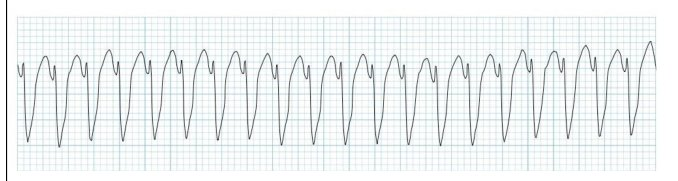
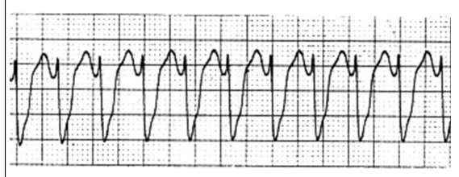
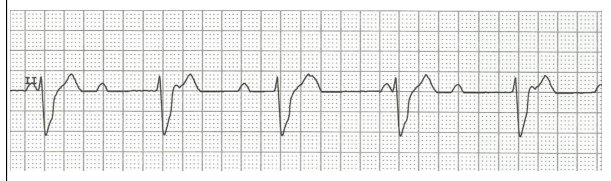
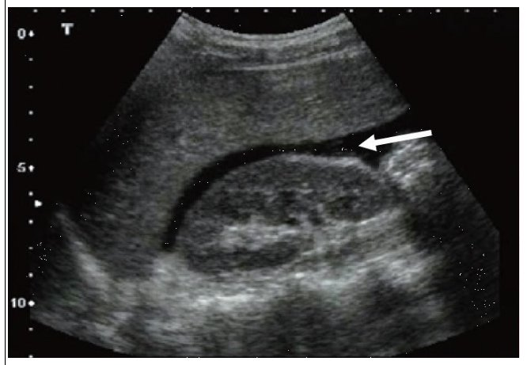
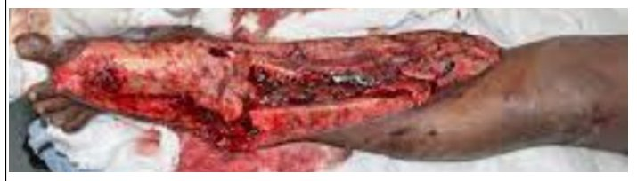
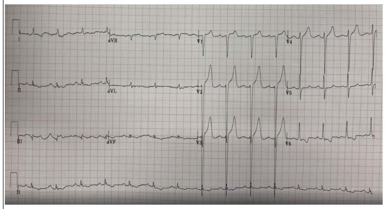
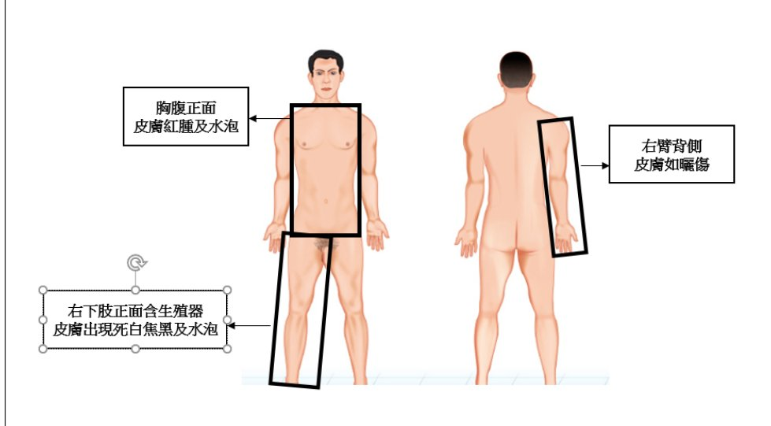

# 110 年度高級救護技術員甄試筆試 題目卷

> 單選題，共 100 題。答案在 [`答案_108-114年.md`](答案_108-114年.md)，作答完再對。

### 1. 高級救護技術員的初訓課程，是屬於哪一種的醫療指導模式？

- (A)前瞻性。
- (B)培育性。
- (C)即時性。
- (D)任務性。

### 2. 救護技術員對於確定罹患新冠肺炎(COVID-19)的病人救護時，因擔心自身受到感染而未進行必要之急救，在法律的觀點上，何者正確？

- (A)家屬可以主張救護技術員未依法行政而提出告訴。
- (B)家屬若要提出民事告訴，其時效為六個月。
- (C)救護技術員符合因正當防衛與緊急避難而免除其過失。
- (D)救護技術員可以主張病人在法理上符合與有過失。

### 3. 根據我國疾病管制署的建議，救護技術員因工作發生疑似愛滋病毒暴露時，下列緊急處置，何者正確？

- (A)若有扎傷處應立即以大量優碘消毒傷口。
- (B)若暴露處為黏膜(如眼睛)則大量沖水即可。
- (C)必須於72 小時內向工作單位進行事件通報。
- (D)必須於暴露後3 個月、6 個月、1 年追蹤三次抗體檢驗。

### 4. 依據「國際緊急派遣協會」定義，公共場所目擊OHCA 的派遣等級是？

- (A) E (ECHO)。
- (B) A (ALPHA)。
- (C) C (CHARLIE)。
- (D) O (OMEGA)。

### 5. 在進行區域EMS 重大外傷品管時，針對下列哪一類傷患的死亡，我們應該深入了解院前院後是否有品管可改進之處？

- (A) ISS 低且RTS 低的傷患。
- (B) ISS 低且RTS 高的傷患。
- (C) ISS 高且RTS 低的傷患。
- (D) ISS 高且RTS 高的傷患。

### 6. 如果教師想要以G-A-S 模式進行教學反饋時，在學員操作完XXX 情境但表現不佳時，教師針對 「獲取資訊 (Gathering)」以以下哪一個詢問方式最為恰當？

- (A)當病人發生XXX 時，您為什麼沒有進行OOO 的處置呢？
- (B)您今天表現欠佳，之前是否沒有遇過病人發生XXX 的情境呢？
- (C)如果我是您，在病人發生XXX，您覺得我會怎麼作呢？
- (D)當病人發生XXX 時，您當時的心情或想法是什麼的呢？

### 7. 高級救護技術員以 google 表單發送給認識的同仁與學弟，完成「喝酒與工作壓力關係」的碩士論文。關於上述研究，何者正確？

- (A)請認識的同仁或學弟填寫問卷，通常不需要受試者知情同意書。
- (B)要減少選擇偏差，在議題設計時必須進行專家內容效度的檢測。
- (C)要減少測量偏差，在問卷發放對象的選擇時必須進行分層與抽樣。
- (D)要增加研究信度，可以在經過一段時間後再次請受訪者填答。

### 8. 關於血液中的氧氣與二氧化碳運輸，以下何者為是？

- (A)氧氣在血液中以二種形式存在，直接溶解以及與血紅素結合。而直接溶解的氧氣量大於與血紅素結合。
- (B)一個血紅素分子可以攜帶4 個氧氣分子，這樣的狀態稱為飽和。通常在氧氣分壓80~100mmHg 時達到飽和。
- (C)二氧化碳在血液中有兩種型態，直接溶於血漿以及以碳酸根離子型式存在， 直接溶解態約佔8%。
- (D)在氧分壓40mmHg 時，90%以上的血紅素均已攜帶氧分子。超過40mmHg 以上時，增加的攜氧量有限。

### 9. 下列關於腦部解剖構造的敘述，何者為是？

- (A)丘腦的功能是監督維持身體姿勢的肌肉，並以感覺的訊息為基礎，調 節隨意和不隨意的大動作。
- (B)下視丘含有口渴中樞、體溫中樞、攝食中樞等調控中樞，亦可調節自主神經功能與內分泌。
- (C)控制心 搏速率、心收縮力及循環血流量的心臟血管中樞及呼吸節律中樞都位於腦幹中的橋腦。
- (D)大腦包含感覺訊息的轉遞與處理中樞，是所有上行感覺訊息傳遞的最後轉遞點，也擔任訊息過濾器。

### 10. Amiodarone 是院前常使用的抗心律不整藥物，關於此藥以下敘述何者為非？

- (A)屬於第三類(Class III)的抗心律不整藥物。
- (B)可能引致心臟收縮力降低、血管擴張及血壓下降。
- (C)嚴禁用於已知有嚴重心臟功能受損的患者的心律不整。
- (D)藥效半生期長，可至40 天，易累積在體內。

### 11. 60 歲男性從火場被救出，體重目測75 公斤，燒燙傷面積一度約為10%，二度約為18%，三度約佔9%。依據最新版PHTLS，使用兩套標準輸液套管滴注，請推算前八小時每一套標準輸液套管每分鐘須調整為幾滴最為合適？

- (A) 84。
- (B) 42。
- (C) 21。
- (D) 63。

### 12. 關於血液的組成，何者為是？

- (A)血液大部分由紅血球組成，佔55~60%。
- (B)紅血球壽命約為120 天，血球比例僅次於白血球。
- (C)O 型血中血漿抗體不含A 或B 抗體，只可接受O 型血輸血。
- (D)血漿中水份約佔九成。

### 13. 有關藥理學相關名詞，何者正確？

- (A)拮抗作用(Antagonism)：當併用兩種或兩種以上藥物時，藥物效果出現相互阻抑而使藥物效果的總和小於個別使用藥物的效果加總(1＋1 < 2)。
- (B)禁忌症(Contraindication)：在藥物治療劑量內發生不希望出現但常常是無法避免的效果。
- (C)藥物過敏(drug allergy)：一種藥物被另一種先前給予藥物所影響，產生增加或減少藥效作用。
- (D)適應性(tolerance)：重複使用藥物因藥物濃度累積，出現治療效果增強，需要調低藥物劑量。

### 14. 呼吸中通氣量和潮氣容積的描述，何者為是？

- (A)正常呼吸下的潮氣容積為5,000~6,000 毫升。
- (B)計算真正肺泡潮氣量時，需要減掉氣道的容積。
- (C)潮氣容積等於通氣量乘以每分鐘的呼吸次數。
- (D)通氣量每個人是固定不變的。

### 15. 正常生理狀況下，有關二氧化碳濃度圖儀監測，何者為是？

- (A)二氧化碳分壓值在吸氣階段，正常時可以降至0。
- (B)潮氣末二氧化碳分壓值，位於吐氣的起點。
- (C)開始吐氣的階段，二氧化碳分壓值最高之後開始下降。
- (D)CPR 時突然上升的潮氣末二氧化碳分壓值，代表插管滑脫。

### 16. 關於病患病史詢問的內容，正確的觀念是？

- (A)主訴包括一個或多個主要的自覺症狀，同時也必須記錄症狀發生或持續的時間。
- (B)現病史的第一個重點，就是要釐清主要患者身分的特徵。
- (C)詢問發生當時狀況，指的是症狀發生病患的反應以及是否有人協助處置。
- (D)加劇或緩解因素是協助高級救護技術員判斷是否為危急個案的必要條件。

### 17. 病史詢問之目的與作法何者為非？

- (A)藉由訪談傷病患、家屬或相關目擊者，以瞭解傷病患的症狀表現及相關醫療狀況。
- (B)經由與傷病患及家屬在病情詢問時的交談過程，同時安撫傷病患情緒。
- (C)危急病人應先先評估現場病人的意識與生命徵象，完成初級評估。
- (D)病人沒有生命徵象而必須立即接受心肺復甦術，高級救護技術員應優先專注於急救及後送，病史詢問可等到院後由醫師協助。

### 18. 75 歲男性求救，牙痛數天未就醫，左臉部及左頸部腫脹而打119 求救，你到現場發現他有發燒、吞嚥困難、喉嚨痛，似乎快要窒息。此時問診及身體檢查其相關症狀，形成臆斷的配對何者為非？

- (A)身體檢查可發現體溫上升、口腔內口水積聚、頸部皮下氣腫。
- (B)誘發因子可能為頸部異物(魚刺、骨頭)傷害、牙源性感染。
- (C)主要危象表現：漸進式呼吸困難。
- (D)臆斷疾病：嚴重過敏合併咽喉水腫。

### 19. 48 歲男性因腳腫、呼吸喘求救，你到現場發現他呼吸淺快、心跳120 下/分鐘、下列何者視觸診線索可以支持他最可能為肺栓塞？

- (A)單側肢體紅腫合併水泡產生、疼痛劇烈。
- (B)單側肢體腫脹、肢體溫熱。
- (C)雙下肢脈搏消失或減弱。
- (D)雙下肢出現網狀青斑。

### 20. 派遣令任務是要您至檢疫所護送COVID-19 快篩陽性的病患至專責醫院，請問此時最適合的醫病互動模式為何？

- (A)「主動—被動」模式。
- (B)「指導—合作」模式。
- (C)「共同參與」模式。
- (D)「遵從法規」模式。

### 21. 50 歲男性，求救原因為視力突然變模糊，不敢自行騎摩托車就醫，你現場評估的結果發現，只有病患往右看時，會出現複視的現象，做神經學檢查時，視力是正常的，但右眼無法往右看，但往上往左往下的旋轉都是正常的，左眼沒有轉動限制的問題，下列敘述何者最適當？

- (A)第三對腦神經出現病灶。
- (B)第四對腦神經出現病灶。
- (C)受影響的腦神經是屬於具備感覺與運動功能的混合型神經。
- (D)第六對腦神經出現病灶。

### 22. 下列有關於「哮喘音(Wheezes)」和「喘鳴音(Stridor)」兩種肺音的比較，下列敘述何者有誤？

- (A)「哮喘音」屬於肺內異常肺音；「喘鳴音」屬於肺外異常肺音。
- (B)「哮喘音」以呼氣期為主；「喘鳴音」以吸氣期為主。
- (C)「哮喘音」較為高頻；「喘鳴音」較為中頻。
- (D)「哮喘音」為空氣通過狹窄的上呼吸道氣管；「喘鳴音」為空氣收縮狹窄的小細支氣管。

### 23. 「您好，我是xx91 的EMTP，同事報案主訴意識不清，病患為60 歲男性，有高血壓、糖尿病史，現場評估GCS 為E2V2M5，我們現場量測血糖值為50，已經給予D50W 兩隻，現在GCS 回復至E4V4M6」，以上敘述關於「SBAR」的應用，何者是錯誤的？

- (A)「同事報案主訴意識不清」，屬於「S」Situation。
- (B)「病患為60 歲男性，有高血壓、糖尿病史」，屬於「B」Background。
- (C)「現場評估GCS 為E2V2M5，我們現場量測血糖值為50」，屬於「A」Assessment。
- (D)「給予D50W 兩隻，現在GCS 回復至E4V4M6」，屬於「R」Recommendation。

### 24. 一位20 歲男性無過去病史，20 分鐘前感覺心悸，心電圖監測如下。依照2020 年AHAguidelines for CPR and ECC，下列處置何者最適當？

- (A)若病人的血壓80/50mmHg，先完成12 導程心電圖再繼續下一個處置。
- (B)若病人的血壓120/80mmHg，給予Diltiazem 15mg 靜脈緩慢注射。
- (C)若病人的血壓120/80mmHg，嘗試Adenosine 6mg 靜脈快速注射。
- (D)若病人的血壓80/50mmHg，給予Amiodarone 150mg 靜脈快速注射。

### 25. 關於甲狀腺急症的相關敘述，下列何者為是？

- (A)黏液性水腫(myxedema)病人臨床表現會有皮膚粗糙、聲音尖銳及肌腱反射增強等症狀。
- (B)嚴重的黏液性水腫病人會有嗜睡、體溫下降等症狀，但仍需與低血糖等急症鑑別。
- (C)甲狀腺機能亢進(thyrotoxicosis)臨床病人會有亢奮、煩躁、心悸或體重增加等症狀。
- (D)甲狀腺風暴(thyroid storm)病人可能會有發燒、意識昏迷，需與嗎啡類中毒鑑別診斷。

### 26. 一位50 歲男性，主訴突然上腹劇烈疼痛持續30 分鐘，現場生命徵象如下：體溫36.5℃，心跳130 下/分鐘，呼吸18 次/分鐘，血壓110/60mmHg。病人有抽菸及酗酒病史，意識清楚，自述嘔吐多次及冒冷汗。關於接下來的評估與處置，何者為非？

- (A)病人可能有低血容，若送醫距離較長，可依縣市預立醫囑考慮給予靜脈輸液。
- (B)送醫途中須注意呼吸道暢通與血氧濃度，必要時給予氧氣維持SpO2>94%。
- (C)病人能清楚闡明自己身體的痛點，可排除心血管疾病而不需考慮心電圖監測。
- (D)若觸診腹部有明顯僵硬，表示可能有腸道穿孔所導致的腹膜炎，到院前應請病人禁食。

### 27. 一名中年男子主訴昨晚起喉嚨疼痛呼吸困難而報案，評估時發現頸部肌肉用力，且吸氣時有明顯喘鳴聲(stridor)。現場接觸時體溫38.7℃，心跳111 次/分鐘，血壓146/88 mmHg，呼吸30 次/分鐘，血氧92%。EMT 給予氧氣面罩8L/分鐘，並協助病人於擔架床半坐臥。上車後發現病人的喘鳴聲減少到幾乎聽不到，接下來最先需要做什麼？

- (A)檢查攜帶氧是否已經用盡。
- (B)確認血氧是否仍維持在94%以上。
- (C)協助給予病人退燒藥物。
- (D)觀察病人呼吸動力是否足夠。

### 28. 病人主訴吐血，以下處理何者正確？

- (A)由於血液碰到胃酸會呈現咖啡色，因此若是口吐鮮紅色的血，就表示不是胃部或十二指腸出血。
- (B)糖尿病病人吐血，由於預期到院後要空腹，因此院前處理休克應給予大量含糖輸液。
- (C)肝硬化病人食道靜脈曲張出血，相較於常見的消化道潰瘍出血，死亡率反而較高。
- (D)只要病人意識清醒，吐血的病人能夠自行保護呼吸道，EMT 不需介入維持呼吸道。

### 29. 以下何種疾病為空氣傳染？

- (A)水痘。
- (B)腸病毒。
- (C)流行性感冒。
- (D)鏈球菌肺炎。

### 30. 關於成人的致命性過敏反應，請問以下何者為最可能的主訴與病徵？

- (A)病人主訴喘，呼吸有喘鳴聲，同時合併持續腹痛。
- (B)病人全身皮膚起疹子且發紅發癢。
- (C)病人主訴昏厥，EMT 接觸時已清醒，血壓120/74 mmHg。
- (D)病人持續胸悶胸痛冒冷汗，心跳90 次/分鐘，血壓126/92 mmHg。

### 31. 一名主訴呼吸困難病患經評估發現皮膚發紺、血壓降低及脈搏壓變窄。並且出現奇異脈(paradoxical pulse)及深吸氣時脈搏變弱等徵象。最可能為下列何種診斷？

- (A)心肌炎。
- (B)心包膜填塞。
- (C)心肌梗塞。
- (D)房室傳導阻斷。

### 32. 一名急性右心室心肌梗塞合併右心室衰竭病患，血壓80/46 mmHg，心跳53 次/分鐘，呼吸18 次/分鐘，肺部聽診發現有兩側濕囉音。下列何種處置最適當？

- (A)靜脈注射乙型阻斷劑(β blocker)。
- (B)靜脈滴注心臟收縮藥物Dopamine。
- (C)靜脈滴注心臟收縮藥物Dobutamine。
- (D)Normal saline 快速靜脈注射。

### 33. 40 歲女性被家人發現倒臥家中，GCS=E1V1M4，無外傷，理學檢查無其他異常發現。血壓110/70 mmHg、心跳100 次/分鐘、呼吸10 次/分鐘、體溫正常。未使用氧氣治療下，動脈氣體分析：pH=7.20、PaCO2=80mmHg、PaO2=40mmHg，HCO3=25mmHg、SaO2=75%。最可能的病因為？

- (A)安眠藥過量使用。
- (B)氣喘急性發作。
- (C)肺炎併呼吸衰竭。
- (D)心因性肺水腫。

### 34. 60 歲男性，因高血壓造成左側基底核顱內出血，併發經天幕疝脫(transtentorial herniation)導致昏迷，最可能伴隨以下哪一種狀況？

- (A)右眼瞳孔放大，右側肢體無力。
- (B)左眼瞳孔放大，左側肢體無力。
- (C)右眼瞳孔放大，左側肢體無力。
- (D)左眼瞳孔放大，右側肢體無力。

### 35. 您在救護車上監視一位病患，他的胸悶在使用舌下 NTG 含片後緩解，可是 EKG 監視器突然出現下圖，並主訴胸悶冒汗及頭暈，量測生命徵象發現血壓70/40mmHg，以下最佳處置為何？

- (A)給予同步電擊 100 Joule。
- (B)給予非同步電擊200 Joule。
- (C)給予 Atropine 1 mg IV。
- (D)給予Adenosine 6mg IV。

### 36. 有關中風病人到院前處置，何者最適當？

- (A)皆須建立靜脈路徑，並快速且大量給予輸液避免低血壓。
- (B)若病人出現高血壓狀況，立即請病人服用平常之降血壓藥物。
- (C)若病人意識不清懷疑有IICP 的徵兆時，可將病人頭部抬高超過45 度。
- (D)選擇合適的急救責任醫院，必要時繞過中風照護資源不足的醫院。

### 37. 有關眩暈(vertigo)描敘，何者為非？

- (A)是一種神經學的症狀，感覺自身或環境在轉動的現象。
- (B)周邊型眩暈常為短暫發作，中樞型持續時間則不一定。
- (C)周邊型眩暈可能伴隨聽力減弱、耳鳴、耳痛及腫脹。
- (D)周邊型眩暈會合併多方向、持續性眼震。

### 38. 40 歲男性因左足紅腫熱痛三天，服用第一次使用之不明止痛藥，半小時之後開始全身發紅，下列何者正確？

- (A)若病人有腹痛，嘔吐，則多半是因為急性腸胃炎，而非因為過敏症狀。
- (B)若有低血壓及全身紅疹，需優先考慮蜂窩性組織炎導致敗血性休克。
- (C)若出現呼吸困難，可能因為支氣管收縮，而產生喘鳴聲，甚至缺氧現象。
- (D)合併休克時，epinephrine 為最適合的治療，應靜脈注射給予最有效。

### 39. 75 歲女士主訴呼吸喘、呼吸困難、頭暈且全身無力、同時合併胸痛不適，血壓78/49mmHg，心跳約40 次/分鐘，心電圖監視器顯示如下圖，下列敘述何者為是？

- (A)此為第一度房室傳導阻斷(1o AV Block)，不需要緊急治療心律，可以先觀察症狀。
- (B)此為第二度房室傳導阻斷(2o AV Block) Mobitz 第一型，不需要緊急治療心律，可以先觀察症狀。
- (C)此為第二度房室傳導阻斷(2o AV Block) Mobitz 第二型，先給予Atropine 1mg 靜脈推注。
- (D)此為第三度房室傳導阻斷(3o AV Block)，因病人症狀不穩定，可考慮使用TCP。

### 40. 80 歲男性病人，過去病史有慢性阻塞性肺病(COPD)，近期呼吸較喘且吐氣時有哮鳴聲，請問下列何者為非？

- (A)COPD 病人是依賴低氧驅力來維持呼吸，故血氧低於90%時，不可給氧以免導致患者不呼吸。
- (B)若病人備有支氣管擴張劑吸入器，可協助家屬幫助病人使用。
- (C)若病人出現呼吸急促、精神混亂、躁動則可能是血氧過低或者是血中二氧化碳過多所致。
- (D)若聽診兩側肺音聽不到哮鳴聲，仍須考慮可能為嚴重之急性發作。

### 41. 56 歲女士，無特殊過去病史，被家人發現倒在客廳沙發，檢查後發現右側手腳無力，疑似中風，以下何者符合施打血栓溶解劑之適應症？

- (A)四個月前有腸胃道出血病史。
- (B)量測血糖為30 mg/dL。
- (C)經藥物控制後血壓為190/115 mmHg。
- (D)最後一次看見病人正常時間為5 小時前。

### 42. 關於腦膜炎雙球菌感染之敘述，何者為非？

- (A)為葛蘭氏陰性球菌，常存在鼻部和咽喉的粘膜中。
- (B)好發於老年人，年輕人及兒童較少見。
- (C)屬於飛沫傳染，在未適當防護下接觸病人飛沫者需預防性抗生素投藥。
- (D)約10%的人會成為不具感染症狀的帶原者，但仍具有傳染力。

### 43. 創傷嚴重度評估指數，以下何者為非？

- (A)改良式創傷指數(RTS)，依據「昏迷指數」、「收縮壓」和「呼吸速率」三個變項，每一個變項分數0~4 分，分數愈高則傷害愈高。每一個變項分數再乘以該項係數之後，三者相加即為創傷指數值。
- (B)簡易創傷分數(AIS)，將身體分成六個解剖區域,包括:頭頸(head/neck )、顏面( face )、胸部( thorax )、腹部(abdomen)、肢體(extremity)、外觀軟組織(external)，每個解剖區域依損傷嚴重程度,由0~6 分代表，分數越高表示越嚴重。
- (C)ISS 定義為「三個最嚴重創傷解剖區域之最高AIS 分數平方總合」。ISS 分數越高，死亡率越高。臨床上凡ISS≧16 即屬嚴重創傷。
- (D)昏迷指數(GCS)最低3 分，最高15 分，分數高低與死亡率有明顯相關。

### 44. 70 歲男性有末期腎病變病史，最近因家裡辦喪事一個禮拜未到診所洗腎，兒子今天發現病人呼吸急促和昏迷因而報案。初步評估發現病人只對痛有反應且病人有休克徵象，輔助檢查發現心跳40 次/分鐘，血壓70/40mmHg，血氧濃度86%，關於此病人可能之用藥選擇何者最不適當？

- (A)MgSO4。
- (B)Sodium bicarbonate。
- (C)Atropine。
- (D)Calcium gluconate。

### 45. 下列哪一個疾病較會造成低血壓？

- (A)子癲前症。
- (B)急性腦梗塞。
- (C)腎上腺危象。
- (D)安非他命中毒。

### 46. 48 歲男性，有第二型糖尿病以及高血壓病史，因呼吸困難求救，到達現場時發現病人有快而深的呼吸，兩下肢並無水腫情形，血糖450mg/dL，體溫36℃，血壓170/80mmHg，心跳130 次/分鐘，下列敘述何者為是？

- (A)因病人血壓高，不建議給予大量輸液。
- (B)必須考量病人是否有潛在的感染問題。
- (C)此種狀況病人容易出現頭痛。
- (D)治療上建議常規給予碳酸氫鈉。

### 47. 關於心電圖的敘述，下列何者為是？

- (A)心肌梗塞時出現的超急性T 波(hyper acute T)，可以持續一到兩個小時。
- (B)Lead I、aVL 的ST 段上升，通常暗示供應心室中膈的冠狀動脈出現阻塞。
- (C)右心室傳導束傳導阻斷(Right Bundle Branch Block)通常暗示病人有嚴重的心臟疾病。
- (D)三度房室結傳導阻斷(third degree AV block)的定義包含QRS 波型均會超過心電圖的三小格。

### 48. 40 歲女性有氣喘病史，未規則服用藥物，近日有感冒情形，今日因感到呼吸困難求救，現場血氧95%、血壓125/80mmHg、心跳100 次/分鐘、呼吸24 次/分鐘，臉色蒼白，關於病人處置何者為非？

- (A)應把心肌炎、肺栓塞列入鑑別診斷，詳細詢問病史。
- (B)如聽診出現哮鳴音(wheezing)，可以根據預立醫囑給予支氣管擴張劑。
- (C)病人如有懷孕情形則不建議於院前給予支氣管擴張劑。
- (D)即使血氧正常、聽診無哮鳴音(wheezing)也不可以排除氣喘急性發作。

### 49. 一位50 歲女性，站在椅子上跌落，撞擊右後背，理學檢查：心跳120 次/分鐘、血壓80/50mmHg、呼吸24 次/分鐘、血氧：96%、GCS=E3V5M6、右後背腰瘀青、無開放性傷口；超音波無明顯異常，至以下描述何者為非？

- (A)可給予1000cc 生理食鹽水灌注。
- (B)超音波無明顯異常，可證明後腹腔無明顯出血。
- (C)患者腰部瘀青可能是後腹腔出血，為Turner sign。
- (D)急救性血管內氣球阻斷術(REBOA)可以從血管內部達到暫時控制出血的效果，為傷患爭取開刀或作栓塞的時間。

### 50. 關於孕婦外傷，以下敘述何者最適當？

- (A)孕婦需要供應胎兒所需，只要輕微出血(<10%總血量)，便會有明顯的血壓下降、心跳加速。
- (B)安全帶使用可能增加子宮破裂的機會。
- (C)如無脊髓外傷疑慮，孕婦可以考慮以右側躺方式運送，避免壓迫下腔靜脈。
- (D)子宮貫穿傷中，胎兒較母親有較佳的預後。

### 51. 13 歲男童，體重目測35 公斤，現場GCS=E2V2M4，心跳150 次/分鐘、血壓70/30mmHg、呼吸30 次/分鐘、血氧75%，理學檢查：腹部有安全帶徵象、瞳孔等大（左2mm/右2mm)、氣管向右偏移、頸靜脈怒張、呼吸音：左側減低，左側胸部敲診為鼓音，以下描述何者最適當？

- (A)腹部有安全帶徵象通常與嚴重腹內損傷無關。
- (B)小兒組織柔軟，如果有肋骨骨折，胸腔內的損傷的機會不高。
- (C)考慮患者有左側張力性氣胸，應於左胸第五肋間腋後線前側實行針刺減壓。
- (D)可以先以700ml 林格氏液快速輸注。

### 52. 一位18 歲男高中生，騎腳踏車與公車發生車禍，發現病患離事故現場20 公尺，患者持續胸痛，心跳70 次/分鐘、血壓110/70mmHg、GCS=E4V5M6、呼吸16 次/分鐘、血氧98%，理學檢查僅全身多處擦傷，以下描述何者為非？

- (A)應考慮創傷性主動脈破裂。
- (B)兩側肢體的脈搏可能強弱不同。
- (C)超音波無心包膜及肋膜積液可排除創傷性主動脈破裂。
- (D)心音聽診可能有心雜音。

### 53. 關於出血性休克，以下敘述何者為非？

- (A)所有創傷性休克傷患需積極排除出血性休克的可能性。
- (B)輸液首選為林格氏液，其次為生理食鹽水。
- (C)給予1,000cc 生理食鹽水，生命跡象短暫改善後，復發性心跳上升，血壓下降，預估出血量為總血量的15-40% 。
- (D)同時合併腦外傷病患血壓低時，應按照允許性低血壓維持≧90mmHg 即可。

### 54. 48 歲男性因汽車車禍、呼吸喘、右上腹痛求救，你到現場發現他呼吸淺快、心跳120 次/分鐘、有一地區醫院距離現場8 分鐘車程，創傷中心距離20 分鐘車程。你運用e-FAST 評估如下影像，以下敘述何者錯誤？

- (A)e-FAST 適當的訓練可以提供良好的敏感度與特異度。
- (B)e-FAST 的部分掃描部位皆為身體躺平時身體最低的部位。
- (C)此肝腎交界有黑色的水積液，配合情境要高度懷疑肝臟破裂內出血。
- (D)盡速送往路程最近的醫院，增加存活率。

### 55. 有關顱底骨折的描述，以下敘述何者為非？

- (A)眼眶周圍如果有類似浣熊眼(Raccoon's eyes)瘀青及鼻漏(rhinorrhea)，要懷疑有前顱底骨折。
- (B)有耳漏(otorrhea)則要懷疑有中顱底骨折。
- (C)耳後有瘀青，巴氏徵侯(Battle's sign)，要懷疑有後顱底骨折。
- (D)顱底骨折第一時間易忽略，要跟醫師交班輔以X 光檢查確診。

### 56. 有關頭部創傷的急救處置觀念，何者為非？

- (A)在現場處理頭部創傷最重要的就是在保護頸椎的前提下，維持呼吸道的通暢並給予足夠的通氣與氧合。
- (B)到院前低血氧(SpO2<90%)與低血壓(SBP < 90mmHg)都會增加創傷性腦損傷的死亡率。
- (C)到院前使用BVM 給氧治療頭部外傷傷患時，其換氣速率同一般急救(每分鐘10~12 次通氣)。
- (D)創傷性腦損傷血壓的控制要維持在90mmHg 以下，避免平均動脈壓過高增加顱內壓或增加顱內出血風險。

### 57. 一名 35 歲男性倒臥在工廠內， 左下肢被捲入滾輪機器，您到達現場發現患者已脫困，但左下小腿傷勢十分嚴重，一直有鮮血冒出。根據 PHTLS 處置原則 XABCDE ，請問以下敘述何者為非？

- (A) X：為控制可見的大出血。
- (B) A：呼吸道處置、頸椎保護。
- (C) C：確認循環相關問題，控制中度、輕度出血。
- (D) D：鑑別診斷致命傷害。

### 58. 承上題：您評估患者傷口如下圖，有多處動脈出血點及大面積的軟組織損傷，脛骨、腓骨開放性骨折，請問以下何者是最理想的止血法？

- (A)戰術止血帶止血法。
- (B)直接加壓止血法。
- (C)止血棉填塞止血法。
- (D)合併多種止血法。

### 59. 一名70 歲男性病患主訴胸痛而報案，生命徵象穩定，現場心電圖如下圖所示，下列敘述何者最適當？

- (A)需立刻再做一張右側心電圖。
- (B)通報後送醫院啟動心導管小組。
- (C)等到達醫院後再追蹤EKG，由醫師決定是否啟動心導管。
- (D)給予初步藥物治療，就近送往一般級醫院，密切觀察追蹤。

### 60. 35 歲男性，被發現倒臥在大樓中庭，意識不清、心跳150 次/分鐘、血壓80/50mmHg、呼吸24 次/分鐘、血氧 98%、傷患兩側跟骨明顯腫脹變形。以下敘述何者為非？

- (A)判斷受傷機轉有可能為墜樓。
- (B)休克原因需考慮出血性休克。
- (C)受傷機轉不會造成腰椎骨折。
- (D)病患無法檢查頸椎壓痛故需進行頸椎保護。

### 61. 關於出血性休克分級與表現徵候，下列敘述何者為非？

- (A)Class I 代表出血量小於全身血量的15%。
- (B)Class II 臨床表徵可能會出現脈搏壓減少。
- (C)Class III 通常是需要輸血治療。
- (D)Class IV 代表出血量大於全身血量的30%。

### 62. 關於脊髓損傷的相關敘述，何者為非？

- (A)前脊髓症候群(Anterior cord syndrome)通常會造成痛覺及溫覺喪失，但本體感覺保留。
- (B)脊髓半切症候群(Brown-sequard syndrome)通常會造成受傷同側運動功能喪失，對側感覺功能喪失。
- (C)脊髓休克(Spinal shock)通常會以心跳緩脈及組織灌流不足表現。
- (D)中央脊髓症候群(Central cord syndrome)通常上肢的症狀會比下肢嚴重。

### 63. 一名男性於火場救出，其傷勢描述及範圍如下圖所示，分別為右臂背側皮膚如曬傷，胸腹部正面出現皮膚紅腫及水泡，右下肢及生殖器皮膚出現死白焦黑及水泡，請問含2 度以上燒燙傷面積計算為多少%？

- (A) 22.5%。
- (B) 28%。
- (C) 32.5%。
- (D) 37%。

### 64. 重大創傷時「創傷致命三合症(Lethal triad of trauma)」，不包含以下何者？

- (A)凝血病變。
- (B)酸血症。
- (C)低體溫。
- (D)低血氧。

### 65. 40 歲男性工作時被火灼傷，全身多處大面積燒傷，意識清楚表示疼痛，下列處置何者最適當？

- (A)傷患顏面燒傷，眉毛鼻毛燒焦捲曲，若尚可講話不用考慮插管。
- (B)計算靜脈輸液治療時，燒燙傷面積不需加入一度燒傷面積。
- (C)三度燒傷區域，可以為乾硬不具彈性的皮膚稱為焦痂(eschar)，會有嚴重疼痛表現。
- (D)輸液補充量計算改用修正後布魯克公式(modified Brooke formula)，為了增加體液的補充量，避免體液流失造成休克惡化。

### 66. 關於創傷性主動脈斷裂(traumatic aortic rupture)， 下列何者最適當？

- (A)常見主動脈破裂或斷裂的位置是胸腹主動脈交接處。
- (B)80~90%的傷患會有右側胸腔內積血。
- (C)最常見於高處跌落創傷機轉。
- (D)因動脈韌帶(ligamentum arteriosum)固定住主動脈，拉扯造成斷裂。

### 67. 一位 23 歲男性病人在停車場因停車糾紛，左胸部被刺一刀，意識清楚但血壓只有 90/70mmHg，心跳 160 次/分鐘、呼吸18 次/分鐘，下列描述何者最適當？

- (A)若左邊肺部無呼吸聲音且氣管偏移有可能是心包膜填塞。
- (B)若雙邊肺部皆有呼吸聲音且氣管沒有偏移需考慮張力性氣胸。
- (C)超音波檢查需注意跳動的心臟周邊，有無像心臟內一樣的黑色的水在周邊。
- (D)開放性傷口若有氣泡或冒泡聲，首要任務是完全封閉胸壁開放性傷口。

### 68. 關於腹部臟器創傷，下列描述何者為非？

- (A)肝臟為腹部最大的實質器官，為腹部刀刺傷中最常受損的器官，受傷機轉中有上腹部創傷者均應懷疑有肝臟損傷之可能。
- (B)Kehr 徵象為脾臟損傷，疼痛轉移至左肩之現象。
- (C)胰臟損傷最常見的機轉為外力直接撞擊上腹部壓迫胰臟撞擊脊椎所致，症狀包括上腹部瘀青、傷口，上腹痛並放射至背部。
- (D)小腸損傷初期主要症狀為腹部疼痛，理學檢查需要有腹膜炎徵象。

### 69. 20 歲男性在夏日馬拉松賽跑後，全身冒汗且神智不清，現場量測體溫為42℃，請問關於此病患的診斷與治療，下列何者最適當？

- (A)病人若發生抽搐，可使用Lorazepam 控制。
- (B)降溫的主要目標，是快速將體溫降到38℃以下。
- (C)中暑病人的皮膚通常是乾燥無汗，因此這位病人熱中暑機會很低。
- (D)使用4℃的生理食鹽水點滴輸液降溫比用灑水併吹風扇降溫安全快速。

### 70. 30 歲女性被困在冷涷庫中30 分鐘，救出時身上無明顯外傷，但已無生命徵象，量測病人中心體溫為20℃。請問關於此病患的急救，下列何者最適當？

- (A)呼吸及脈搏不易評估，評估脈搏至少需45 秒以上。
- (B)氧氣需求量少，因此氣管內插管對病人並無幫助。
- (C)若發現病人身體已完全結凍、口鼻已冰封，則可以停止急救。
- (D)在體溫回升到30℃前不應給予Epinephrine，以免造成組織毒性。

### 71. 關於足月新生兒接受正壓通氣的描述，下列何者最適當？

- (A)娩出時若無哭聲，需立即給予正壓通氣。
- (B)給予正壓給氧的速率約為40-60 下/分鐘。
- (C)為避免缺氧，通氣時應使用100%的氧氣。
- (D)除非心跳小於60 下/分鐘，否則不需給予正壓通氣。

### 72. 有關產婦急救敘述，下列何者最適當？

- (A)維持正常去顫電擊的位置和電量。
- (B)務必以左側躺姿勢進行壓胸急救。
- (C)點滴注射時，儘量打在下肢靜脈。
- (D)插管時應選用較大號的氣管內管。

### 73. 33 歲男性到綠島水肺潛水，最後一次潛水後約 12 小時產生突發性雙下肢無力、完全無法走路的症狀。關於這位病人的描述，下列何者最適當？

- (A)發生此症狀的原因，最可能是血中的氧氣氣泡阻塞血管所致。
- (B)轉送過程中需給予高濃度氧氣，並以頭低腳高的姿勢運送。
- (C)病人可能罹患減壓病，需轉送至有高壓氧治療的適合醫院。
- (D)病人如需空中轉送，機艙內壓力應儘量維持較海平面壓力為低。

### 74. 70 歲男性，通報意識不清，現場發現全身冒汗、嘔吐、大小便失禁。理學檢查發現呼吸明顯濕囉音。血壓 160/80 mmHg、 脈搏40 次/分鐘、呼吸 30 次/分鐘、體溫 36.5℃、血氧92%、GCS= E3V4M5、雙側瞳孔大小1mm 且對光有反應。請問這位病人的症狀，與哪種中毒症候群最符合？

- (A)膽鹼性中毒症候群。
- (B)抗膽鹼性中毒症候群。
- (C)致幻覺性中毒症候群。
- (D)仿交感神經作用中毒症候群。

### 75. 關於準自殺行為的危險因子，下列何者為非？

- (A)退休狀態。
- (B)完美主義人格。
- (C)婚姻處於分居狀態。
- (D)曾執行一次的準自殺行為。

### 76. 關於臺灣毒蛇的敘述，下列敘述何者正確？

- (A)眼鏡蛇的毒牙為管牙，被咬傷後因組織被破壞導致疼痛腫脹與腐爛。
- (B)雨傘節的神經性毒液的毒性為台灣陸生毒蛇中毒液最強者。
- (C)百步蛇蛇毒常會引起急性賢衰竭與全身性出血的症狀。
- (D)台灣目前的抗蛇毒血清共有六種，僅有醫學中心六種皆有備藥隨時可用。

### 77. 下列皆是腸病毒71 型感染併發重症的常見病徵，但何者為非？

- (A)肌躍型抽搐(myoclonic jerks)。
- (B)低血糖(hypoglycemia)。
- (C)肢體顫抖(tremor)。
- (D)心搏過速(tachycardia)。

### 78. 王太太因情緒不佳，去藥局買了一些普拿疼(Acetaminophen, ACT)企圖自殺，服用一小時由119 送來急診。下列敘述何者為非？

- (A)其主要毒性傷害為肝毒性，如未治療，症狀在第3、4 天最為嚴重。
- (B)病人到院時就要馬上抽測血中ACT 濃度，並立刻給解毒劑治療。
- (C)解毒劑是N-Acetylcysteine，8 小時內使用有很高的機會完全康復。
- (D)服用解毒劑N-Acetylcysteine 時，不應同時給予活性炭治療。

### 79. 我們可以利用CAGE 的簡易口訣，提早發現同仁可能有酗酒的問題，請問下列關於CAGE的敘述，何者錯誤？

- (A) C 代表Continuity，我們可以先詢問同仁是否已不自覺的連續多天飲酒？
- (B) A 代表Annoyance，可以接著詢問同仁是否因喝酒而造成家人或朋友的嫌惡？
- (C) G 代表Guilty，下一步是詢問同仁是否會覺得這樣長期飲酒有罪惡感？
- (D) E 代表Eye opener，可以詢問同仁是否一早起來就會覺得想要找酒來喝？

### 80. 救護現場一名36 歲女性，明顯眼神紊亂，表示自己有超能力可以操縱氣體，且她聽到居禮夫人叫她操縱瓦斯進行發電；跟家人詢問後，家人表示病人無過去病史，但這半個月以來此類妄想此情形反覆發生，這次是因為已有明顯危害自己跟家人人身安全的疑慮，才報案處理。請問以下描述，何者最適當？

- (A)根據病人臨床表現及家人提供的資訊，此病人有可能的臆斷應為躁症發作。
- (B)以溝通原則來說，問答採用「是居禮夫人叫你開瓦斯嗎？」比「居禮夫人跟你說了什麼？」還要適合。
- (C)除了過去病史之外，還應該詢問家族內是否有身心科病史、病人最近是否有使用娛樂性用藥或毒品。
- (D)此病人已有明顯自傷傷人之疑慮，故在警察尚未抵達之前，救護員可以依法將病人強制約束及送醫。

### 81. 你接獲通報，前往協助一名酒醉路倒的病患送醫；當你到場時，發現病患渾身酒氣、意識不清、全身瘀青倒在店家門口，老闆表示病患這幾天都沒吃東西，剛剛半小時前又跟他買酒喝，希望你載他到附近醫院就醫；在運送過程中，病患突然牙關緊閉、眼睛上吊、疑似癲癇發作(seizure)，請問引起此病患癲癇發作的鑑別診斷何者最不可能？

- (A)電解質異常(Electrolyte imbalance)。
- (B)酒精戒斷(Alcohol withdrawal)。
- (C)創傷性腦損傷(Traumatic brain jury)。
- (D)低血糖(Hypoglycemia)。

### 82. 8 歲男童體重約30 公斤。吃果凍吃到一半突然臉色紫青，而後轉為心跳停止。你抵達現場時已有家人在進行心肺復甦術。接下來的急救措施，何者正確？

- (A)當預計進行氣管置入時，無氣囊的氣管內管號數應挑選為5.5 號以上。
- (B)當成功置入後，無氣囊氣的管內管置入深度應為15 公分以上。
- (C)在急救過程中，施打腎上腺素(Epinephrine)的劑量每次為0.03mg。
- (D)在回復自主呼吸心跳後，此男童收縮壓的標準應維持在86mmHg 以上。

### 83. 請問下列救護情境，何者最不像是兒童虐待的案件？

- (A)母親表示3 歲大女嬰在家人睡午覺時，自己從床上翻落導致腹部瘀傷。
- (B)父親表示10 個月男嬰練習走路時不慎跌倒，X 光發現移位性股骨骨折。
- (C)老師表示4 歲女童早上跌倒導致頭部撕裂傷，傍晚帶來急診傷口縫合。
- (D)教練表示6 歲男童在跆拳道集訓過程中，雙側前臂瘀青疼痛活動困難。

### 84. 相較於固定翼航空器(小飛機)，以直昇機進行空中救護有哪項優點？

- (A)機動性高。
- (B)安全性佳。
- (C)醫療條件較優。
- (D)受天候影響小。

### 85. 大地震後災區病人的預期健康狀況，下列何者為非？

- (A)急性心肌梗塞比例會增加。
- (B)孕婦流產及早產的情形將較為少見。
- (C)大部份嚴重的傷患，應該都是合併多處創傷。
- (D)傷患常因頭、胸部嚴重壓傷造成立即死亡。

### 86. 關於事件指揮系統中後勤組的功能，下列何者為非？

- (A)建立並維護通訊系統。
- (B)維護電力及衛生設備。
- (C)提供工作人員食物及飲水。
- (D)追蹤應變人員的工作時間。

### 87. 使用START 法進行檢傷時有些傷患的病情容易被誤判為重症，但下列何者除外？

- (A)孕婦。
- (B)失聰傷患。
- (C)下肢殘障傷患。
- (D)過度換氣傷患。

### 88. 關於不明化學物質外洩現場的災害處置與救護，下列何者正確？

- (A)除污走廊應設在外洩點的下風上坡處。
- (B)在熱區可對傷患進行簡單的呼吸道維持治療。
- (C)在暖區執行除污時，傷口應以大量高壓水沖洗清潔。
- (D)執行除污時，傷患身上的固體毒化物顆粒，需立刻以清水乾淨。

### 89. 颱風可能對醫療服務造成的影響，下列敘述何者最不適當？

- (A)道路中斷，可能需要空中運輸。
- (B)緊急救護時，行車安全的風險增加。
- (C)醫療院所淹水及交通阻斷，影響醫院運作。
- (D)造成新興傳染病盛行，耗費大量醫療資源。

### 90. 關於大型活動的醫療規劃原則，下列敘述何者最不適當？

- (A)醫療規劃時，「保護自己的安全」為首要規劃重點。
- (B)醫療站動線必須讓急救人員可攜帶急救裝備順利往返。
- (C)醫療站位置最好設置在8 分鐘路程內可到所有活動區域處。
- (D)預估傷患人數通常與活動種類、持續時間、現場溫度與高度有關。

### 91. 關於核生化事件的防護衣，下列敘述何者最適當？

- (A)C 級防護衣不可在缺氧環境下使用。
- (B)化災防護衣，可防護穿透式的輻射線。
- (C)進入毒化災現場，當毒物不明時，應穿戴B 級防護衣。
- (D)C 級防護衣是包括全面式面罩加上供氧呼吸裝備及全身防潑濺的防護衣。

### 92. 核電廠發生輻射外洩事件，一名傷患經除汙之後，輻射應變隊偵測傷患身上沒有輻射反應，你獲派運送此傷患就醫。下列敘述何者最適當？

- (A)偵測身上沒有輻射反應，表示該傷患輻射暴露劑量極低。
- (B)救護人員治療此位傷患，仍需穿著防輻射衣進行。
- (C)傷患出現嘔吐症狀距離輻射暴露的時間，和輻傷嚴重度有關。
- (D)該傷患應至少會出皮膚紅、噁心、嘔吐或發燒其中之一的症狀。

### 93. 事故指揮系統中，以下哪項應為執行部部長的任務？

- (A)確保轄屬的工作人員都依照安全規範執行任務。
- (B)收集、分析、散發資訊。
- (C)提供資源和服務，以協助事故應變順利進行。
- (D)保存災害復原記錄與損害記錄。

### 94. 大量傷患檢傷分類大部分的國家係分成四級，依照顏色來表示，下列敘述何者錯誤？

- (A)紅色：重傷，屬於優先處理患者，患者通常傷勢嚴重危及生命，但若及時治療存活機會大，如身體大量出血，上呼吸道阻塞，張力性氣胸。
- (B)黃色：中傷，暫緩治療，患者通常有顯著傷勢，但是稍微晚點處置不會危及生命，也不會造成嚴重的後遺症，如股骨骨折。
- (C)綠色：皮肉輕傷，可自己行走，延遲處理也不會有後遺症。但需要小心有惡化成紅色或黃色的情形。
- (D)黑色(白色)：瀕死，多處重大創傷或者已經是明顯死亡的傷病患，全世界處理順序都是最後處治。

### 95. 事故應變的現場作業又區分為現場評估→集結檢傷→現場救護→確適醫療。以下敘述何者錯誤？

- (A)現場評估的重點包含4 個S，也就是確保安全(Safety)，事故資訊(Size-up)，狀況回報(SendInformation)，及建立指揮(Set up)。
- (B)集結檢傷屬於現場檢傷，主要目的在決定醫療處理的優先順序，因此屬於初級檢傷。
- (C)現場救護被視為事故現場與確適醫療之間的過渡階段，主要的重點有3T，檢傷(Triage)，治療(Treatment)，後送(Transport)。
- (D)確適醫療是指醫院有足夠能力以及足夠容量來處理這個患者，不需要再轉介至其他醫療院所治療。

### 96. 對於大量傷患後送至確適醫療單位的原則與現況，下列敘述何者為非？

- (A)相較於重症傷患，輕症傷患常在初期湧入醫院消耗大量處理能量，以致當重症傷患送達時沒有足夠人力和設備處理。
- (B)輪送(rotating)適用於事故地點附近醫院的距離、處理能力和容量都相似時，將嚴重度類似的傷患輪流後送以避免醫院不堪負荷。
- (C)當某醫院已超乎負荷，沒有能力接收新傷患時，應採取繞道(bypass)原則，避開這家無法負荷的醫院。
- (D)群送(packaging)適合用於輕症傷患，將一整群傷患一起送到某家醫療院所，轉送前須確認該醫院有足夠的接收容量。

### 97. 關於大量傷患作業時，後送小組的職責，下列敘述何者為非？

- (A)後送為現場救護的三大重點之一，需要與檢傷小組、治療小組互相配合分工。
- (B)後送管制員需與醫療小組的醫療派遣員溝通了解傷患傷情細節，了解各醫院接收能量，協調後送順序及調配轉送資源。
- (C)後送組長應儘可能將輕傷病患分配至不同醫院以避免壅塞，而不是單純地計算後送醫院已經接收的人數。
- (D)大傷事件的救護紀錄單應隨同傷病患送到醫院，以利醫護人員知道狀況和處置。

### 98. 有關現場救護的權責，下列敘述何者最適當？

- (A)大量傷患現場醫療小組人數可能嚴重不足，而中重傷者常一下子湧入治療區，故只要傷患脫困後即應該馬上轉送醫院，毋須現場執行醫療處置。
- (B)現場檢傷時先召喚可行走傷患集中於傷患集結區，確保人員安全；無法行走傷患則由檢傷人員評估並搬運至傷患集結區。
- (C)明顯死亡的傷患，應該先做好現場蒐證後，再送達遺體區。在危害物質事故時，宜盡速移動遺體以免染污。
- (D)醫療小組的醫療派遣員須和後送小組的後送管制員確認溝通傷病患人數及嚴重度，後送順序、方式、時間、車輛、接收醫院等事宜。

### 99. 關於各種運動賽事場邊救護，以下觀念何者正確？

- (A)進入冰上曲棍球場地執行救護必須著冰刀以免破壞場地。
- (B)柔道跌打損傷多，冷凍噴劑是急救包必備項目。
- (C)摔角賽事基本禮儀是救護人員應比照選手穿著短褲。
- (D)橄欖球賽在醫護人員進入賽場時，比賽仍繼續進行中。

### 100. 新興傳染病感染鏈中，最容易被消滅或打斷以阻絕疾病傳染的部份是？

- (A)傳染途徑。
- (B)易感宿主。
- (C)傳染病源。
- (D)傳染窩。

---

## 作答區

| 題號 | 1 | 2 | 3 | 4 | 5 | 6 | 7 | 8 | 9 | 10 |
|---|---|---|---|---|---|---|---|---|---|---|
| 1–10 | | | | | | | | | | |
| 11–20 | | | | | | | | | | |
| 21–30 | | | | | | | | | | |
| 31–40 | | | | | | | | | | |
| 41–50 | | | | | | | | | | |
| 51–60 | | | | | | | | | | |
| 61–70 | | | | | | | | | | |
| 71–80 | | | | | | | | | | |
| 81–90 | | | | | | | | | | |
| 91–100 | | | | | | | | | | |
