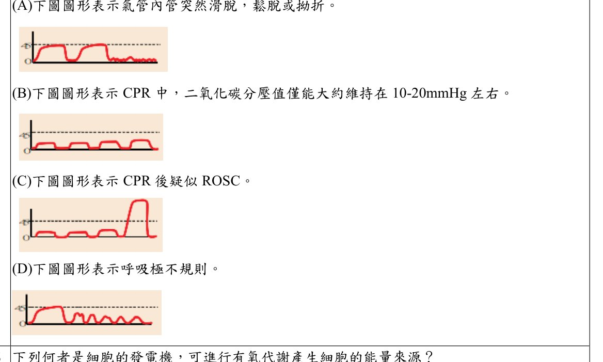
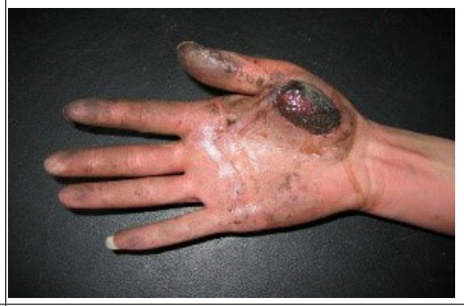
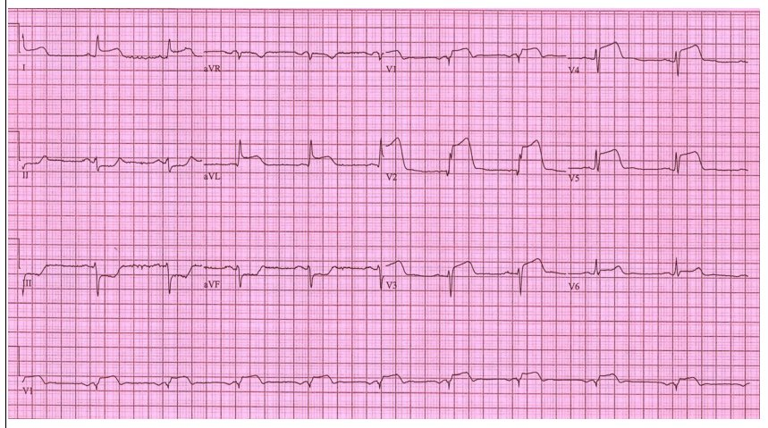

# 111 年度高級救護技術員甄試筆試 題目卷

> 單選題，共 100 題。答案在 [`答案_108-114年.md`](答案_108-114年.md)，作答完再對。

### 1. 如果您是因為「不想進火場、那麼只跑救護好像也不錯」的想法而參訓EMTP，根據馬斯洛需求理論，這樣的動機層次是屬於？

- (A)生理需求。
- (B)愛與歸屬。
- (C)安全需求。
- (D)自我實現。

### 2. 有關選擇後送醫院的「分流政策」與「繞道政策」，何者正確？

- (A)分流政策指的是將重症病人後送到可以做確切治療的醫院。
- (B)繞道政策指的是將輕症病人避開鄰近壅塞的醫院而送至其他的醫院。
- (C)生命徵象穩定但遭受高能量機轉的外傷病人應分流至無壅塞的醫院。
- (D)生命徵象穩定且在黃金時間內的腦中風病人應繞道至栓溶或取栓的醫院。

### 3. 救護行為構成法律上「過失」必須同時符合四項要件，下列何者最不符合過失要件？

- (A)下班時對病人進行CPR 造成肋骨骨折，病人死亡。
- (B)執勤中以氧氣導管直接插入病人氣切口，病人張力性氣胸死亡。
- (C)送醫途中車禍，救護車載送之月經痛病人飛出車外，頭部外傷死亡。
- (D)氣管內管插管，誘發病人嘔吐造成吸入性肺炎，併發敗血性休克死亡。

### 4. 民眾報案家中16 歲的女兒因感情因素想跳樓，救護人員到場後，母親(報案者)擋在門口、表示女兒只是一時情緒不穩定，沒有精神病史，目前也已穩定且在房間裡休息、也有朋友陪同。病人母親要求救護人員不要打擾她、且表示拒絕救護與警察人員入內。此時的處置方式，何者最為適當？

- (A)只要確定病人母親身份並請她於救護紀錄表簽名後，即可離開，不須作過多的解釋與說明，以免侵犯病人隱私。
- (B)母親是病人的法定代理人，能代理法律行為(如簽約)，但不能代理事實行為(如急病狀態與否)，所以最好還是持續溝通、要見到病人。
- (C)即使接觸傷病患弊大於利，救護人員也絕對不可聽信二手資訊(如病人母親轉述)，必須堅持見到病人本人並完整評估，才可返隊。
- (D)這個情境符合法律上的緊急避難，而消防救護人員因具有執行公務的身份，可直接援引行政執行法之規定，進行強制進入。

### 5. 有關台灣醫療指導制度，下列敘述何者為非？

- (A)醫療指導醫師實施辦法為衛生福利部制訂，並自民國99 年7 月1 日正式施行。
- (B)線上醫療指導係指由消防局聘任之醫療指導醫師所執行的即時醫療指導。
- (C)直轄市、縣（市）消防主管機關應指定醫療指導醫師，建立醫療指導制度。
- (D)訂定各級救護技術員品質指標、執行品質監測為醫療指導醫師的法定任務。

### 6. 醫療倫理四基本原則，不包括下列哪一項？

- (A)尊重自主原則。
- (B)行善原則。
- (C)利他原則。
- (D)公正原則。

### 7. 下列何者最不可能是我國高級救護技術員法定之緊急救護範圍？

- (A)在支援大型活動醫療站時給予頭痛病人服用普拿疼(Acetaminophen)。
- (B)在高山偏遠地區，對疑似高山肺水腫低血氧病患進行氣管內管插管。
- (C)在送醫途中對有脈博不穩定之心室頻脈病患進行心臟整流(Cardioversion)。
- (D)在救護現場依預立醫療流程執行TOR(Termination-of-resuscitation)現場判定死亡。

### 8. 有關新冠病毒的傳播描述，以下何者為非？

- (A)新冠病毒傳播主要為飛沫傳染。
- (B)濕洗手對新冠病毒的傳播不具阻斷與防護作用。
- (C)新冠病毒有可能經結膜感染，所以應戴護目鏡防護。
- (D)對COVID-19 病人抽痰，會產生氣溶膠，所以應做好空氣傳染防護。

### 9. 107 年消防署的「派遣員指導旁觀者心肺復甦術」的品管指標，以下何者為非？

- (A)可接觸之報案電話的OHCA 辨識比率：設定指標為95％。
- (B)辨識出OHCA 之報案者接受DA-CPR 的壓胸比率：設定指標為60％。
- (C)電話報案後至辨識出OHCA 時間的中位數：<120 秒。
- (D)從報案電話到開始做CPR 的時間中位數：<180 秒。

### 10. 派遣員初始流程的四大戒律(the Four commandments)，何者為非？

- (A)他(傷病患者)現場有個人需要幫忙
- (B)他(傷病患者)大概幾歲？
- (C)他(傷病患者)的意識是清醒的嗎？
- (D)他(傷病患者)的呼吸是正常的嗎？

### 11. 全球復甦聯盟(GRA)「增加OHCA 存活的十個步驟」中，名列第一步驟最重要的基石為？

- (A)落實快速派遣。
- (B)高品質心肺復甦。
- (C)建立OHCA 登錄系統。
- (D)完整的AED 部署計畫。

### 12. 新生兒出生時為了脫離母體血液循環，會做出一些生理上的調整與變化，下列何者為非？

- (A)體循環血管阻力的上升。
- (B)主動脈、左心室與左心房壓力的上升。
- (C)肺循環的血管阻力上升。
- (D)右心室與右心房的壓力下降。

### 13. 根據科爾伯格的道德發展理論(Kohlberg’s Stages of Moral Development)，對孩子品行道德發展的描述，下列何者為非？

- (A)「你搔我的背，我就會搔你的」這種『互惠』的概念是屬於天真的行為。
- (B)『好孩子心理』是屬於習俗水準的道德推理。
- (C)『法律與秩序』的心理是屬於後習俗水準的道德推理。
- (D) 由經教養過的良知來決定什麼是對的，屬於後習俗水準的道德推理。

### 14. 有關抽吸，下列何者為非？

- (A)抽吸過程中，若病人心跳加快，表示病人缺氧，須立刻停止抽吸。
- (B)抽吸可能引發肺部塌陷，連帶引發缺氧，導致心律干擾甚至心跳停止。
- (C)抽吸引發咳嗽可使顱內壓上升，使頭部外傷 病人增加腦疝脫的危險。
- (D)抽吸因呼吸道受刺激可導致血壓升高及心律不整。

### 15. 有關二氧化碳濃度圖儀解析 (虛線表示 40mmHg)，下列何者為非？

- (A)下圖圖形表示氣管內管突然滑脫，鬆脫或拗折。
- (B)下圖圖形表示CPR 中，二氧化碳分壓值僅能大約維持在10-20mmHg 左右。
- (C)下圖圖形表示CPR 後疑似ROSC。
- (D)下圖圖形表示呼吸極不規則。

### 16. 下列何者是細胞的發電機，可進行有氧代謝產生細胞的能量來源？

- (A)高基氏體。
- (B)內質網。
- (C)中心粒。
- (D)粒線體。

### 17. 2 歲兒童因誤食硬幣求救。您到達現場後進行身體檢查，目視其呼吸淺快，進一步胸部聽診發現異常呼吸音，以下評估結果何者為非？

- (A)此異常呼吸音為喘鳴音(Stridor)，為連續性雜音，清楚的聽診位置常位於頸部。
- (B)此異常呼吸音為空氣通過阻塞狹窄的胸腔外上呼吸道氣管，為中頻連續音。
- (C)此異常呼吸音也常發現於腫瘤、氣管內結核、痰液阻塞的病人。
- (D)此異常呼吸音於呼吸期出現時間，以吸氣期為主，嚴重狹窄時呼氣期亦會出現。

### 18. 以下各種方式為救護技術員用來評估病人呼吸道是否暢通的方法，何者為非？

- (A)評估病人是否順暢說話。
- (B)檢查病人血氧濃度是否大於94%。
- (C)檢查病人是否有發出喘鳴聲(stridor)。
- (D)檢視病人口腔內是否有異物的存在。

### 19. 高級救護技術員在面臨臨床決策時，可以有效率的將臨床決策按順序以六個以R 開頭的步驟付諸行動，以下何者為非？

- (A)評估傷病患(Read the patient)。
- (B)評估環境(Read the scene)。
- (C)診斷治療(React)。
- (D)回報指導醫師(Report to medical director )。

### 20. 公眾去顫系統(PAD)計畫要成功，除了經費充足與立法保護施救者外，還有四大要素，以下敘述何者為非？

- (A)由醫療專業人員規畫與監督整個計畫的進行。
- (B)加強訓練去顫器管理人員負責急救流程運作。
- (C)與當地的緊急醫療救護系統緊密配合。
- (D)定期的品管回顧檢討改進。

### 21. 關於葉克膜 (ECMO) 的敘述，以下何者為是？

- (A)VA-ECMO 為取代肺臟氣體交換的功能，對心臟的循環沒有幫助。
- (B)VV-ECMO 將靜脈血經氣體交換後送回到動脈，可同時支持心肺功能。
- (C)頭部外傷合併顱內出血72 小時內的患者為葉克膜的禁忌症。
- (D)ECMO 僅限於用於心臟疾病患者，肺部疾病如肺臟移植並非適應症。

### 22. 意識不清的原因素可利用口訣『AEIOUTIPS』來鑑別，以下配對何者為非？

- (A)A：例如酒精(Alcohol)。
- (B)E：例如觸電(Electric shock)。
- (C)O：例如缺氧(Hypoxemia)。
- (D)I：例如中毒(Intoxication)。

### 23. 「SOAP」是高級救護技術員常用的結構式溝通模式。下列哪一項是屬於「SOAP」中的Objective data (O:客觀評估) 的部份？

- (A)病患平時使用的藥物。
- (B)每次胸痛發作的時間。
- (C)家屬提供的最後一次正常時間。
- (D)意識狀態。

### 24. 有關損害預防的3E，下列何者為非？

- (A)法律強制(enforcements)。
- (B)教育訓練(education) 。
- (C)安全設計(engineering) 。
- (D)建立創傷中心(establish) 。

### 25. 一位50 歲女性，站在椅子上跌落，撞擊右後背，理學檢查：心跳每分鐘90 次，血壓110/80mmHg，呼吸速率每分鐘18 次；血氧93%，意識E4M6V5，右後背瘀青，無開放性傷口；但胸壁在吸氣時有凹陷的情況，超音波無明顯異常，以下描述何者為非？

- (A)病人不需要轉送創傷中心。
- (B)超音波無明顯異常可亦可能為後腹腔出血。
- (C)可以給予正壓給氧氣。
- (D)常會發展為呼吸衰竭。

### 26. 關於「外傷現場檢傷分類指引」的敘述，以下描述何者為是？

- (A)包括年紀性別、生命徵象、受傷機轉、特殊傷患等四大項。
- (B)過度檢傷會造成創傷中心壅擠。
- (C)對老人的敏感度比較高。
- (D)過度檢傷應該越低越好。

### 27. 關於脈壓(pulse pressure)的生理描述，以下何者為是？

- (A)脈壓主要反映動脈系統張力。
- (B)出血性休克時脈壓會變寬。
- (C)對於周邊組織灌流變化不敏感。
- (D)其定義為收縮壓加上舒張壓。

### 28. 50 歲男性，報案人說被人刺傷腹部後倒地，有明顯臟器外露，現場GCS：E2V2M5，其心跳每分鐘150 次，血壓70/30mmHg，呼吸速率每分鐘30 次，血氧85%，理學檢查：腹部有明顯壓痛及反彈痛，瞳孔等大且對光有反應(左3/右3)，氣管無偏移，頸靜脈無怒張，呼吸音：正常，以下描述何者為非？

- (A)在到院前收縮壓可以控制在80~90mmHg。
- (B)此病患不需要戴頸圈。
- (C)此病患需要大量輸血。
- (D)可以先快速給予靜脈輸液2000ml 林格式液。

### 29. 關於頭部創傷的到院前處置，下列敘述何者為是？

- (A)若傷患合併低血容性休克，應給予靜脈輸液以維持收縮壓≥90mmHg。
- (B)雖然可能延長送醫時間，但GCS<9 分時仍應執行氣管內插管。
- (C)頭皮撕裂傷的出血量有限，應優先處理其他傷勢。
- (D)已知過度換氣可以降低腦壓保護腦部，應常規執行並維持EtCO2 介於40~45mmHg 之間。

### 30. 關於脊髓創傷的到院前處置，下列敘述何者為是？

- (A)儘早給予高劑量類固醇注射可以有效改善傷患預後。
- (B)若傷患低血壓合併四肢癱瘓，應優先考慮神經性休克。
- (C)若為長時間運送，長背板固定效果比鏟式擔架更好且併發症更少。
- (D)若胸部穿刺傷的傷患意識清楚，不需要常規執行脊椎固定。

### 31. 關於神經性休克(neurogenic shock)和脊髓性休克(spinal shock)，下列敘述何者為非？

- (A)脊髓性休克是脊髓損傷後產生暫時性的失能。
- (B)神經性休克通常表現為四肢溫暖、心搏過緩和低血壓。
- (C)脊髓性休克通常在第六節胸椎之上的脊髓損傷才會產生。
- (D)神經性休克屬於分佈性休克的一種。

### 32. 對於胸部創傷時，適時使用超音波可以協助診斷，下列胸腔超音波的敘述何者為是？

- (A)若在M-mode 下看到條碼症候(barcode sign)，代表傷患一定有氣胸。
- (B)若在胸腔超音波看到肺點(lung point)，代表傷患一定有氣胸。
- (C)若在M-mode 下看到海浪徵候 (seashore sign)，代表傷患一定沒有氣胸。
- (D)若在胸腔超音波下看到與肋膜平行的A line，代表傷患一定沒有氣胸。

### 33. 下列胸部創傷的敘述何者為非？

- (A)兒童遭遇胸部創傷時，會比成人容易肋骨骨折。
- (B)創傷性主動脈破裂的位置通常是在動脈韌帶。
- (C)張力性氣胸針刺減壓在第五肋間腋前線的成功率較第二肋間鎖骨中線處高。
- (D)肺部比起腹部受到層層保護，因此肺挫傷在初期症狀通常不明顯。

### 34. 關於腹部創傷之描述下列何者為是？

- (A)小腸損傷初期症狀為腹部疼痛，但沒有腹膜炎徵候無法排除小腸損傷。
- (B)胰臟損傷在電腦斷層上仍不易評估，藉由澱粉酶的指數評估較準確。
- (C)脾臟為腹部鈍挫傷最常見的臟器損傷，60%傷患會有Kehr’s 徵候。
- (D)前胸傷害若非第9~12 肋間，不需考慮腹部臟器損傷。

### 35. 34 歲男性，騎機車車禍，到達現場時傷患初評外觀無明顯可見出血，病人可講話，呼吸淺快，四肢蒼白濕冷，且左腰側瘀青有壓痛情形，輔助檢查血壓70/40mmHg，心跳每分鐘130下，請問下列何者為是？

- (A)傷患可能後腹腔出血，包含腹主動脈、第一部分之十二指腸、腎臟和胰臟的損傷。
- (B)此時給予超音波e-FAST 檢查，無法很準確的檢查是否有後腹腔出血。
- (C)若患者脾臟撕裂傷出血，則一定可以利用超音波在脾腎交界看到黑色的積液。
- (D)超音波骨盆的掃描僅需橫向掃描即可容易判斷有無出血。

### 36. 以下有關骨折及脫臼部位合併之常見周邊神經損傷，何者為非？

- (A)肘關節脫臼→尺神經。
- (B)遠端肱骨骨折→橈神經。
- (C)膝關節脫臼→腓神經。
- (D)髖關節脫臼→坐骨神經。

### 37. 下列有關骨骼肌肉的創傷描述何者為是？

- (A)鎖骨骨折常因肩部挫傷所致，所以80%的鎖骨骨折發生在外側三分之一處。
- (B)打鬥造成之拳擊者骨折是因直接撞擊導致，所以最常見的為較長的第三掌骨骨折。
- (C)髖關節脫臼中常見為後位脫臼，會導致患肢長度縮短及髖關節外轉。
- (D)膝關節創傷常見膕動脈損傷，尤其容易發生在膝關節後脫臼的傷患上。

### 38. 自小客車自撞安全島引發引擎起火，當您將傷患脫困後發現其痰液中有炭粒，眉毛、鼻毛有燒焦情形，軀幹有大面積的二度燒傷。以下評估何者為是？

- (A)聲門以上吸入性灼傷為吸入過熱的氣體時所造成，有喘鳴聲(stridor)時，應放置LMA。
- (B)聲門以下吸入性灼傷多是傷患吸入火場微細煙塵或有毒物質所導致，症狀通常又快又急。
- (C)若病人血中一氧化碳濃度高達10％~20％時，通常就會出現昏迷的症狀。
- (D)為防止休克及休克處理，應盡速給予靜脈注射及輸液。

### 39. 一名台電工人，於維修地面高壓電變電箱時突然觸電倒地，目擊者說她看到火花後，傷患四肢抽搐約2 分鐘，然後一動也不動地躺在地面。此時你將進行傷患評估及處置，何者為是？

- (A)聯繫相關專業人員切斷電源或就地取材尋找樹枝(木頭)將傷患移至安全區域。
- (B)皮膚接觸處可能會有牛眼形狀傷口，電流出口處潰爛、爆炸翻出傷口、局部組織缺損。
- (C)早期輸液補充應以葡萄糖液為主，可預防低血容量和後繼相關的腎衰竭，並避免低血糖。
- (D)神經組織為較佳的電流導體，所以受到電損傷影響通常較低，受傷後復原的速度也較快。

### 40. 在KTV 火警救護案件中，你迅速評估一位病人：全身滿佈煙灰，僅有臉部與頸前頸後處有燒傷，呼吸深快並伴有咳出碳粒痰。目前呼吸次數30 下/min，血氧95%，HR：106/min，BP：140/80mmHg，下列評估何者為是？

- (A)吸入性灼傷判斷很重要，特別是一氧化碳中毒時要利用血氧機(oximeter)加以確認。
- (B)有吸入性灼傷或呼吸道腫脹時，可在地方醫療指導授權下考慮給予氣管插管。
- (C)若無發現其它燒傷處，依灼傷嚴重度區分此病人為中度灼傷。
- (D)若有環狀灼傷會出現止血帶效應，但在此病人應該不會發生。

### 41. 請問C.A.T.戰術止血帶正確的順序為何？(1)將束帶透過扣環拉緊，旋桿朝肢體外側。(2)將旋桿旋緊至出血減緩且遠端脈搏摸不到。(3)註記時間之固定帶貼緊固定槽，於固定帶上並記錄時間。(4)將創傷用止血帶放在接近肢體出血處的近心端，距離傷口約5~8 公分。

- (A) (4)→(2)→(1)→(3)。
- (B) (4)→(1)→(3)→(2)。
- (C) (2)→(1)→(4)→(3)。
- (D) (4)→(1)→(2)→(3)。

### 42. 關於止血方式的描述，下列何者為是？

- (A)直接加壓止血的效果，不如傳統的止血點止血法來得有效。
- (B)加壓式包紮是於出血點上方加厚敷料以達到局部加壓，纏越寬止血效果越好。
- (C)止血敷料直接於出血處加壓也很有效，現代止血敷料使用幾乎不需要太多額外的訓練。
- (D)止血帶應該作為最後一線的止血手段，且每30 分鐘要鬆開，組織才不易壞死。

### 43. 35 歲男性因騎機車與汽車擦撞，患者外觀無明顯大出血，能說話，但意識混亂E4V3M5，頭頸部無傷口及疼痛情形。胸腹部大面積瘀傷，右上腹處疼痛，輔助檢查評估心率124 下/分鐘，血壓110/82mmHg，血氧值為92%，呼吸次數24 下/分鐘。若以出血性休克評估最可能為第幾期？

- (A)第一期(出血量 <15%)。
- (B)第二期(出血量15~30%)。
- (C)第三期(出血量31-40%)。
- (D)第四期(出血量>40%)。

### 44. 中年男性車禍被送到醫院時診斷為右側張力性氣胸，經細針減壓以及右側胸管置入後，生命徵象都獲得改善。五分鐘後，該患者突然又再度呼吸困難、血壓下降。下列敘述何者最為適當？

- (A)因生命徵象不穩定，應重新進行初級評估。
- (B)再次進行細針減壓最適當位置是右腋中線第五肋間。
- (C)先安排電腦斷層確定是否有其他內出血。
- (D)可能胸管功能不佳，應再插上第二根胸管強化引流效果。

### 45. 50 歲男性騎摩托車自摔未戴安全帽，頭部外傷現場意識清楚，但在救護車上突然意識變化。意識E2V1M5，血壓180/90mmHg，心跳每分鐘55 下，呼吸速率每分鐘10 次，血氧89%，理學檢查：瞳孔不等大(左2/右5)，氣管無偏移，呼吸音正常。以下敘述何者為非？

- (A)病患一開始表現為清明期，有可能是硬腦膜上出血的表現。
- (B)顱內出血造成腦壓上升，會引發收縮壓升高與脈搏變慢。
- (C)血壓太高會加重顱內出血，需控制收縮壓 80~90mmHg。
- (D)血氧不佳需給氧氣治療，同時意識不佳需維持呼吸道暢通。

### 46. 使用NEXUS Low Risk Criteria 來評估是否有頸椎受傷，下列相關敘述何者正確？

- (A) E：Extension 向前伸頸時、頸部不會覺得疼痛。
- (B) X：eXtreme distracting injury 無其它劇痛的傷勢。
- (C) U：Up 向上提頸時、頸部不會覺得疼痛。
- (D) S：Sense 病人顏面與四肢感覺皆正常。

### 47. 到院前懷疑傷患為張力性氣胸，欲進行針剌減壓的三個要件，不包括？

- (A)意識不清到對疼痛無反應。
- (B)嚴重呼吸窘迫或通氣困難。
- (C)患側呼吸音變小或聽不到。
- (D)病人收縮壓小於90mmHg。

### 48. 創傷出血性死亡的三兄弟 (hemorrhagic trauma triad of death)，何者正確？

- (A)低血鈣、低血氧、高腦壓。
- (B)低血氧、酸血症、凝血異常。
- (C)低血鈣、低體溫、高腦壓。
- (D)低體溫、酸血症、凝血異常。

### 49. 慢性阻塞性肺病包含肺氣腫與慢性支氣管炎；下列有關兩者的敘述，何者不正確？

- (A) 肺氣腫的病患，外表瘦、胸廓拉長、會有桶狀胸。
- (B) 慢性支氣管炎的病患，會呈現慢性發紺。
- (C) 肺氣腫的病患，咳嗽通常無痰，為乾咳。
- (D) 慢性支氣管炎的病患，較常出現噘嘴呼吸。

### 50. 家屬報案，50 歲男性癲癇持續發作，過去有創傷性腦傷與癲癇的病史；您到達現場，發現病患倒臥在客廳地上，意識不清，膚色發紺，持續抽搐中，最優先的處置為？

- (A)測量血氧，使用BVM 給氧。
- (B)確認意識，施打Midazolam。
- (C)給予口咽呼吸道，保護頸椎。
- (D)打開呼吸道，確認脈搏。

### 51. 關於12 導程心電圖的判讀，下列敘述何者正確？

- (A)右心房擴大的變化主要為P 波變寬(>0.12 秒)，形成所謂的P mitrale。
- (B)有意義的ST-T 波變化必須有連續三個或以上的導程出現變化。
- (C)V3、V4 導極對應到的心臟解剖位置為左心室側壁。
- (D)急性心肌缺血的表現會出現高聳的T 波，稱之為hyperacute T。

### 52. 45 歲女性長期抽菸喝酒病史，凌晨突發急性上腹痛，下列敘述何者正確？

- (A)急性肝炎常以急性上腹痛做為表現。
- (B)從疼痛位置來考慮的話，不會是闌尾炎的表現。
- (C)有可能是膽結石，東方人膽結石以色素結石為主。
- (D)如為十二指腸潰瘍，通常進食會刺激胃酸分泌，導致症狀加重。

### 53. 一位50 歲女性為右側乳癌病人做過乳房及淋巴切除，三天前剛做完化療出院。家屬表示今日開始發燒昏迷。現場的評估與處置，下列敘述何者為非？

- (A)若量到她血壓偏低，可選擇在右上肢建立大管徑的靜脈途徑以補充輸液。
- (B)雖然發燒可能讓病人意識不清，但仍須排除低血糖或嗎啡過量的問題。
- (C)骨頭轉移好發於乳癌病人，因此須詢問病人的腫瘤分期與治療的近況。
- (D)病人的發燒可能與化療後的白血球低下有關，打針處置時須更加小心無菌措施。

### 54. 44 歲男性農夫，自述開始工作20 分鐘後呼吸困難。你到達現場後發現病人意識清楚，生命徵象如下：體溫36.8℃，心跳110/分鐘，呼吸24 次/分鐘，血壓80/50 mmHg。關於接下來的處置與評估，下列何者為非？

- (A)需詢問病人是否有氣喘、心臟疾病等慢性病史以列入鑑別診斷。
- (B)即使沒有看到皮膚紅疹也可以考慮給予腎上腺素肌肉注射治療。
- (C)病人可能合併有嚴重的腹絞痛、噁心或嘔吐等腸胃道症狀。
- (D)若病人有明顯黏膜與眼皮水腫，則不適合給予靜脈輸液注射。

### 55. 無明顯外傷OHCA 病人成功氣管內管插管並接上EtCO2 偵測器後，你維持6 秒鐘給一次通氣，每次通氣得到的穩定EtCO2 數值約在50~60 mmHg 之間，根據這項數值，最正確的作法是？

- (A)通氣仍維持6 秒鐘一次，每次不特別增加換氣量，維持與急救指引一致。
- (B)改為3~4 秒鐘通氣一次，且增加每次擠入的潮氣量，才能將病人體內的CO2 帶出來。
- (C)由於數值明顯高於40 mmHg，表示ROSC 應該立即停止CPR，只要給予通氣就好。
- (D)這是單側插管的現象，可以每循環外拔一公分後持續監測，直到降到40 mmHg 以下。

### 56. 67 歲男性過去有下背痛及眩暈病史，今天他突然覺得嚴重下背痛，求助於119，身體檢查發現病人臉色蒼白，盜汗，體溫36.7℃，脈搏130 次/分鐘，血壓80/50 mmHg，最有可能的診斷為何？

- (A)急性心肌梗塞。
- (B)乙狀結腸憩室破裂。
- (C)腎結石。
- (D)腹主動脈瘤破裂。

### 57. 有關主動脈剝離（aortic dissection）之陳述，下列何者為非？

- (A)可能造成心肌梗塞，急性心包膜填塞或主動脈破裂。
- (B)所有主動脈剝離皆應早期施行外科手術治療。
- (C)電腦斷層攝影有相當高的診斷率。
- (D)血壓過高建議使用交感神經乙型阻斷劑控制血壓。

### 58. 依據2020 年ACLS 成人心臟停止急救流程，以下何者為非？

- (A)不可電擊心律之成人心臟停止應儘速給與腎上線素。
- (B)可電擊心律去顫，若使用雙相電擊器，依據製造商建議劑量。
- (C)成人心臟停止流程在VF，第三次電擊後給予藥物可以為Lidocaine 1-1.5mg/kg。
- (D)當去顫器抵達後，需等五個循環CPR 後才可分析心律。

### 59. 關於泌尿生殖系統急症之描述，下列何者為是？

- (A)會陰部壞死性筋膜炎為嚴重的皮膚及軟組織感染，僅需以抗生素治療不用手術治療。
- (B)嵌頓性疝氣會因掉入陰囊內之腸子血液循環不佳而導致缺血性疼痛，但不會有腹脹、嘔吐及食慾不振等症狀。
- (C)睪丸扭轉常會造成突發性劇痛，但外觀不會有明顯的紅腫現象，須儘早手術治療。
- (D)急性副睪炎病人，若用手輕輕往上抬起疼痛側之睪丸，仍不能緩解疼痛感。

### 60. 65 歲男性過去病史為肺癌接受治療中，主訴右側胸痛及呼吸急促，身體檢查發現病人臉部及頸部水腫、頸靜脈怒張及胸壁靜脈擴張，關於此病人之診斷及處置何者為是？

- (A)為肺癌導致之續發性張力性氣胸，須給予針刺減壓。
- (B)為腫瘤治療過程中導致之腫瘤溶解症候群，須給予適當輸液補充及矯正電解質。
- (C)為腫瘤影響到心包膜導致之心包膜填塞，須給予心包膜穿刺術處置。
- (D)為腫瘤造成之上腔靜脈症候群，應抬高頭部及上肢並給氧。

### 61. 50 歲男性十分鐘前開始胸悶及冒冷汗，到院前12 導程心電圖如下，請問下列何者為是？

- (A)為下壁心肌梗塞，應立即聯絡可行心導管之醫院。
- (B)若無禁忌，應立即給予口服Aspirin 100mg。
- (C)至急診應確認心肌酵素指數升高後才施行再灌流治療。
- (D)到院後，應儘快執行心導管(PCI)於90 分鐘內打通血管。

### 62. 以下何種理學檢查無法協助判斷病人是否適合給予大量輸液？

- (A)頸靜脈是否怒張。
- (B)病人是否呈現端坐呼吸。
- (C)聽診兩側肺部是否呈現濕囉音。
- (D)呼吸是否呈現Kussmaul 式呼吸。

### 63. 使用傳統式水銀血壓計時，何種情況所對應到的血壓值代表舒張壓？

- (A)壓脈帶壓力升高且雜音消失時。
- (B)壓脈帶壓力升高且雜音出現時。
- (C)壓脈帶壓力下降且雜音消失時。
- (D)壓脈帶壓力下降且雜音出現時。

### 64. 關於休克的敘述，下列何者正確？

- (A)心包膜填塞屬於心因性休克 (Cardiogenic shock)。
- (B)張力性氣胸屬於再分佈性休克 (Redistributive shock)。
- (C)休克定義雖然為組織灌流不足，但四肢不一定呈現冰冷。
- (D)休克代表組織灌流不足，心跳會變快，只有神經性休克會以緩脈表現。

### 65. 70 歲女性早上05：00 起床時發現右側無力，你是到場的EMT，關於此病人的處置，下列何者最為適當？

- (A)病患發作時間明確，建議轉送至最近可施打血栓溶解劑的醫院。
- (B)病患符合r-tPA 施打條件，應該在08：00 前施打完成。
- (C)如過去病史有曾經服用抗凝血劑，就不建議施打r-tPA。
- (D)即使只是事先通報醫院，也可以提升病人接受r-tPA 施打的機率。

### 66. 根據2020 ACLS 指引，下列何種情形最不需要及早心導管介入治療？

- (A)90 歲男性主訴胸痛，心電圖顯示II、III、aVF 出現ST 段上升。
- (B)38 歲女性長期使用口服避孕藥，運動後猝死，經急救後恢復自發性循環，心電圖顯示S1Q3T3。
- (C)70 歲男性冠心病史，到院前心跳停止，電擊兩次後恢復自發性循環，心電圖無ST 段上升。
- (D)45 歲男性主訴胸痛，至急診就診後，診斷為非ST 段上升心肌梗塞，在急診待床時，出現急性肺水腫、心室頻脈。

### 67. 關於內分泌系統的敘述，下列何者正確？

- (A)黏液性水腫(myxedema)是一種甲狀腺能亢進的疾病。
- (B)胰臟僅具有內分泌而沒有外分泌的功能。
- (C)糖尿病酮酸血症（DKA）的治療目標是讓血糖恢復正常數值。
- (D)高滲透高血糖非酮酸症候群（HHNS）比糖尿病酮酸血症（DKA）容易產生昏迷。

### 68. 關於顏面神經的敘述，下列何者正確？

- (A)顏面神經可分為上、中、下三支。
- (B)周邊性顏面神經麻痺可能合併舌頭後三分之一的味覺喪失。
- (C)貝爾氏麻痺（Bell’s palsy）如未治療，大部份會造成永久性眼歪嘴斜之後遺症。
- (D)中樞性的顏面神經麻痺，僅對側臉下半部麻痺，無法做露齒、吹口哨、鼓氣等動作，但仍可以皺前額、皺眉頭、閉眼。

### 69. 溺水事件救護，病患從上游高山清澈溪水中搜救出後交到你的手上；目測約為一名20 歲男性，溺水時間初估為10 分鐘，當地水溫預估8 度C，初步評估發現病人意識不清(GCS=3)，體溫31 度，全身濕冷蒼白，血壓血氧仍在量測當中。請問關於此起溺水救護，以下描述何者正確？

- (A)此年紀男性發生溺水事件，意識不清應為低體溫、溺水缺氧造成，不需考量其他因素。
- (B)溺斃者常產生嚴重的喉部呼吸道痙攣，因此幾乎沒有或很少液體吸入肺中，約佔15%。
- (C)除了積極回溫之外，低體溫病人脈搏不易偵測，應延長評估脈搏時間跟增加藥物使用量。
- (D)水源清澈、時間不長以及年輕病人是預後較佳因素，但水溫過低則會導致死亡率上升。

### 70. 當你今天出勤一個山區墜落山崖開放性骨折的病人時，你應該要考量許多重要且不同於城市中的特別考量，請問以下何者並不屬於其中？

- (A)我採用長背板以及止血帶搬運對此病患的好處是什麼？可能面臨的危害是什麼？
- (B)今天的天氣是雷雨天，我在運送此病患最適合他的照護是什麼？需要避免失溫？
- (C)此骨折是否應該要先進行適當固定、復位後再搬運，避免將來可能發生的殘疾？
- (D)若選用直升機吊掛的方式，病人是否有足夠的金錢來負擔費用，國家是否給付？

### 71. 76 歲女性於凌晨三點通報胡言亂語、精神異常，請你至現場進行相關救護。你抵達現場後，病人表示聽到佛祖在跟她說話，說話顛三倒四，缺乏現實感；家屬表示病人過去病史為高血壓及糖尿病，並精神科相關病史，昨天睡覺前對答也都很正常。現場量測生命徵象為E4V5M6、體溫37.6 度、心跳每分鐘110 下、呼吸每分鐘24 下、血壓130/100 mmHg。請問關於此病人的相關敘述何者最適當？

- (A)有明顯聽幻覺應為思覺失調症發作，需送往精神科醫師值班之醫院。
- (B)年齡和性別都是思覺失調症高盛行率族群，應詢問有無相關家族史。
- (C)雖然GCS 滿分，但意識混亂，根據過去病史，仍應先進行血糖量測。
- (D)心跳較快應與情緒激動、胡言亂語有關，需要現場施作心電圖。

### 72. 請問關於下列四位自殺病人的風險評估，何者錯誤？

- (A)22 歲跟男友分手後賭氣服安眠藥自殺的女性病人，其自殺高風險因素為單身。
- (B)70 歲退休獨居男性於家中上吊自殺，其自殺高風險因素包含老年退休男性。
- (C)33 歲憂鬱症女性合併酒精成癮在家燒炭，其高風險因素包含物質濫用及精神疾病。
- (D)35 歲無過去病史、家庭支持良好、事業有成男性作勢跳樓，並無明顯高風險因素。

### 73. 下列何者不是老年人心臟衰竭常見的症狀和徵候？

- (A)疲勞。
- (B)夜尿。
- (C)皮膚搔癢、傷口癒和緩慢。
- (D)食慾不振、肝腫大、腹水。

### 74. 下列有關於新生兒使用腎上腺素，何者為非？

- (A)新生兒急救很少使用到急救藥物。
- (B)不論何種途徑均稀釋10 倍後才可使用。
- (C)若有需要，可在3～5 分鐘重覆給予相同劑量。
- (D)經臍靜脈給予腎上腺素是最快速且方便的途徑。

### 75. 下列有關產婦羊水栓塞之敘述，何者為非？

- (A)常見症狀為突然的缺氧、低血壓、休克及凝血功能障礙。
- (B)可能為羊水雜質經子宮頸靜脈進入母體肺部血管造成。
- (C)胎兒娩出後，就不可能發生產婦羊水栓塞。
- (D)最好犯於多胞胎產婦第一產程。

### 76. 下列有關臺灣毒蛇之敘述，何者為非？

- (A)台灣目前的抗蛇毒血清共有四種。
- (B)最容易造成急性腎臟衰竭為鎖鍊蛇。
- (C)眼鏡蛇的毒牙為管牙。
- (D)被眼鏡蛇咬傷後，局部傷口易造成組織腫脹、腐爛，有些甚至會進展壞死性筋膜炎。

### 77. 指揮中心通報一名40 歲孕婦生產後大量出血，EMT 的現場處置何者最正確？

- (A)將手深入產道中，進行加壓止血。
- (B)按摩子宮底促進陰道收縮，減少出血。
- (C)避免會陰部檢查，並給予大量靜脈輸液維持灌流。
- (D)讓胎兒吸吮母親乳頭，促使乳腺分泌子宮收縮素，幫助止血。

### 78. 王先生聽信民間偏方，服用了大量的大花曼陀羅治療氣喘，發生中毒，下列敘述何者為非？

- (A)臨床徵候包括心搏過速、瞳孔擴大。
- (B)全身皮膚潮濕，口水、淚液分泌增多。
- (C)以呼吸道、通氣及循環的支持性療法為主。
- (D)症狀嚴重，有解毒劑physostigmine 可注射使用。

### 79. 哮吼(Croup)的常見症狀，何者為非？

- (A)犬吠咳嗽聲(Barking cough)。
- (B)呼吸出現喘鳴音(Stridor)。
- (C)說話聲音沙啞(Hoarseness)。
- (D)呼吸出現喘鳴音(Wheezing)。

### 80. 45 歲潛水教練於工作中發生溺水意外，當你抵達現場病人已經直接升至水面，意識不清且呼吸淺快；據同事表示此次使用氣瓶為氮氧混和氣且下潛深度較過往深，事件發生前病患已連續工作多日，曾表示有些胸悶不適、關節疼痛等症狀，有關這位病人的可能臆斷何者最不適當？

- (A)氮醉(nitrogen narcosis)是造成病人意識不清的可能臆斷。
- (B)若肺音聽起來對稱且正常，可以排除空氣栓塞(air embolism)。
- (C)下水前就有症狀，減壓病(decompression sickness)惡化是可能臆斷
- (D)低體溫造成的心室心律不整也是可能的臆斷。

### 81. 你參與旅行團前往玉山攻頂，在排雲山莊睡到凌晨時，發現室友嚴重失眠並且抱怨自己頭痛難耐，吃了止痛藥也沒有效果，你懷疑他高山症(Acute Mountain Sickness)發作；連忙跟導遊反應，決定透過無線電與山下支援醫院求助。下列的描述，何者最不適當？

- (A)以無線電回報時，應一併報告有無呼吸道症狀、感覺疲憊/虛弱或頭暈/頭重腳輕等症狀，以利支援後線判斷高山症的嚴重程度。
- (B)病人表示登山前有吃丹木斯(Acetazolamide)，也有攜帶上山，這個藥也可用來當作治療建議病人服用。
- (C)病人出現呼吸困難、咳嗽帶粉紅色泡泡，此時應立即摸黑下山不該再等。
- (D)在下山途中病人開始步態不穩、意識不清，此時應給予氧氣治療，並選擇有加壓艙的醫院。

### 82. 下列關於低體溫病人救護的相關敘述，何者最不適當？

- (A)心律監測器可能會發現無脈搏性電氣活動(PEA)，也可能發現如駱駝峰突起的Osborn波。
- (B)應輕柔地處置病人，輕微的動作都可能誘發病人發生心室纖維顫動(Vf)等致命性的心律不整。
- (C)在中心體溫未接近正常體溫時，我們不該假設病人已經死亡，應該持續積極回溫並持續治療。
- (D)積極施救及回溫下病人常會有不錯的預後，中斷壓胸評估脈搏不該超過10 秒。

### 83. 下列有關COVID-19（Coronavirus Disease-2019）新冠病毒的描述何者最為適當？

- (A)症狀以腸胃道為主，症狀包括食慾不振、噁心嘔吐、腹瀉等症狀。
- (B)可能的傳播途途徑為糞口傳染，故感染者的排泄物需謹慎處理。
- (C)為預防感染，應避免前往人潮擁擠、空氣不流通的地方、維持手部衛生及佩戴口罩。
- (D)載送疑似病患時，個人防護裝備的等級越高越好，不需要考慮其他因素。

### 84. 美國Pediatric Education for Paramedics (PEP)課程發展出的兒童評估三角(PediatricAssessment Triangle，PAT)為兒童急救教育的核心，請問下列何者不屬於評估的內容？

- (A)昏迷指數。
- (B)膚色循環。
- (C)肌肉張力。
- (D)呼吸作功。

### 85. 當你在轉送一名6 歲主訴胸悶的病童至醫院的路上，生理監測器上發現病童突然心跳加快、呼吸急促，關於下列相關治療的敘述何者最為適當？

- (A)當病童尚為有脈的心室頻脈(VT)時，應採用同步整流的劑量為2 J/kg。
- (B)當你判斷此病童心律為心室上頻脈(PSVT)時，不得進行迷走神經刺激術。
- (C)當病童已進展至致命性的心室顫動(VF)時，首次的電擊劑量為2 J/kg。
- (D)當第一次電擊無法成功結束心室顫動，需要再次嘗試的電擊劑量為3 J/kg。

### 86. 關於三級檢傷，下列敘述何者為非？

- (A)在現場進行的檢傷分類稱為現場檢傷(field triage)，也有人稱為初級檢傷(primarytriage)。
- (B)初級檢傷，口訣BASIC，也就是B (Bleeding，控制出血)，A(Airway，呼吸道)，S(Shock，預防休克)，I(Ice packing，冰敷)，C(Classification，分類)。
- (C)SAVE 檢傷法是目前較為人所知的次級檢傷方式。
- (D)傷病患後送到醫療院所之後，在醫院內進行的檢傷稱為三級檢傷(tertiary triage)。

### 87. 有關輻射傷害的現場救護敘述，何者錯誤？

- (A)照護輻射污染的傷患，適當防護下，對救護人員、設備和設施不會有嚴重危害。
- (B)有生命危險的輻射污染傷患，仍應先除汙再進行醫療急救處置，以免污染救護人員。
- (C)有生命危險的傷患，應儘速後送至最近或最快可處理之醫院，而不限於核災急救責任醫院。
- (D)以輻射偵檢器檢測非有生命危險病患身上是否仍有輻射殘留，如果傷患污染區域之輻射劑量在背景值的2~3 倍以上，則繼續上述清洗除污步驟。

### 88. 下列有關危害物質對健康的影響，何者最正確？

- (A)有機磷殺蟲劑會造成神經系統作用失常，造成意識障礙或痙攣，或是導致呼吸及循環系統不穩，甚至於心肺衰竭而致命。
- (B)氰化物會使血液無法攜帶氧氣至組織中而造成窒息。
- (C)所有毒化災物質的病患皆可以用清水除汙。
- (D)毒化物進入人體可能經由呼吸、口服、注射等方式，但不會經皮膚吸收。

### 89. 關於大型運動緊急醫療救護的敘述，下列何者錯誤？

- (A)參賽對象的年齡層與特性關係到該運動賽事常見傷害的發生率，以及醫療救護團隊所該準備的器材與耗材數量。
- (B)支援大型運動緊急醫療救護需了解運動賽事的比賽規則及醫護規則。
- (C)多數項目需要經裁判許可或指示，才能進行傷害處理，只有少部分項目不須等候裁判指示，就可以進入比賽場地進行傷害處理。
- (D)運動選手是場館醫療服務工作必須服務的對象。現場運動團隊的隊職員、裁判、場地工作人員則須自行就醫，緊急時則打119 求助。

### 90. 感染發生的過程稱為『感染鏈』(chain of infection)，其中包含六個條件，下列敘述何者為非？

- (A)感染源(infectious agent)為其中條件之一。
- (B)傳染途徑(modes of transmission)為感染鏈的六種條件中最難防範與打斷者。
- (C)傳染窩(reservoir) 指感染源賴以生存和繁殖，並可逸出使得易感宿主遭受感染的處所。
- (D)易感宿主(susceptible hosts) 指能被感染源感染的人或動物。

### 91. 有關生物戰劑的敘述，何者為是？

- (A)生物戰劑可能造成大量傷亡，但也有其限制，如很難進行有效率的傳播。
- (B)依造成疾病的嚴重程度或死亡率分成A、B、C、D 四類。
- (C)炭疽病(Anthrax)，黃熱病(Yellow fever)，及天花(Smallpox)皆屬於A 類生物戰劑。
- (D)生物戰劑所需費用製程複雜，相較其他種類武器要昂貴許多。

### 92. 某中學宿舍約20%的學生今天發病，他們有發燒，倦怠和淋巴結腫大等症狀。校護告訴119 派遣員說三天前有一學生在宿舍自助餐廳噴撒不明液體。你第一時間被派遣到現場，有關下列防護衣穿著，何者最為恰當？

- (A)在宿舍自助餐廳的清掃阿姨應著等級D 防護衣。
- (B)救護技術員當處理未知濃度的未知化學物質，應著等級D 防護衣。
- (C)校護因第一線接觸學生，建議著等級C 以上防護衣。
- (D)後送至醫院端，醫院相關人員應著等級A 防護衣。

### 93. 地震及颱風為台灣常見天然災害，常常造成緊急醫療救護的衝擊及人員的傷亡。有關常見天然災害敘述，何者為是？

- (A)天然災害造成的大量死亡，若遺體沒有清理，雖然造成臭味，但並不是疾病的來源。
- (B)依照現行災防體系，水災的主管機關為內政部。
- (C)地震所發生的災害以外傷為主，其他非創傷的病患較地震前差不多。
- (D)搜救黃金時間72 小時，表示超過72 小時救出的傷患存活率大幅降低，應考慮停止救援。

### 94. 離島常因設備或專長無法提供治療，需要空中救護的協助，保障病患生命的安全。下列病人何者不符合現行空中轉診適應症？

- (A)病人因急性胸痛，經超音波診斷為主動脈剝離。
- (B)病人診斷為自發性腦出血，昏迷指數9 分。
- (C)傷患工作時遭砂輪機截斷右手食指。
- (D)自然產後，產後大出血的產婦。

### 95. 救護直升機執行空中緊急救護或空中轉診時，除駕駛員外，至少應有一名空中救護人員隨機執行救護。前項空中救護人員，下列何者可以擔任？

- (A)呼吸治療師。
- (B)實習醫學生。
- (C)初級救護技術員。
- (D)65 歲即將退休的醫師。

### 96. 研究是緊急醫療系統一個重要的活動，因為研究可以幫助緊急醫療系統不停向前演進。而研究的實施有5 種標準的方法，請問下列對於研究方法的敘述，何者為非？

- (A)描述型(descriptive)方法：又叫觀察型(observational)方法。僅是觀察分析事件的發生和結果，而沒有嘗試去操弄或改變事件的結果。
- (B)實驗型(experimental)方法：在研究中導入某種介入措施，然後觀察此種介入措施的效果。
- (C)前瞻性(prospective)方法：在研究開始前，特定的問題、假設、和資料收集的方式早就被定義好。
- (D)回溯性(retrospective)方法：研究在一個特定時間點或一段很短時期內的一群人。

### 97. 研究的方法有很多種，問卷調查也是一種收集病人資料的重要方式，試問以下設計問卷的基本流程何者正確？(1)問卷的測試(2)確定研究問題和目標族群(3)向度(dimension)和議題(issue)的產生與選擇(4)議題的實體化

- (A) (3)→(2)→(4)→(1)
- (B) (2)→(1)→(3)→(4)
- (C) (2)→(3)→(4)→(1)
- (D) (3)→(2)→(4)→(1)

### 98. 下列何者不是「事故指揮系統ICS」之核心價值？

- (A)共通詞彙：使用標準化詞彙，在跨部會應變通訊時，避免誤解。
- (B)模組化：採由上而下的設計，根據事故種類跟發展，可將基本架構擴編或者縮編，具有彈性。
- (C)指揮：事故一開始就必須建立明確的指揮系統，並且隨事故發展轉移指揮權。
- (D)發言：根據事故指揮官指示，設定發言人，提供正確且正式的新聞。

### 99. 關於安全官的任務，下列何者最不適當？

- (A)審核應變行動計畫的安全議題。
- (B)緊急制止危險的應變行動。
- (C)參與計畫會議。
- (D)評估現場狀況。

### 100. 高級救護技術員要能夠勝任救護訓練的指導者需要一些教育理論與教學方法的基礎與培育，而課程設計有許多架構與模式，了解課程設計的架構與模式能讓臨床教師在設計課程時掌握邏輯性並容易勾勒出課程的整體輪廓。以下對於課程設計模式的敘述何者為非？

- (A)歷程模式(process model)：強調教育方式與教學過程，而非教育的目標內容，重視學習者的主動學習以及教師的專業思考。
- (B)情境模式(situation model)：又稱「文化分析模式」，與當代社會文化分析密不可分，主張從文化選擇的角度來詮釋課程，情境模式強調課程的目標是在傳授學生文化中最重要的部分。
- (C)試誤模式(try and error model)：指在學習過程中，最初總是要經歷一些錯誤的嘗試動作，以後隨著動作的不斷反覆，錯誤的動作逐漸減少，成功動作逐漸增多，最後完全獲得成功。
- (D)目標模式(objective model)：由學者泰勒(Tyler)提出，最核心的概念就是課程設計需要有明確一致的教育目標。

---

## 作答區

| 題號 | 1 | 2 | 3 | 4 | 5 | 6 | 7 | 8 | 9 | 10 |
|---|---|---|---|---|---|---|---|---|---|---|
| 1–10 | | | | | | | | | | |
| 11–20 | | | | | | | | | | |
| 21–30 | | | | | | | | | | |
| 31–40 | | | | | | | | | | |
| 41–50 | | | | | | | | | | |
| 51–60 | | | | | | | | | | |
| 61–70 | | | | | | | | | | |
| 71–80 | | | | | | | | | | |
| 81–90 | | | | | | | | | | |
| 91–100 | | | | | | | | | | |
