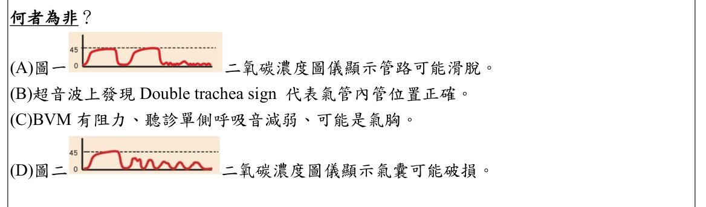
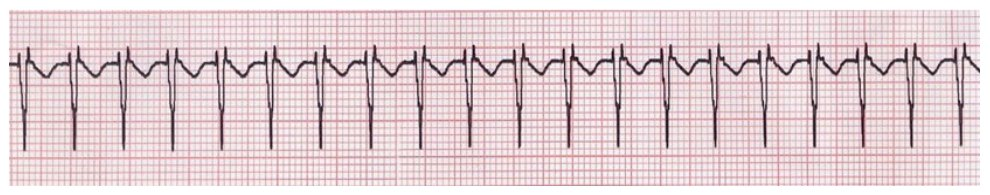
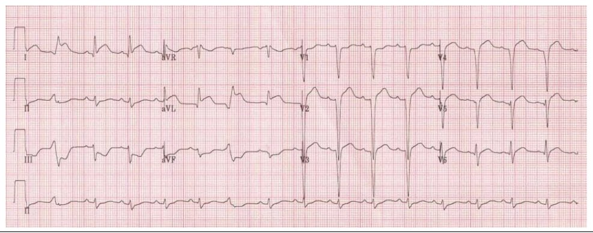
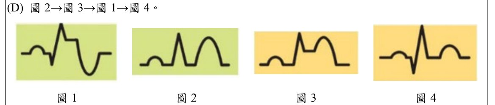
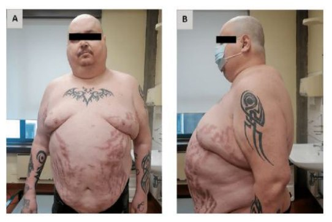
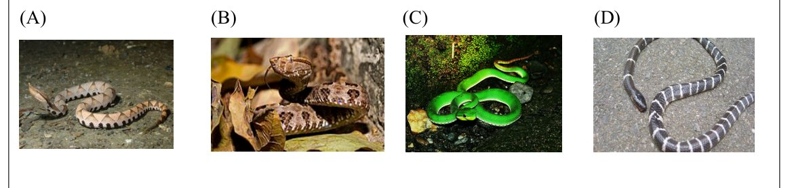
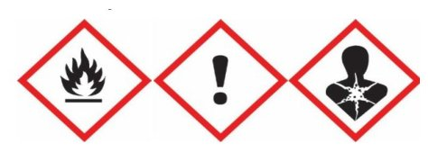

# 112 年度高級救護技術員甄試筆試 題目卷

> 單選題，共 100 題。答案在 [`答案_108-114年.md`](答案_108-114年.md)，作答完再對。

### 1. 建立完善的緊急醫療救護體系須從四個面向努力，下列有關四個面向的敘述，何者為是？

- (A) 卓越領導：依緊急醫療救護法第25 條，建立醫療指導制度，由醫療指導醫師領導緊急醫療救護體系發展。
- (B) 完整系統：完整系統的要素，舉凡人才招募、教育訓練、醫療設施、品質管理等，都必須逐項建立。
- (C) 健全財務：公家機關資源有限，民間資源無窮，訓練經費與器耗材不足等的資金缺口都可依賴募款補足。
- (D) 妥善立法：依緊急醫療救護法第2 條，社區緊急醫療救護系統之運作，主管機關在各縣市，相關法規應由各縣市自行立法。

### 2. 有關法律與救護倫理的敘述，下列何者為非？

- (A) 法律是這個社會評價中的最低標準，符合倫理的行為必定為合法的行為。
- (B) 對於同樣的困境，每個人會有不同的倫理價值判斷，也不一定具有標準答案。
- (C) 道德觀是建構個人倫理價值的重要元素。每個人的倫理標準也會因為道德觀的不同而有所差異。
- (D) 透過經常的練習及不斷的思考，有助於個人在面對倫理困境時，迅速做出判斷及採取適當的行動。

### 3. 消防隊員小志支援火警任務。現場發生閃燃，分隊很照顧他的資深學長不幸往生。事發後小志腦裡還常浮現閃燃和急救學長的畫面，不斷地出現自責、生氣、失眠的現象，也不願意靠近救護車。請問您覺得小志怎麼了還有可以如何幫助他的以下敘述，何者最為正確？

- (A) 事件造成小志極大的痛苦並且影響到日常生活，可能會持續一個月以上。
- (B) 事發了解小志曾罹患焦慮症， 但這病史不會讓他更容易得到創傷後壓力症。
- (C) 經歷嚴重的創傷事件後，出現短期急性壓力症是常見的，不用擔心。
- (D) 創傷後壓力症與急性壓力症的首選治療方式為「藥物治療」，所以要陪同他盡快就醫服藥。

### 4. 根據高級救護技術員教科書(第二版)提到，當救護技術員遇到精神異常的救護時，應該快速地評估病人狀況，以下何者相對較不重要？

- (A) 主要求救原因。
- (B) 是否有攻擊行為。
- (C) 是否有自殺意圖或計畫。
- (D) 是否有精神病史。

### 5. 執行愛滋病病人救護時病人不配合， 救護員被尖銳物扎傷左手， 接著噴濺的血液飛入救護員眼中，關於處理流程建議何者正確？

- (A) 以肥皂及水清潔左手傷口，眼睛沖水即可，一周內向工作單位通報。
- (B) 被扎者並不需要立即檢測HIV，因為會有空窗期。
- (C) 預防性投藥不要超過72 小時，超過7 天則無預防效果。
- (D) 定期追蹤3 次抗體，3 個月後追蹤結果為陰性，即可排除感染之虞。

### 6. 第一反應員(first responder) 為緊急醫療救護系統中第一位到達現場的受過訓練之專業人員，下列敘述何者為非？

- (A) 透過社區層級的醫療反應及第一反應員的設立，可以改善時間急症患者的預後。
- (B) 第一反應員可以是消防人員、警察、民間救護人員、警衛安全人員或社區志工等。
- (C) 經過合格受訓的第一反應員，可以取代緊急醫療救護人員並提升社區存活率。
- (D) 辨識傷病人疾病的嚴重程度或受傷的情形為第一反應員的訓練的主要內容之一。

### 7. 關於派遣員協助心肺復甦術(Dispatcher Assisted CPR，以下稱DA-CPR)敘述，何者正確？

- (A) 研究顯示，在緊急救護人員接觸病人之前，旁觀者先執行CPR，OHCA 病人的存活機率並無明顯提升。
- (B) 在辨識階段，派遣員必須詢問兩個關鍵問題「意識是否清醒？」以及「呼吸是否正常？」。
- (C) 派遣員執行DA-CPR 時需要另一端的報案者積極配合，並且學過CPR，才能為突發性心跳停止的病人爭取更佳的救活機率。
- (D) 詢問句型「 有無呼吸」與「有無正常呼吸」，對於同一病人這兩個問題的OHCA 辨識率相似。

### 8. 有一種果實，食用方式是咀嚼與唾液混和後吐出，咀嚼後很快會有提神的效果，服用過量會產生分泌物增加、縮瞳、緩脈、支氣管痙攣，下列以藥理學敘述吃的過程何者為非？

- (A) 吸收方式為口腔內吸收。
- (B) 植物鹼會經過肝臟首渡效應再進入循環系統。
- (C) 以症狀來看檳榔毒性應該是乙醯膽鹼。
- (D) 長期越吃越多才有提神效果是因為適應性(tolerance)。

### 9. 插管病人運送途中常常會發生血氧下降、ETCO2 異常，以下關於插管後的評估照護的敘述何者為非？

- (A)圖一二氧碳濃度圖儀顯示管路可能滑脫。
- (B)超音波上發現Double trachea sign 代表氣管內管位置正確。
- (C)BVM 有阻力、聽診單側呼吸音減弱、可能是氣胸。
- (D)圖二二氧碳濃度圖儀顯示氣囊可能破損。

### 10. 下列哪一個疾病最不可能因分流(Shunt)而導致低血氧？

- (A) 吸入型肺炎。
- (B) 化學性肺炎。
- (C) 急性肺水腫。
- (D) 肺栓塞。

### 11. 一位罹患慢性阻塞性疾病病人，主訴呼吸喘。臨床發現雙側有哮喘音(Wheezing)，病人未使用氧氣時，血氧濃度88%。以下敘述，何者為非？

- (A)病人噘嘴呼吸，肋間肌凹陷，有呼吸窘迫現象。
- (B)病人有下呼吸道阻塞現象。
- (C)可考慮使用Ventri-mask(凡德里面罩)，以提供低流速、高濃度氧氣。
- (D)考慮給予吸入型支氣管擴張劑。

### 12. 關於潮氣末二氧化碳濃度的臨床應用，何者為非？

- (A) 正常潮氣末二氧化碳分壓值(EtCO2)為45~50 mmmHg。
- (B) 可評估CPR 的按壓品質，並確認是否恢復自主循環。
- (C) 嚴重低體溫的病人，潮氣末二氧化碳分壓值可能偏低。
- (D) 嚴重頭部外傷的病人，潮氣末二氧化碳分壓值可能偏高。

### 13. 以下對於人體神經系統的描述，何者為非？

- (A) 自律神經系統的神經傳遞物質中，最常見的是多巴胺（Dopamine）。
- (B) 許多藥物或毒物，都是由類似神經傳遞物質，或阻礙神經傳遞物質的構造而產生作用的。
- (C) 延髓是人體的生命中樞，包括多項生命中樞，如心臟血管中樞、呼吸節律中樞、吞嚥中樞、嘔吐中樞等。
- (D) 交感神經系統，主要負責人體在面對壓力的反應。

### 14. 以下對於「酸鹼不平衡」中，對應的檢驗、症狀、原因與處置，何者為非？

- (A) 呼吸性酸中毒：pH<7.35，常見於換氣不足，可利用機器輔助呼吸改善。
- (B) 代謝性酸中毒：深且快的庫式呼吸、應根據病因給予治療。
- (C) 呼吸性鹼中毒：感覺麻木、通常因為過度換氣使得血中氧氣減少造成。
- (D) 代謝性鹼中毒：pH>7.35，可因為大量嘔吐，胃酸流失造成。

### 15. 根據六到十二歲學齡兒童發展的里程碑，我們會發現到這時期的兒童發展有不同的重點。關於這些重點，下列敘述，何者為非？

- (A) 體重的增加開始以肌肉為主而非脂肪；力量增加。
- (B) 孩子的道德邏輯推理能力建立。
- (C) 雙親通常陪伴孩子的時間增加。
- (D) 孩子逐漸理解死亡的概念。

### 16. 55 歲男性病人突然意識改變與全身抽搐。您到達現場時，病人仍意識不清無法溝通並嘴角抽動，請問此時最適合的醫病互動模式為何？

- (A) 「主動—被動」模式。
- (B) 「指導—合作」模式。
- (C) 「共同參與」模式。
- (D) 「遵從法規」模式。

### 17. 55 歲男性病人主訴早上起床後發現自己右側肢體無力。您到達後與病人採用「SOAP」溝通模式，下列描述哪一項屬於「O」的敘述？

- (A) 早上起床病人表示發現自己右側無力。
- (B) 請病人雙手平舉，發現病人右手明顯下垂。
- (C) 最後一次正常時間為昨晚10 點睡覺前。
- (D) 過去病史有高血壓。

### 18. 您和一位資深救護員接獲一趟行為急症的救護，現場為35 歲女性，左手前臂多處刀傷，病人一直在哭泣，反覆大喊；｢我是沒有用的人，不如早點離開人間。｣。和您一起出勤的學長，走到病人身邊，蹲下輕拍病人肩膀，和病人說：｢您願不願意和我多聊聊？跟我多說一些？｣。此學長所利用的溝通技巧為何？

- (A) 促進(facilitation)。
- (B) 反射(reflection)。
- (C) 澄清(clarification)。
- (D) 同理心(empathic responses)。

### 19. 以下呼吸模式與對應的可能的臨床疾病組合，何者正確？

- (A) 庫斯毛耳氏呼吸 (Kussmaul respiration) – 慢性阻塞性肺病。
- (B) 陳施氏呼吸 (Cheyne-Stokes respiration) – 糖尿病酮酸中毒。
- (C) 逆理式呼吸 (paradoxical respiration) – 呼吸衰竭。
- (D) 畢歐氏呼吸 (Biot’s respiration) – 大腦損傷。

### 20. 病人主訴頭暈及嘔吐，對於協助區分此病人為中樞型或周邊型眩暈之相關檢查何者為非？

- (A) 病人以腳跟接著腳尖連續直線行進(tandem walking)。
- (B) 病人以手指頭摸鼻子接著摸您的手指頭之反覆點對點運動(point-to-point movement)。
- (C) 觀察患者眼球活動，檢查患者眼球活動及眼震方向。
- (D) 利用叩診槌檢查患者深部肌腱反射(deep tendon reflexes)。

### 21. 當您出勤派遣救護時，收集及彙整有關現場環境、主訴、病史及實施初評等病人資訊，為執行關鍵思考之哪一步驟？

- (A) 資料判讀。
- (B) 概念形成。
- (C) 應用原則。
- (D) 反應評估。

### 22. 關於成人基本救命術(basic life support)目前的科學證據與急救指引，以下敘述何者最適當？

- (A) 因心室顫動或無脈性心室頻脈的OHCA 病人，每延遲一分鐘的心肺復甦術會使存活率下降17~20%。
- (B) 電擊去顫前，目擊者有施行心肺復甦術，OHCA 病人的存活率下降會比較慢，大約每分鐘降3~4%。
- (C) 高品質心肺復甦術包含盡量減少中斷壓胸時間，是指胸部按壓時間須佔所有搶救時間的50%以上。
- (D) 從病人心跳停止導致腦部沒有血液供應的那一刻起，10 分鐘後腦細胞就會因為缺氧而開始分解破壞。

### 23. 在復甦醫學的新進展中，關於葉克膜體外維生系統(Extracorporeal Membrane Oxygenation，ECMO)的敘述，下列敘述最不適當？

- (A) ECMO 對於急性心衰竭的病人，可有效改善心臟收縮功能，增加組織灌流改善循環。
- (B) VV-ECMO 取代肺臟氣體交換的功能，對心臟的循環沒有助益，只能用在肺部疾病病人。
- (C) VA-ECMO 將靜脈血經氣體交換後送回到病人動脈，可用於心臟衰竭或肺功能衰竭的病人。
- (D) 頭頸部外傷併顱內出血72 小時內、缺氧至腦部嚴重受損為不適用於葉克膜的禁忌症。

### 24. 下列有關爆炸傷的描述，何者為是？

- (A) 爆炸傷是複合性傷害，但並非所有爆炸傷都會經歷所有階段。
- (B) 爆炸傷第一階段傷害為燒傷。
- (C) 因爆炸彈出之患者，並非全部都視為頸椎受傷傷患。
- (D) 到達爆炸現場，應先將患者救出避免再次爆炸進而造成患者二次傷害。

### 25. 依美國外科醫學會外傷委員會所修訂之現場檢傷分類指引，下列哪一名患者最應優先送往創傷中心？

- (A) 廚師切肉不慎將左手食指切斷。
- (B) 80 歲老人走路不慎跌倒，有服用抗凝血劑。
- (C) 懷孕18 週孕婦車禍。
- (D) 時速15 公里車禍之機車駕駛。

### 26. 依據PHTLS 的初級評估，下列部位發現創傷大量外出血(Exsanguinating hemorrhage)時的立即止血方式，何者最不適當？

- (A)前臂：止血帶。
- (B)腋下：止血紗布和壓力敷料。
- (C)頸部：傳明酸 (Tranexamic acid)靜脈注射。
- (D)腹股溝處：肢幹交界型(junctional)止血帶。

### 27. 下列有關休克傷患到院前的評估與處置的描述，何者為是？

- (A) 到院前使用靜脈輸液，是否會提高休克傷患存活機率，目前尚無定論，故晶質或膠質輸液通常保留至到院後再給予，不建議使用於到院前。
- (B) 若有需要使用晶質溶液，應以溫暖的的晶質溶液進行急救，林格氏乳酸溶液為輸液首選，其次為生理食鹽水溶液。
- (C) 靜脈輸液的流速與留置導管的內徑呈現4 次方正比(即導管內徑增為2 倍，最大流速可提高為16 倍)、與導管的長度成正比。
- (D) 老年傷患對副交感神經刺激反應較差，因此失血造成的心跳加速或心收縮力增加不如年輕人顯著，因此老人傷患需早期進行積極復甦及監測。

### 28. 您抵達一名機車騎士騎車自撞路樹的車禍現場，傷患意識清楚無頸部疼痛或是上肢不適情形，但是呼吸淺快，血氧90%、臉色蒼白、皮膚明顯濕冷、脈搏較弱、腹部紅腫併明顯壓痛，左小腿有瘀青合併明顯變形，請問下列何者是您最應先做的處置？

- (A) 左小腿骨折固定。
- (B) 現場幫病人打點滴。
- (C) 給予氧氣協助呼吸。
- (D) 擦傷傷口包紮。

### 29. 出血性休克傷患，若對初始輸液反應不佳，則需要考慮輸血。下列有關輸血時的注意事項，何者為非？

- (A) 血品的選擇：對於有懷孕能力的婦女，為避免母體產生抗體，造成將來懷孕時之併發症，建議可使用O 型Rh 陰性血輸血。
- (B) 避免低體溫：最有效避免大量輸血或輸液後低體溫的方法，是輸液前先將輸液加熱至39°C，晶質液可使用微波加熱及血液可放在保溫器加熱。
- (C) 大量輸血：預測需要大量輸血的方法為ABC score，其內容包含心跳>100 次/分，血壓<90mmHg，穿刺傷及FAST 超音波呈陽性，符合2 項或以上。
- (D) 凝血功能異常：嚴重創傷出血可能會快速消耗凝血因子，大量輸液亦會造成血小板及凝血因子被稀釋而影響功能，低體溫則可能影響血小板凝集。

### 30. 一位24 歲男性騎機車自撞電線杆，您抵達現場時發現傷患安全帽已脫落，頭部雖無出血變形，但嘴唇撕裂傷合併口腔變形，病人持續出血躁動，請問下列處置何者最不適當？

- (A) 放置口咽呼吸道以維持暢通。
- (B) 準備大口徑的抽吸管抽吸，避免肺部吸入性傷害。
- (C) 使用下頷推擠法暢通呼吸道並給予頸椎固定。
- (D) 若傷患因呼吸困難躁動無法配合戴頸圈，維持呼吸道暢通比頸椎固定重要。

### 31. 您接獲指揮中心通報，據同車友人表示，病人開車自撞山壁後意識不清，但您抵達現場後發現病人意識清楚，主訴頭部疼痛，理學檢查發現頭部有5 公分撕裂傷合併頭皮血腫，其餘各部分都無明顯外傷，後續轉送至醫院後，病人於留院觀察中突然失去意識、肢體癱瘓。請問有關此傷患最可能的傷害何者正確？

- (A) 硬腦膜上出血 (epidural hemorrhage)。
- (B) 硬腦膜下出血 (subdural hemorrhage)。
- (C) 蜘蛛膜下腔出血 (subarachnoid hemorrhage)。
- (D) 腦內出血 (Intracerebral hemorrhage)。

### 32. 關於眼睛損傷的描述，下列何者最不適當？

- (A) 若被強酸、強鹼灼傷，需儘快以大量清水沖洗。
- (B) 支配眼球運動的肌肉受傷時，可能產生複視的現象。
- (C) 眼球挫傷後的瞳孔反應不正常，最常見的原因是第三對腦神經損傷。
- (D) 眼睛被化學物品灼傷時，可在醫療指導醫師指示下，將隱形眼鏡拔除。

### 33. 下列有關於頸部創傷的敘述，何者為非？

- (A) 高位頸椎創傷須密切注意傷患使否進展至呼吸衰竭。
- (B) 罹患中央脊髓症候群(central cord syndrome)的傷患，可能有四肢輕癱現象，且上肢較下肢嚴重。
- (C) 根據加拿大頸椎守則(Canadian C-Spine Rule，簡稱CCR)，清醒且生命徵象穩定的傷患，即使沒有頸椎損傷的高危險及低危險因素，CCR 建議應令傷患自行轉動頸部才能排除頸椎損傷。
- (D) 脊髓性休克(spinal shock) 主要機轉為脊髓受傷導致交感神經受到影響，交感神經失去對血管的控制，引起全身性的血管擴張，治療為適度輸液，必要可以適度使用升壓劑。

### 34. 關於下列胸部創傷的描述，下列何者為是？

- (A) 創傷性主動脈剝離，最常好發處為升主動脈。
- (B) 氣管支氣管破裂，以肺內細支氣管破裂最常見。
- (C) 心臟震盪(commotio cordis)的傷患，最常見的心律是心室顫動。
- (D) 創傷性窒息，常見受壓迫位置以下皮膚呈現藍紫色，而以上的皮膚顏色正常。

### 35. 30 歲男性自述右胸中彈，無肢體大出血，呼吸速率正常，經檢視後發現右胸壁前後各有一開放性傷口，給予塑膠包裝貼三邊覆蓋傷口後送醫，但在送醫途中傷患突然意識變化、呼吸急促。請問有關此患者相關處置，下列何者最不適當？

- (A) 再次檢查胸腹部是否有其他傷口。
- (B) 執行延伸性創傷超音波(e-FAST)評估傷患病情改變原因。
- (C) 移除傷口原塑膠包裝改用急救填塞止血敷料。
- (D) 若是評估為張力性氣胸，在第五肋間腋中線前側給予針刺減壓。

### 36. 關於胸部創傷敘述，下列何者為是？

- (A) 執行超音波e-FAST，在劍突處進行掃描，主要是確認橫膈膜是否破裂。
- (B) 執行胸部超音波時看到條碼徵候（barcode sign）表示傷患可能有氣胸的情形。
- (C) 發現開放性氣胸時，應進行針刺減壓，減低胸內壓力。
- (D) 針刺減壓時應選擇第五肋間腋中線前側肋骨下緣下針。

### 37. 50 歲男性駕駛汽車發生交通事故，因車體變形受困車內，脫困後膚色蒼白、呼吸淺快，請問以下哪個徵候會讓您最合理懷疑傷患可能有脾臟損傷？

- (A) 腰部瘀青(Turner sign)。
- (B) 肚臍周圍瘀青(Cullen sign)。
- (C) 右上腹挫傷。
- (D) Kehr 徵象(Kehr sign)。

### 38. 23 歲男性工地高處跌落，右下腹遭巨型鋼片穿刺留於腹壁上，下列關於腹骨盆創傷評估與處置何者最不適當？

- (A) 血壓測量80/50 毫米水銀柱，直接給予大量生理食鹽水2 公升。
- (B) 穿刺傷口周圍出血，給予直接加壓止血，並嘗試固定穿刺物。
- (C) 按壓骨盆不穩定懷疑骨盆骨折，使用骨盆固定帶進行固定。
- (D) 評估患者出現休克徵候，呼吸急促，給予氧氣面罩使用。

### 39. 院前的FAST 超音波檢查可以改變20~30%外傷傷患的處置或後送，有關院前FAST 檢查腹部掃描的注意事項下列何者錯誤？

- (A) 注意掃描時需上、下仔細去檢查，而非只看一個面。
- (B) 掃描肝腎交界時把探頭橫放在右側肋骨下緣，腋前線的位置。
- (C) 掃描脾腎交界時把探頭橫放在左側肋骨下緣，腋後線的位置。
- (D) 掃瞄膀胱時探頭放在恥骨上緣，並把探頭往恥骨聯合方向掃描。

### 40. 下列有關骨骼肌肉創傷的敘述，下列何者為非？

- (A) 肩部創傷到院前評估處置重點為：評估有無合併神經及血管損傷、三角巾或八字肩帶固定、冰敷患處。
- (B) 肱骨遠端或中段骨折容易合併腋神經損傷。
- (C) 拳擊者骨折是因直接撞擊造成掌骨骨折，最常見為第五掌骨折。
- (D) 根據統計高處墜落跟骨骨折傷患中，10％會合併脊椎骨折；5％為雙側跟骨骨折。

### 41. 關於骨骼肌肉創傷，以下何者錯誤？

- (A) 腹部鈍挫傷中最常見的受傷器官是脾臟及肝臟。
- (B) 脫臼復位通常傷患會極度疼痛，因此不建議在現場執行。
- (C) 遇到截肢傷，應直接將斷肢放在冰上以增加保存及手術復原機率。
- (D) 在脫困出傷患、尤其在受壓迫超過4 小時以上，鬆開受壓迫的肢體前應給予大量靜脈輸液或使用碳酸氫鈉鹼化。

### 42. 50 歲女性駕駛汽車出車禍，初步評估中發現全身多處擦挫傷，左小腿變形合併有一處深部撕裂傷口，沒有持續出血，現場亦無明顯外出血。下列關於這位傷患處置，何者最不適當？

- (A) 若遠端脈搏摸不到，可考慮牽引移動到原解剖位置。
- (B) 牽引過程中，傷患明顯疼痛或過程中有阻力時應停止動作。
- (C) 發現為開放性骨折，將外露的骨折或軟組織塞回傷口內。
- (D) 搬運過程中傷口開始出血，加壓仍無法控制出血，打上止血帶。

### 43. 關於燒燙傷與電灼傷，下列描述何者最不適當？

- (A)當傷患有顏面灼傷、鼻毛燒焦、呼吸有喘鳴聲 (stridor)、聲音沙啞時，要高度懷疑有呼吸道灼傷。應考慮儘早放置氣管內管。
- (B)嚴重燒燙傷傷患之輸液補充，可採修正後布魯克公式 (modified Brooke formula)：初始24小時靜脈輸液量 = 2ml/公斤體重 × 傷患體重 × 灼傷面積(無計入一度燒傷面積)。
- (C)若閃電傷害現場同時造成多位傷患，應優先急救呼吸中止者(不論有無脈搏)。
- (D)若暴露在粉末之化學物質情況下，應儘快用清水或生理食鹽水沖洗，以免粉末持續對皮膚產生化學性灼傷。

### 44. 搜救人員將傷患從火場中抬出，患者表示胸口很痛，呼吸不順，右手前臂灼傷，下列處置何者最為適當？

- (A) 血氧量測96%，應先觀察患者狀況，再決定是否給予氧氣治療。
- (B) 傷患右前臂有一個手鍊，表示很有紀念價值，拒絕將其拿下來，協助將手鍊降溫。
- (C) 除了詢問基本病史外，應詢問搜救人員傷患所在位置，燃燒物質等。
- (D) 傷患從火場抬出，意識清楚可以講話，並持續表示胸口很痛，呼吸道正常，吸入性灼傷機會小。

### 45. 指揮中心通報，化工廠有一名員工接觸到不明物質，請您協助前往救護。有關此病人的處置與敘述何者為是？

- (A) 到場發現患者身上有不明白色粉末，雙手暴露有紅腫起水泡，立即使用大量清水沖洗。
- (B) 鹼性燒傷通常比酸性燒傷來的嚴重，因為強鹼性物質造成的傷害方式是液化性壞死。
- (C) 廠區員工查出化學物質後提供中和試劑，隊員應使用中和試劑來沖洗化學性灼傷的部位。
- (D) 眼睛遭受到鹼性燒傷初期，不建議使用乳酸林格氏液持續沖洗。

### 46. 某男於河堤路跑時不慎遭流浪犬隻攻擊造成臉部一處咬傷，請問咬傷的傷口處理原則下列敘述何者為非？

- (A) 給予抗生素治療。
- (B) 確實清洗傷口。
- (C) 給予破傷風治療。
- (D) 到院後傷口立即進行清創及縫合以免造成感染。

### 47. 反應複雜的凝血機制可以精要地分為三大基本步驟，下列何者為非？

- (A) 由受傷處釋放出血小板因子。
- (B) 凝血因子串聯反應形成凝血酶(thrombin)。
- (C) 凝血酶結合纖維蛋白原(fibrinogen)形成(血)纖維蛋白，進而網住紅血球形成血塊。
- (D) 血塊因血小板因子作用黏附後成形，大過傷口並將其完整封閉。

### 48. 男性50 歲，於家中因液化石油氣氣爆被救出，在爆炸傷五階段受傷機轉中，下列何者為非？

- (A) 耳膜可能破裂，溝通障礙時留意溝通方式調整及變換。
- (B) 呼吸急促，不能排除吸入性傷害可能性，適時給予氧氣治療。
- (C) 震盪與撞擊，可能有家具飛散撞擊或騰空後落地等傷害，必要時露身檢查。
- (D) 爆閃強光，須注意視力是否受影響，應給予紗布覆蓋雙眼保護。

### 49. 一名病人因蜜蜂螫傷後全身紅疹過敏送醫，途中開始呼吸喘且出現喘鳴音(Stridor)，血氧濃度下降，下列何者為此病人呼吸困難最可能的成因？

- (A) 通氣。
- (B) 擴散。
- (C) 灌流。
- (D) 滲透。

### 50. 關於肺栓塞之敘述，下列何者為是？

- (A)血栓會造成肺靜脈系統堵塞，造成病人有低血氧的症狀產生。
- (B)靜脈疾病為肺栓塞危險因子之一，而骨盆以及下肢靜脈系統為最常形成血栓的部位。
- (C)肺栓塞病人最常見的表現為心電圖S1Q3T3 與右側束支傳導阻滯(RBBB)。
- (D)對於高度懷疑急性肺栓塞之病人，可依預立醫囑於院前給予抗血小板藥物。

### 51. 下列對於肺氣腫病人臨床症狀的描述，何者為非？

- (A) 胸廓拉長、桶狀胸。
- (B) 發出哮鳴音(wheezing)及乾囉音。
- (C) 體重增加、身形肥胖。
- (D) 膚色呈現粉紅色。

### 52. 阻塞性呼吸道疾病是三種不同疾病的統稱，分別是慢性支氣管炎、肺氣腫以及氣喘，關於此疾病下列敘述何者為是？

- (A) 在氣喘及慢性支氣管炎病人身上，肺泡不能吐出空氣是因為肺泡壁受到破壞和失去回復的彈力，造成吐氣時氣道的狹窄。
- (B) 在肺氣腫病人身上，肺泡不能吐出空氣是因為黏液塊和氣道狹窄造成吐氣時氣體無法流出而造成肺泡過度擴張。
- (C) 慢性支氣管炎的病人在吸氣跟吐氣時都會有呼吸道阻力升高的現象，但肺氣腫的病人卻只有在吐氣時才會有呼吸道阻力升高的情形。
- (D) 肺氣腫的病人會出現紅血球增生(polycythemia)的情形，這在慢性支氣管炎的病人中並不常見。

### 53. 病人因急性呼吸衰竭被插上氣管內管使用呼吸器，但氧氣濃度持續下降，關於可能原因下列何者最不適當？

- (A) 氣管內管放置位置錯誤。
- (B) 呼吸道因痰塊阻塞。
- (C) 因插管通氣引起氣胸。
- (D) 鎮靜藥物造成呼吸抑制。

### 54. 58 歲男性，有高血壓、糖尿病等過去病史，因半小時前發現右側肢體無力報案，對於此病人之到院前處置，下列敘述何者為非？

- (A) 若病人意識清楚，可以排除低血糖情形，不需要測量血糖。
- (B) 可以用洛杉磯到院前腦中風評量表(LAPSS)，協助評估病人是否可能為腦中風。
- (C) 若病人有低血壓狀況，應將主動脈剝離列為可能之鑑別診斷。
- (D) 將此病人送醫時，應直接送至可以給予血栓溶解劑的醫院。

### 55. 腦脊髓液的產生處及流動路徑何者為是？

- (A) 由側腦室流向第二腦室，經由大腦導水管通向第三腦室，最後流入蜘蛛網膜上腔，再藉由蜘蛛膜絨毛被吸收進入血管。
- (B) 由側腦室流向第三腦室，經由大腦導水管通向第四腦室，最後流入蜘蛛網膜上腔，再藉由蜘蛛膜絨毛被吸收進入血管。
- (C) 由側腦室流向第二腦室，經由大腦導水管通向第三腦室，最後流入蜘蛛網膜下腔，再藉由蜘蛛膜絨毛被吸收進入血管。
- (D) 由側腦室流向第三腦室，經由大腦導水管通向第四腦室，最後流入蜘蛛網膜下腔，再藉由蜘蛛膜絨毛被吸收進入血管。

### 56. 救護現場1 名55 歲女性主訴一小時前開始心悸，身體無其他任何不適，經量測生命徵象GCS15 分，血壓：121/70mmHg，心電圖監測如下，針對該病人的評估及處置何者最適當？

- (A) 經靜脈給予adenosine 6mg 緩慢推注。
- (B) 該名患者的心律可能為心房顫動(atrial fibrillation)。
- (C) 可考使用慮迷走神經刺激術(vagal maneuvers)。
- (D) 給予amiodarone 150mg 靜脈快速注射。

### 57. 依據下圖心電圖判斷，最可能屬於何種區域之心肌梗塞？

- (A) 前壁 (Anterior wall)。
- (B) 側壁 (Lateral wall)。
- (C) 後壁 (Posterior wall)。
- (D) 下壁 (Inferior wall)。

### 58. 下列四張心電圖分別代表心肌梗塞不同時期變化，請依時序排出正確順序。

- (A) 圖4→圖3→圖2→圖1。
- (B) 圖2→圖1→圖3→圖4。
- (C) 圖4→圖2→圖1→圖3。
- (D) 圖2→圖3→圖1→圖4。

### 59. 有關心電圖判讀，下列敘述何者為非？

- (A) 心肌缺血可能會出現T 波反轉的心電圖變化。
- (B) 肺動脈狹窄常導致右心房擴大，造成心電圖中P 波變高。
- (C) 左心房擴大時，會形成P mitrale，常見於肢體導程。
- (D) 一般正常的心室去極化時，胸前導極R 波的大小將逐漸變小，而S 波則逐漸變大。

### 60. 40 歲男性無過去病史，因全身無力一個月報案，現場初步評估無休克現象，但病史詢問部分發現病人最近有體重增加，皮膚容易瘀青出血，視野模糊問題，其外觀如下圖所示，請問此病人如產生視野缺損，最有可能產生哪種型態視野缺損？

- (A) 雙眼顳側視野缺損。
- (B) 雙眼鼻側視野缺損。
- (C) 單眼視野缺損。
- (D) 一眼鼻側，另一眼顳側視野缺損。

### 61. 關於高滲高血糖非酮酸症候群(HHNS)及糖尿病酮酸血症(DKA)，以下敘述何者錯誤？

- (A) HHNS 比起DKA 病人發病時通常血糖濃度較高。
- (B) HHNS 比起DKA 通常體內製造胰島素較少。
- (C) HHNS 比起DKA 通常疾病形成時間較慢。
- (D) HHNS 比起DKA 病人年紀通常較高。

### 62. 當人體內的紅血球數目或血紅素不足時，就會出現貧血的症狀，針對貧血的敘述何者正確？

- (A) 造成貧血的常見原因可分為紅血球的製造出問題或是紅血球的破壞增加。
- (B) 貧血本身是一個疾病的診斷、可能會有會有頭暈目眩、蒼白、氣喘、心悸等症狀。
- (C) 臨床上不論何種貧血種類皆不會干擾到脈衝式血氧計的判讀。
- (D) 貧血症狀和它的成因、輕重程度、及進展的速度與是否合併其他疾病無關。

### 63. 人體的血液量約佔體重的1/13，主要是由血漿和血球所組成，關於血漿和血球的描述何者正確？

- (A) 血球可分為紅血球、白血球和血小板，其中又以白血球為最多。
- (B) 血漿的主要成分是水與蛋白質，以及無機鹽類和有機物。
- (C) 血球佔所有血液組成的70~75%。
- (D) 血漿是含有多種物質的液體，呈紅色。

### 64. 根據下列各種白血球分類計數，相對應對抗致病菌功能，下列何者為非？

- (A) 嗜中性白血球(neutrophil) 85%，臨床上偏向細菌感染。
- (B) 嗜酸性白血球(eosinophil) 15%，可能為寄生蟲感染。
- (C) 單核球(monocyte) 15%，可能為結核菌感染。
- (D) 淋巴球(lymphocyte) 60%，臨床上偏向過敏反應。

### 65. 肥大細肥和嗜鹼性細胞內的去顆粒化，會釋放出誘發過敏反應的物質，下列物質何者為非？

- (A) 組織胺。
- (B) 白三稀素。
- (C) 肝素。
- (D) 抗凝血因子。

### 66. 下列有關泌尿急症描述，何者錯誤？

- (A) 尿滯留會導致老人家譫妄。
- (B) 泌尿道結石好發於女性，需區別是否為婦產科急症。
- (C) 腎盂腎炎發生時，病人通常會有強烈的疼痛感(flank knocking pain)。
- (D) 有關泌尿道結石，台灣常見之結石種類以草酸鈣最多。

### 67. 泌尿道感染(Urinary Tract Infection, UTI)的定義是細菌在泌尿道滋生而產生感染的症狀。泌尿道感染大多是逆行性的感染，下列不屬於泌尿道感染？

- (A) 尿道炎。
- (B) 膀胱炎。
- (C) 腎盂腎炎(pyonephritis)。
- (D) 腎絲球腎炎(glomerular nephritis)。

### 68. 病原體進入體內後，帶有記憶能力並放出抗體來進行中和作用以避免進一步傷害的是？

- (A) 白血球。
- (B) 巨嗜細胞。
- (C) T 型淋巴球。
- (D) B 型淋巴球。

### 69. 關於局部皮膚冷傷害的描述，下列何者最不適當？

- (A) 吸菸、酒精及穿著限制性的衣服是皮膚冷傷害的加重因子。
- (B) 身體最容易發生凍瘡的部位為下肢。
- (C) 當處置患肢時，應以溫毯或其他回溫器材緩慢的回溫。
- (D) 大風、潮濕的環境以及病人本身的內科問題亦會加重傷害的程度。

### 70. 一位30 歲男性於東北角龍洞潛水50 米後因憋氣上升，至水面後立即喪失意識，呼吸急促，您是EMTP 到現場進行處置，下列何者最不適當？

- (A) 現場立即進行氣管內管插管。
- (B) 應該要考慮進行基本救命術與給予氧氣。
- (C) 病人的鑑別診斷可能是動脈氣體栓塞。
- (D) 應考慮送往高壓氧的醫療院所進行高壓氧治療。

### 71. 您獲派前往一山域救援行動。傷患資訊如下：女性，60 歲有糖尿病史，求救原因為天雨路滑不慎摔倒導致左前臂約2 公分撕裂傷及左側髖部挫傷以致於不能移動。傷患待援地點為該區最高點的一個涼亭。您接觸她的時候離受傷已過8 小時。關於此傷患最適當的評估與處置描述為何？

- (A) 病人意識清楚但可能因為疼痛無法順利進食，應立即建立含糖輸液之管路以避免低血糖。
- (B) 因病人無法順利自行移動，應優先尋求直升機吊掛撤離，以及早進行手術。
- (C) 應同時評估是否有因維持同一姿勢過久而產生壓瘡或橫紋肌溶解症的風險。
- (D) 若左前臂之撕裂傷已無出血，表示傷口無進一步感染，可不必再重新清創。

### 72. 當您執行野外救護進行長時間搬運時，應留意脊椎固定或是使用長背板運送的病人，可能會出現壓瘡或深部靜脈血栓。以下關於避免長時間搬運產生可能的傷害，在權宜安全與避免傷害間，下列做法何者最不適當？

- (A) 抬長背板時，不應讓身體兩側輪流抬高。
- (B) 固定病人時要讓下肢能夠活動。
- (C) 允許病人能夠在擔架上翻身。
- (D) 全身的抽氣式護木(vacuum splint)取代長背板。

### 73. 您被派遣到一個跳樓救助的現場，一名女性在十層樓高的陽台外揚言要輕生，情緒非常激動。請問在這個情形下，病人評估及處置技巧的敘述，下列何者為非？

- (A) 由於病人的思緒處在相當混亂的階段，採取讓病人回答「是」或「不是」的是非問題，以免刺激到病人的情緒。
- (B) 可以考慮減少外界對病人的刺激，並減少現場的噪音、光亮，維持相對舒適的環境會對控制病人有所幫助。
- (C) 憂鬱症病人最令人擔心的是自殺問題，據國內研究統計，自殺死者中97%生前有精神疾病。
- (D) 此類病人危急處置的目標包含穩定情勢或病人的情緒、善用現場的人力資源並使病人恢復正常情緒。

### 74. 在確立精神疾病的診斷前，應先排除其他內科急症。下列診斷何者最不可能有類似躁症的臨床表現？

- (A) 紅斑性狼瘡。
- (B) 腎衰竭。
- (C) 吸食安非他命。
- (D) 低血鉀症。

### 75. 下列有關失智的敘述，何者錯誤？

- (A) 突然的情緒不穩或是令人尷尬的行為可能是失智症的第一個徵候。
- (B) 失智症通常和中風、基因、病毒或阿茲海默症有關。
- (C) 目前失智症只要好好配合醫師治療，是可回復的。
- (D) 失智有時和譫妄不好區分，如果病人本身的病史可能不可靠，先把病人當成譫妄來處置，因為這可能是危及生命的急症。

### 76. 下列針對老年病人的敘述，何者為是？

- (A) 譫妄(Delirium)的症狀包含注意力變差、失去定向感及意識清醒程度時好時壞等，病程緩慢發展，是一種慢性且不可逆的老年疾病。
- (B) 白內障是老年病人常見的眼疾之一，機轉為眼內壓上升造成視神經受傷，通常發生於雙眼，但不會造成全盲。
- (C) 老年病人有動脈粥狀硬化疾病會造成高血壓，高血壓定義為血壓持續大於140/90mmHg，且常以非典形症狀表現出來(如頭痛、健忘等)。
- (D) 老年傷患在遭遇胸部外傷時，加減速傷害應考慮主動脈剝離，但主動脈剝離通常不會立即死亡，適當的評估和治療可以挽救其生命。

### 77. 有關兒童族群的院外心跳停止(OHCA)處置與敘述，下列何者為非？

- (A) 嬰兒OHCA 幾乎皆為呼吸問題導致，故不使用AED 或電擊器，以提升急救效率。
- (B) 兒童急救時，胸外按壓的建議深度為胸廓前後徑的三分之一，大約為5 公分。
- (C) 兒童OHCA 靜脈管路難以建立時，替代給藥途徑為骨內注射或從氣管內管給予。
- (D) 因呼吸問題為常見原因，故尚未建立進階呼吸道時，雙人操作的按壓通氣比為15:2。

### 78. 派遣時告知為一名8 個月大的嬰兒(2 公斤)，失去呼吸心跳。此時急救的處置下列何者正確？

- (A) 單人急救時，壓胸及正壓給樣比例為15:2。
- (B) 插管Endo 尺寸選擇為3.0 有氣囊，深度為12cm。
- (C) 靜脈給藥Epinephrine(1:10000) 為0.2mg。
- (D) 氣管內管給藥Epinephrine(1:10000) 為0.2mg。

### 79. 下列有關新生兒急救時的擺位與呼吸道清理的相關敘述，何者為是？

- (A) 新生兒出生後，建議常規性進行口、鼻的抽吸，以確保呼吸道暢通。
- (B) 進行呼吸道抽吸的步驟，建議以吸球先抽吸鼻部，再做口部的抽吸。
- (C) 為了維持呼吸道通暢，可將毛巾置於新生兒的枕部，以保持嗅吸姿勢。
- (D) 目前準則並不建議常規性地為羊水胎便染色的新生兒進行呼吸道抽吸。

### 80. 關於婦產急症，下列何者最為適當？

- (A) 如發生產後大出血，讓胎兒吸吮媽媽乳頭是可以考慮的處置。
- (B) 如有監測裝備，孕婦OHCA 建議同時監測胎兒心跳。
- (C) 子癇前症通常發生在懷孕的第三期，癲癇發作時可以給予硫酸鎂。
- (D) 胎盤早期剝離最常發生於懷孕第二期會有突然的無痛大出血。

### 81. 30 歲女性，懷孕30 週，騎機車與小客車擦撞，您到現場發現她全身多處有擦傷，右下肢腫脹變形，主訴腹部疼痛。初步生命徵象：意識略顯焦躁，血壓85/40 mmHg，脈搏140 次/min，血氧濃度為99%。胎心音監測胎兒心跳為110 次/min。關於孕婦創傷的處置，下列敘述何者最為適當？

- (A) 常規給予氧氣並無益處，此病人血氧99%不建議給予氧氣治療。
- (B) 此病人出血量預估至少30%，建議盡快進行輸血。
- (C) 腹部疼痛須注意是否有子宮破裂或胎盤前置等情形。
- (D) 懷孕婦女不建議施打破傷風疫苗，避免造成畸胎。

### 82. 口服以下哪一種物質中毒，是可以考慮給予活性碳除污？

- (A) 氰化物(cyanide)。
- (B) 酒精中毒(ethanol intoxication)。
- (C) 鋰鹽(lithium)。
- (D) 鴉片類止痛藥(opioids)。

### 83. 下列何種毒蛇之蛇毒為單純的神經毒？

- (A)（見上圖）
- (B)（見上圖）
- (C)（見上圖）
- (D)（見上圖）

### 84. 有一名患者吸食過多海洛英(heroin)，到院後要給予何者解毒劑？

- (A) Acetylcysteine。
- (B) Benzodiazepines。
- (C) Flumazenil。
- (D) Naloxone。

### 85. 工廠爆炸多人被救出，現場採START/JumpSTART 檢傷，其中rapid treatment 快速治療，何者不是？

- (A) 暢通呼吸道。
- (B) 直接加壓止血。
- (C) 給予胸封貼。
- (D) 給予人工呼吸。

### 86. 事故指揮系統(Incident Command System，ICS)將事故指揮官下轄的工作人員區劃為管理幕僚(management staff)與功能幕僚(supportive staff)兩大類型。對於規劃在管理幕僚的人員裡，下列何者為非？

- (A) 發言官(Public Information Officer，PIO)。
- (B) 安全官(Safety Officer)。
- (C) 聯絡官(Iiaison Officer)。
- (D) 財務官(Finance Officer)。

### 87. 有關輻射災害現場救護的觀念，下列何者為非？

- (A) 照護輻射污染的傷患，適當防護下，對救護人員、設備和設施不會有嚴重危害。
- (B) 輻射污染傷患，除污優先，醫療其次，避免後續醫療人員、醫療處所受輻射影響。
- (C) 有生命危險的傷患，應儘速後送至最近或最快可處理之醫院不限於核災急救責任醫院。
- (D) 傷患轉送前應脫除身上衣物，從頭到腳、從上而下的方式，剪下衣物，並向內捲。

### 88. 下列危害物質GHS 標示說明，何者為是？

- (A) 氧化性物質。
- (B) 刺激性物質。
- (C) 急毒性物質。
- (D) 爆炸性物質。

### 89. 有關大型活動醫療設站考量，可分為「人、事、時、地、物」5 個部份，以下考量何者為是？

- (A) 現場如需要高級救命術人力，一般要求高級救命術(ALS)小組或備有自動電擊器小組應在5 分鐘內到達活動的任何一個位置。
- (B) 醫療站的地點選擇以開放場所為佳，位置最好10 分鐘路程內可到達所有活動區域，醫療站對內及對外的動線要保持順暢及安全。
- (C) 大型活動在人群移動時容易產生傷病人，因此緊急醫療救護的規劃，至少應從活動開始前至活動結束1 小時。
- (D) 預估參加人數須先有初步粗略的估算，參加人員包含所有工作人員及觀眾，現場遊客人數無法預估，不列入考量。

### 90. 鳳凰馬拉松比賽在您所屬的縣市舉辦，在離抵達終點的500 公尺處，主辦單位無線電通報最近的救護站有一名30 多歲的男性突然目擊倒地，鄰近的跑者已經在執行CPR，請趕緊前往現場評估處置，下列描述何者最不適當？

- (A) 經救命術處置後的救活率可高達80%。
- (B) 經由自動體外電擊器治療的效果明顯。
- (C) 高級救命術小組應在十五分鐘內抵達活動。
- (D) 現場插管並給予氧氣亦是處置的方向。

### 91. 在台灣，每年皆有腸病毒重症的發生，下列有關腸病毒的敘述，何者為是？

- (A) 根據基因分A、B、C 三型，其中腸病毒71 型被歸類於人類腸病毒A 型。
- (B) 人類是唯一腸病毒的傳染來源。
- (C) 主要藉由腸胃道傳染及接觸傳染，不太會藉由呼吸道傳播。
- (D) 嬰兒急性心肌炎及成人心包膜炎由A 族克沙奇病毒引起。

### 92. 穿戴防護裝備越高等級的防護裝備會使活動更加的困難。因此永遠要有風險與利益的平衡分析，若已知將遭遇有飛濺危害的已知液體，但蒸氣接觸皮膚有害的可能性低時。請問您出勤前該如何選擇最適當之個人防護裝備？

- (A) A 級防護衣。
- (B) B 級防護衣。
- (C) C 級防護衣。
- (D) D 級防護衣。

### 93. 台灣位處地震帶上，地震災害頻傳，造成人員的傷亡及財產的損失。下列有關地震災害的敘述，何者為非？

- (A)地震的規模，在九二一地震後，重新修訂為七級。
- (B)根據世界各國的地震報告顯示，重大地震所造成的傷患，百分之六十以上都是在平常以外的醫療機構尋求治療。
- (C)地震災害造成的大量死亡，屍體沒有清理，除了環境上的臭味，同時也是疾病的來源。
- (D)台灣的地震，死亡人數最多的是西元1999 年的集集地震。

### 94. 依據台灣衛生福利部空中轉診審核中心之轉診申請表，對於申請空中緊急救護其適應症，以下何者為非？

- (A) 昏迷指數小於10。
- (B) 單手2 根以上手指碾碎性斷指。
- (C) 脊椎、脊髓嚴重或已導致肢體癱瘓的創傷。
- (D) 溺水、並併發嚴重呼吸系統病症。

### 95. 下列敘述空中救護所具備的優點，何者為非？

- (A) 縮短治療時間。
- (B) 降低死亡機率。
- (C) 降低運送風險。
- (D) 節省醫療資源。

### 96. 英國統計學家Sir Austin Bradford Hill 提出Bradford Hill criteria，來審查確認推定原因與研究結果，之間因果關係。包括條件何者為非？

- (A) 強度(strength)：有較大的相對風險(relative risk)。
- (B) 可逆轉性(reversibility)：降低曝露導致較小的疾病機率產生。
- (C) 時序性(temporality)：因在果前面發生。
- (D) 特異性(specificity)：數個因導致一個特定的果。

### 97. 緊急醫療系統研究可以有許多應用，例如收集相關資料來知道何種處置、技術或是設備比較有效，也可以用來回答臨床的問題，藉此改善整個系統。請問緊急醫療系統研究的實施標準方法下列何者為非？

- (A) 描述型方法。
- (B) 前瞻性方法。
- (C) 橫斷面方法。
- (D) 功能型方法。

### 98. 某縣市救護科決定對於所有胸痛病人都要做院前12 導程心電圖，請問他最可能是僅基於品質目標六大面向中的哪一項做出這個決策？

- (A) 有效(effectiveness)。
- (B) 傷病人為中心(patient-centeredness)。
- (C) 安全(safety)。
- (D) 效率(efficiency)。

### 99. 醫學教育學者Dr. David Kern 的著作「醫學教育課程發展六大步驟」，將臨床教育訓練的課程發展，具體的劃分出六個階段何者為非？

- (A) 第三階段：開發教學資源(resources developer)。
- (B) 第四階段：教育策略(educational strategies)。
- (C) 第五階段：課程執行與推廣(implementation)。
- (D) 第六階段：評估與回饋(evaluation and feedback)。

### 100. 以下哪一個行動顯著地有助於GAS 反饋模型的「分析」階段？

- (A) 提供練習時的影像紀錄或旁觀者筆記。
- (B) 鼓勵每個學員反思，討論為何會發生缺失。
- (C) 討論缺失會打擊團隊士氣，應盡量避免。
- (D) 應指派隊長提出演練缺失的解決方案。

---

## 作答區

| 題號 | 1 | 2 | 3 | 4 | 5 | 6 | 7 | 8 | 9 | 10 |
|---|---|---|---|---|---|---|---|---|---|---|
| 1–10 | | | | | | | | | | |
| 11–20 | | | | | | | | | | |
| 21–30 | | | | | | | | | | |
| 31–40 | | | | | | | | | | |
| 41–50 | | | | | | | | | | |
| 51–60 | | | | | | | | | | |
| 61–70 | | | | | | | | | | |
| 71–80 | | | | | | | | | | |
| 81–90 | | | | | | | | | | |
| 91–100 | | | | | | | | | | |
