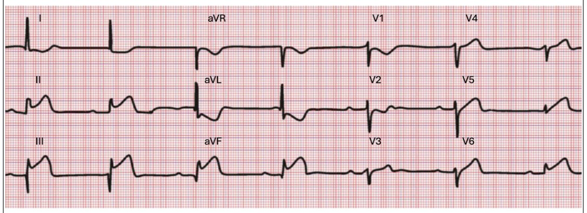
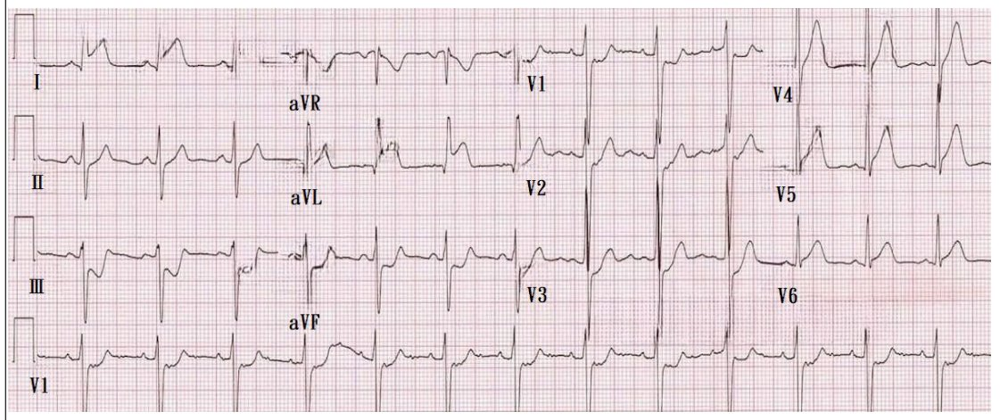

# 113 年度高級救護技術員甄試筆試 題目卷

> 單選題，共 100 題。答案在 [`答案_108-114年.md`](答案_108-114年.md)，作答完再對。

### 1. 關於救護紀錄表的填寫原則，以下何者最不正確？

- (A) 適時完成。
- (B) 詳細填寫。
- (C) 主觀呈現。
- (D) 保護隱私。

### 2. 發現有路倒民眾趕緊撥打119 報案，下列何者為最正確？

- (A) 根據優先派遣(priority dispatch)的觀念，優先派遣高級救護隊(ALS team)前往緊急傷病現場。
- (B) 救護技術員在現場治療的原則是「儘速送醫」Go and Play，爭取黃金時間。
- (C) 事件發生在離島，勤務中心派遣空中救護運輸作為緊急傷病初級運送。
- (D) 標準作業流程屬前瞻性的醫療指導，缺點是與救護過程不直接相關。

### 3. 有關救護技術員管理辦法於114 年所施行之新法，請問下列敘述何者最不正確？

- (A)「常見急症的評估、處置與情境操作」為救護技術員常見之情況，故新增於中級救護技術員的繼續教育課程中。
- (B) 高級救護技術員證書需每年24 小時以上，三年累計達96 小時才得以展延。
- (C) 抽吸呼吸道分泌物、血糖監測和十二導程心電圖使用為初級救護技術員可施行的新增救護項目。
- (D) 中級救護技術員可協助病患使用NTG 舌下含片和自備腎上腺素注射筆。

### 4. EMT 阿志過去無精神科病史，在參與大地震救災後三個月，開始對平時喜歡的釣魚失去興趣、經常鬱鬱寡歡、一點小事就感到憤怒、會不斷地出現事件的痛苦回憶與情緒，即使換單位這個情況仍持續了一年多，下列敘述何者為最適當？

- (A) 阿志經歷創傷事件後的這些情況首先考慮急性壓力症(Acute Stress Disorder，ASD)。
- (B) 被診斷為急性壓力症的病人，兩年內有較少機率會形成創傷後壓力症。
- (C) 精神科醫師治療阿志的這種情況最常使用的治療藥物為抗憂鬱劑。
- (D) 最可能的原因是日常業務的壓力超過阿志所能承受，因此出現適應障礙的問題。

### 5. 關於救護人員出勤傷病患救護的保護措施，以下何者最不正確？

- (A) 面對可以接觸傳播的疾病(如疥瘡)，要配戴手套。
- (B) 面對空氣傳播疾病(如麻疹)，要配戴一般外科口罩。
- (C) 若可能有體液或血液噴濺，應戴上護目鏡。
- (D) 面對飛沫傳播疾病(如流行性感冒)，要配戴一般外科口罩。

### 6. 在社區層級的緊急醫療反應中，當旁觀者進行心肺復甦術(CPR)，下列哪項敘述最符合「第一反應員」制度的實務作用？

- (A) 第一反應員應具備高級救護技術員的訓練資歷。
- (B) 第一反應員的主要目的是於救護人員到達前控制現場局勢。
- (C) 第一反應員不具備替代救護人員的能力，但能提供基本急救協助。
- (D) 第一反應員的唯一責任是指導旁觀者正確進行CPR。

### 7. 關於緊急救護派遣員的敘述，下列敘述何者最正確？

- (A) 大部分的報案者在報案時無法冷靜回答問題，派遣員常需要從報案者情緒化的反應中抽絲剝繭，獲取關鍵訊息。
- (B) 約有70%是來自第二方(指傷病患身旁的人)報案者，相較於自第一方(指傷病患本人)，派遣員仍可以從從他們身上取得關鍵的資訊。
- (C) 派遣員可以在報案電話裡迅速辨識出心跳停止的跡象，藉由詢問兩個關鍵問題“意識是否清醒？”以及“脈搏是否摸到？”來辨識報案電話中的OHCA。
- (D) 派遣員除了執行救護派遣及提供線上指導之外，如任務有需要，也可以幫忙聯繫救護員所需要的支援，例如警察、搜救隊、或電力公司等。

### 8. 關於常見的急救藥物使用時機及描述，下列何者最正確？

- (A) Amiodarone 可使用於寬QRS 波頻脈的病人，給藥途徑為快速靜脈注射。
- (B) 腺甘酸(Adenosine)可用於窄波頻脈之區分診斷，給藥途徑為靜脈滴注。
- (C) 氯化鈣(Calcium chloride)可以用於毛地黃中毒所引起之高血鉀，給藥途徑為靜脈注射。
- (D) Midazolam 可用於因癲癇發作痙攣時抑制痙攣的病人，給藥途徑為肌肉注射。

### 9. 醫師線上醫療指導告知「60 公斤的患者，麻煩泡製Epinephrine 1mg in 250 ml D5W(可得配置濃度4 μg/ml)，給予治療劑量0.5 μg/kg/min」，請問使用標準輸液套管的情況下，需調整滴速每分鐘約幾滴？

- (A) 50 滴/每分鐘。
- (B) 100 滴/每分鐘。
- (C) 150 滴/每分鐘。
- (D) 200 滴/每分鐘。

### 10. 關於成人骨內注射(intraosseous injection)的注意事項，最不正確的描述是？

- (A) 脛骨近端、遠端、肱骨近端及股骨遠端均是可以選擇的注射點。
- (B) 腎上腺素、阿托品及碳酸氫鈉均可以從骨內注射途徑給藥。
- (C) 選擇骨折的部位作為注射點是絕對禁忌症，穿刺部位紅腫也應避免。
- (D) 給藥前，先給1~2ml 生理食鹽水確定骨內留置針是通暢的或沖洗留置針。

### 11. 請問下列各種臨床情況中，哪種最不可能導致潮氣末二氧化碳分壓值(EtCO2)下降？

- (A) 體溫下降。
- (B) 休克。
- (C) 中風。
- (D) 肺栓塞。

### 12. 下列對於困難插管的評方式，其敘述何者為最不正確？

- (A) 評估嘴巴張大可以容納3 指幅以上。
- (B) 評估舌骨及下巴的距離可達三指幅以上。
- (C) 評估甲狀腺切跡和嘴巴底部距離超過兩指幅以上。
- (D) 以上三項皆不符合則為困難插管。

### 13. 當病人右側枕葉發生梗塞，可能會產生何種視野缺損？

- (A) 雙眼鼻側(內側)視野缺損。
- (B) 雙眼顳側(外側)視野缺損。
- (C) 左眼顳側(外側)及右眼鼻側(內側)視野缺損。
- (D) 左眼鼻側(內側)及右眼顳側(外側)視野缺損。

### 14. 下列哪一種心律不整，是由於心臟存在額外的傳導路徑，導致電流「再迴旋異常」(Re-entrant)？

- (A) 多發性心房心搏過速(Multifocal Atrial Tachycardia)。
- (B) 陣發性上心室頻脈(Paroxysmal Supraventricular Tachycardia, PSVT)。
- (C) 心房顫動(Atrial Fibrillation)。
- (D) 心室顫動(Ventricular Fibrillation)。

### 15. 從兒童發展里程碑的角度推測，下列受傷機轉何者最不合理？

- (A) 八個月大男童自己走路跌倒。
- (B) 七個月大女童坐在高背椅上不慎前趴撞到頭。
- (C) 九個月大男童乳牙撞斷。
- (D) 學步期幼兒活動力強且注意力集中時間短，故容易發生跌倒和嗆到。

### 16. 45 歲男性，近日診斷為A 型流感，今日因呼吸喘報案，您到達現場後使用結構式溝通模式(SOAP)收集資訊，下列哪一項為O 的描述？

- (A) 病人表示看電視時覺得愈來愈喘，有吸不到氣的感覺。
- (B) 病人血氧濃度85%，呼吸急促，每分鐘約30 下。
- (C) 過去病史有糖尿病及高血壓。
- (D) 病人可能是A 型流感併發重症。

### 17. 下列關於現病史之口訣與其內容，何者最正確？

- (A) P(Pain)：症狀的發生部位，有無轉移痛。
- (B) Q(Quality)：症狀的特性。
- (C) R(Relief)：減緩或加劇症狀的因子。
- (D) S(Situation)：症狀發生的時間與當時狀況。

### 18. 50 歲女性病人表示頭痛不適，關於病史詢問的敘述，何者為最不正確？

- (A) 詢問病人說出除了頭痛，還有其他不舒服嗎？病人回復：還有噁心及嘔吐的症狀，是使用促進(facilitation)的技巧。
- (B) 承上選項，您回答病人「嗯，所以還有噁心嘔吐」，是屬於運用同理心(empathic responses)的技巧。
- (C) 可以使用疼痛評估量表詢問病人疼痛1-10 分，您覺得你的疼痛是幾分？這是屬於運用澄清(clarification)技巧。
- (D) 請病人描述頭痛的感覺是運用開放性問句，詢問病人頭痛是像有針在戳或是悶悶脹脹的是引導型問句。

### 19. 下列關於使用昏迷指數(Glasgow Coma Scale，GCS)評估傷患意識狀態之敘述，何者為最不正確？

- (A) 傷患經由疼痛刺激後張開雙眼，Eye Opening 指數應為2。
- (B) 對傷患進行疼痛刺激時，不應該採用胸骨上按壓之方式。
- (C) 脊椎受損且四肢癱瘓之傷患無法配合舉起右手之指令，Motor response 為1。
- (D) 詢問傷患有何不適時，傷患僅能回答「痛…」，Verbal response 為3。

### 20. 78 歲男性因主訴腹痛求救。您到達現場後進行身體檢查，視診時發現患者肚臍周圍出現瘀青(Cullen's sign)，也發現患者腹部出現大範圍反射性腹部肌肉持續僵直收縮(即是所謂的muscle guarding)。以下評估結果何者最適當？

- (A) 肚臍周圍出現瘀青須考慮腹部中空器官破裂，如胃穿孔、十二指腸穿孔。
- (B) muscle guarding 代表腹膜受到化學性刺激(如胃酸)或出現炎症反應(腹膜炎)而產生。
- (C) 腹部叩診對此病人有害，應避免操作。
- (D) 若病人身體檢查同時出現移動性濁音(shifting dullness)應考慮是腹水感染引發腹膜炎所導致。

### 21. 下列關於病患評估與決策，何者為最不正確？

- (A) 傷病患具多重主訴的情況時，較適合使用收斂式的資料判讀。
- (B) 對於滿身酒氣之意識改變的傷病患直接判定為飲酒過多的酒鬼，此為<標籤效應>偏見。
- (C) 即使面臨有控管之現場，仍應具備沒有所謂安全環境的預期心態。
- (D) 當傷病患之病情出現改變或對治療反應不佳時，應重新評估並修改治療計畫。

### 22. 一位30 歲男性在打籃球時，突然目擊暈倒，您到現場後給予高品質的CPR、epinephrine、amiodarone、2 次電擊，並進行插管，病人瞳孔3mm/3mm 對光無反應，車上後送時 ROSC，後續處置描述何者最不正確？

- (A) 經急救復甦成功的患者進行治療性微低溫療法(即目標體溫管理)。
- (B) 治療性微低溫療法(目標體溫管理)可以保護缺血後的大腦。
- (C) 可能的原因包含急性心肌炎、急性心肌梗塞、各種心肌病變。
- (D) 葉克膜(ECMO) 亦可考慮使用，首選V-V ECMO。

### 23. 根據葉克膜復甦(ECPR)應用於到院前心跳停止患者(OHCA)之分析，較常使用葉克膜復甦(ECPR)的傷患特質，下列何者最不適當？

- (A) 傷患目擊倒下。
- (B) 呈現可電擊心律(shockable rhythms)。
- (C) 有旁觀者進行CPR (Bystander CPR)。
- (D) 到院前有呈現自發性血循恢復。

### 24. 年輕男性機車騎士自摔，現場評估該傷患呼吸24 次/分鐘、脈搏120 次/分鐘、血壓100/50mmHg、血氧95%、GCS：E3V5M6、右上臂及右大腿骨折，關於該傷患創傷嚴重度評估，下列敘述何者最適當？

- (A) 依救護現場對緊急傷病人所使用的二級檢傷分類，該傷患為非危急個案。
- (B) 到院前依改良式創傷指數(RTS)評估該傷患分數為7.84，數值愈低預後愈好。
- (C) 到院前可用簡易創傷分數(AIS)評估該傷患，AIS 分數愈高代表損傷愈輕。
- (D) 到院後可用創傷嚴重度分數(ISS)回顧該傷患的傷情嚴重度，若ISS≧16 即屬嚴重創傷。

### 25. 創傷嚴重度的評估方式可分為生理學指數、解剖學指數及混合型指數，生理學指數包含昏迷指數(GCS)、創傷指數(TS)、與改良式創傷指數(RTS)，試問下列哪一項非RTS 評估項目？

- (A) 收縮壓。
- (B) 昏迷指數。
- (C) 脈搏速率。
- (D) 呼吸速率。

### 26. 下列哪一名患者最需要送往創傷中心？

- (A) 懷孕30 週女性車禍傷患。
- (B) 火鍋店員工遭熱湯燙傷雙手前臂(約6% BSA)，有起水泡。
- (C) 30 歲男性酒醉走路不慎跌倒，坐在路邊，可以正常對話。
- (D) 裝潢工人自三米A 字梯上跌落，意識清醒。

### 27. 對於嚴重創傷到院前處置的原則下列何者最適當？

- (A) 視情況請求支援，勿從事可能延誤送醫的救護。
- (B) 嚴重創傷傷患現場處置時間盡量以15 分鐘為限。
- (C) 嚴重創傷傷患通常生命徵象不穩，應往最近的醫院送。
- (D) 嚴重創傷傷患休克應在現場為傷患執行靜脈輸液。

### 28. 一名50 歲男性工人不慎從15 公尺高處墜落，經急救人員抵達現場後發現其意識模糊，呼吸8 次/分鐘，脈搏140 次/分鐘，血壓80/50mmHg，皮膚蒼白濕冷，腹部腫脹且觸診疼痛明顯，右腿異常扭曲且出現開放性骨折。現場無明顯的大出血。以下敘述何者最適當？

- (A) 現場立即進行開放性骨折的固定與包紮，並持續監測生命體徵，後送至最近的醫院以進行手術。
- (B) 迅速施行ABC 處置，現場打上IV 給予液體復甦並加強鎮痛劑的使用，以減少患者痛苦，後送至創傷中心。
- (C) 立即進行腹部壓迫以減少可能的內出血，並同時進行大量液體復甦以穩定血壓，後送至創傷中心。
- (D) 保護頸椎、維持呼吸道暢通，並視情況於後送途中進行輸液，務求盡快後送至創傷中心，同時通知創傷小組啟動。

### 29. 40 歲男性傷患意外墜落，下半身著地，到現場時發現右側大腿明顯變形腫脹，右側腰部有瘀青，其心跳140 次/分鐘，血壓 92/50mmHg，呼吸24 次/分鐘，CRT 3 秒，血氧 89%，傷患GCS 13 分，四肢濕冷。以下敘述何者最適當？

- (A) 此傷患收縮壓>90mmHg，此傷患非休克狀態。
- (B) 此傷患依照受傷機轉需先考慮神經性休克。
- (C) 單純的肢體骨折通常不會造成出血性休克。
- (D) 出血性休克的傷患，脈搏壓會比血壓先降低。

### 30. 關於出血性休克傷患輸血注意事項，下最何者最正確？

- (A) 為避免低體溫，輸血前需將血品放入溫水槽或微波爐中加熱至39°C。
- (B) 對於有懷孕能力的婦女，為避免造成將來懷孕時之併發症，建議可使用Rh 陽性血輸血。
- (C) 傳明酸(Tranexamic acid)主要功能為促進血小板凝集，加速血栓形成以達到止血效果。
- (D) 大量輸血時，以濃縮紅血球：血漿：血小板=1：1：1 的比例給予，進行平衡式的復甦(Balanced resuscitation)。

### 31. 關於休克下列敘述何者最適當？

- (A) 阻塞性休克因為進入心臟的血流受阻，所以一定會看見頸靜脈怒張。
- (B) 代償性休克因為周邊血管收縮，皮膚變得濕冷蒼白。
- (C) 神經性休克雖然也會微血管充填時間延長，卻無反射性心跳增快，皮膚也非冰冷。
- (D) 當傷患休克時，生命徵象最先反應的是脈搏上升，這時出血程度為第一級休克。

### 32. 有關中央脊髓症候群(central cord syndrome)的敘述，下列何者最不適當？

- (A) 通常是由於脊椎過度的伸展或彎曲所造成的。
- (B) 主要的影響是阻礙了運動神經左邊到右邊，以及右邊到左邊的傳導。
- (C) 在頸椎受傷時，則有四肢輕癱現象，且下肢較上肢嚴重。
- (D) 有薦髓機能保留(sacral sparing)。

### 33. 關於脊椎創傷傷患發生低血壓時，下列敘述何者最適當？

- (A) 應優先考慮患者發生神經性休克，並加以處置。
- (B) 神經性休克傷患會有皮膚溼冷及心搏過速的情形。
- (C) 當給予輸液1-2 公升仍無法改善低血壓時，可給予升壓劑改善休克。
- (D) 只有頸椎的受傷才可能造成神經性休克。

### 34. 關於眼睛損傷的描述，下列何者最不適當？

- (A) 複視的原因可能為支配眼球運動的肌肉受傷所致。
- (B) 眼球挫傷後的瞳孔反應不正常，最常見的原因是瞳孔括約肌撕裂傷。
- (C) 眼睛被化學物品灼傷時，可在醫療指導醫師指示下，將隱形眼鏡拔除。
- (D) 檢查視力時，要將一眼遮住，由沒受傷的眼睛先檢查，分別測試兩眼視力。

### 35. 關於顏面創傷的敘述，請問以下何者描述最適當？

- (A) 脫落的牙齒經過適當的保存可以有較高的再植入率，保存法包括將牙齒含在嘴巴裡或泡在牛奶裡。
- (B) 評估傷患眼球運動時是否有複視、視力模糊或視野局限的問題，主要是在評估第二、三、六對腦神經的功能。
- (C) 上頜骨骨折是除了鼻骨之外最常見的顏面骨骨折。
- (D) 耳朵撕裂傷的傷患，如果有組織脫落應該要直接包在濕紗裡一起帶到醫院。

### 36. 60 歲男性傷患喝酒後騎腳踏車摔落，臉部有多處擦挫傷、左側浣熊眼(Raccoon’s eye)，頭皮有撕裂傷經加壓後可止血，口鼻有些許鮮血、呼吸淺快。經過評估，該名患者意識清楚、可配合指令，但無法回想起剛剛發生了什麼事且一直問重複的問題。以下關於此傷患的評估內容與相對處置，何者最不適當？

- (A) 應強烈懷疑患者有顱底骨折，並且應密切留意其意識狀態、瞳孔大小、對光反射等顱內出血徵象。
- (B) 傷患現意識清楚，但仍應擔憂其正處於硬腦膜上出血的「清明期(Lucid interval」，無法排除顱內出血、顱骨骨折的可能性。
- (C) 患者於評估過程突然大量嘔吐、意識不清僅對痛有反應，此時除了要擔心可能是顱內出血惡化，亦有可能是喝醉酒引起的反應。
- (D) 為了確保患者的呼吸道，應考慮以口咽、鼻咽呼吸道或聲門上呼吸道治療。

### 37. 有關針刺減壓的敘述下列何者最適當？

- (A) 適應症必須符合：頸靜脈怒張且氣管偏移，且患側呼吸聲音變小或聽不到，且收縮壓＜90mmHg。
- (B) 成人因前胸較厚，故較佳的針刺減壓的位置應在患側第五肋間腋中線前側。
- (C) 針刺減壓是張力性氣胸確切治療方式。
- (D) 為統一作法，針對兒童，針刺減壓位置也是患側第五肋間腋中線前側。

### 38. 關於胸部創傷的描述，下列何者最適當？

- (A) 氣管支氣管破裂，以喉頭周圍2.5 公分內的氣管破裂最常見。
- (B) 連枷胸常造成呼氣時胸壁凹陷，吸氣時胸壁凸出的奇異式呼吸運動。
- (C) 創傷性主動脈剝離，最常好發處為動脈韌帶(Ligmentum arteriosum)的位置。
- (D) 創傷性窒息常因下腔靜脈遭受壓迫，而造成臉部及頸部呈現青紫色及結膜出血。

### 39. 一名70 歲男性駕駛轎車撞電線桿，車頭全毀、安全氣囊作動、除胸口到腹部有安全帶勒痕外，無其他明顯外傷，以下哪種傷害最不可能？

- (A) 創傷性窒息。
- (B) 心肌挫傷。
- (C) 支氣管損傷。
- (D) 甩鞭損傷。

### 40. 70 歲女性，本身因有心律不整長期服用心得安(inderal，乙型阻斷劑)，因機車碰撞事故請求救護。抵達現場時發現傷患神情痛苦、身體捲曲、大喊腹痛。初步評估傷患意識清醒，呼吸24 次/分鐘，血氧95%，脈搏95 次/分鐘，血壓100/65mmHg。身體檢查發現上腹部有疑似把手撞擊的瘀痕，腹部檢查發現上腹部有明顯壓痛。基於上述臨床徵象，以下敘述何者最適當？

- (A) 送醫過程中可使用e-FAST 檢查有無腹水，若檢查無腹水則可排除出血可能性。
- (B) 依據傷患的生命徵象顯示，目前可以排除低血容休克。
- (C) 肚臍周圍身體檢查若有瘀青時，名為Turner sign。
- (D) 救護過程需再次檢查生命跡象，若需要輸液治療，維持收縮壓90mmHg 即可。

### 41. 28 歲女性，機車車禍。仰躺在離事發地點約5 公尺遠的地上，現場無明顯大量血跡，不斷發出呻吟聲，橈動脈摸不到，但頸動脈摸得到，脈搏約130 下/分鐘，理學檢查時發現右上腹有瘀傷，觸診會皺眉，發現傷患的會陰部有出血的情況，關於現場處置，請問以下何者最適當？

- (A) 就算會陰部有瘀青，但若骨盆觸診沒有壓痛，可以不用上骨盆固定帶。
- (B) 右上腹痛合併休克，因解剖位置的考量需懷疑是脾臟損傷造成出血。
- (C) 如果懷疑有腹內出血，可以考慮在現場掃FAST 確認。
- (D) 像這樣的腹腔內出血，可通知院後考慮使用血管內氣球阻斷術(ResuscitativeEndovascular Balloon Occlusion of the Aorta, REBOA)止血。

### 42. 關於骨骼肌肉的創傷，下列敘述何者最適當？

- (A) 長骨骨折可造成出血，如脛骨及腓骨骨折出血量可達500ml 以上。
- (B) 當傷患因嚴重創傷造成意識不清，可適時的給予止痛劑。
- (C) 壓碎傷症候群(Crush syndrome)的傷患，容易發生在事故後1 到2 小時。
- (D) 處理截肢可直接放在冰塊上，放置在密閉塑膠袋送至醫療機構。

### 43. 關於骨骼肌肉損傷之評估與處置，下列敘述何者最不適當？

- (A) 外傷所造成的開放性骨折容易因外露的骨頭與外界環境接觸而造成感染，嚴重時甚至造成骨髓炎。
- (B) 老年人常於跌倒後造成鎖骨骨折，其中有80%鎖骨骨折是發生在鎖骨中三分之一處，無需特別考慮手術治療。
- (C) 肘關節損傷容易造成併發症，需評估有無合併神經及血管損傷，尤其是橈動脈及橈神經損傷。
- (D) 由高處墜落且腳先著地之患者都要考慮有無跟骨骨折的可能，其中約有10%患者會合併脊椎骨折。

### 44. 於地震救災現場有一名傷患雙下肢被壓在瓦礫堆中已四小時，請問關於此傷患狀況及處置下列何者最不適當？

- (A) 於脫困前應給予大量輸液，每小時可給予1,000 毫升生理食鹽水。
- (B) 脫困時因血液進入壓傷部位可能導致低血壓。
- (C) 受傷組織於再灌流後可能導致高血鉀、高血磷、高血鈣。
- (D) 可考慮鹼化尿液以矯正酸血症及高血鉀。

### 45. 一位30 歲約60 公斤的男性自火災現場救出，評估時傷患意識模糊，眉毛有燒焦，口鼻部有明顯碳粒，身上多處燒燙傷，體表面積(BSA)分別為1 度10%，2 度16%，3 度14%，其生命徵象心跳：110 下/分鐘，呼吸：30 下/分鐘，血壓：100/80mmHg，SpO2：83%，請問下列處置何者最不適當？

- (A) 傷患救出時除燒燙傷外仍應考慮頭頸部傷害，若無法排除應戴上頸圈。
- (B) 為預防吸入性灼傷造成喉頭水腫，應盡早建立進階呼吸道處置。
- (C) 根據修正後布魯克公式(modified Brooke formula)，傷患在灼傷後的前8 小時要給予1,500-2,000 ml 的乳酸林格氏液。
- (D) 移除傷患身上的衣物及飾品，並在燒燙傷傷口以冰敷降溫。

### 46. 出勤一件颱風過後，台電人員搶修電線觸電救助案件(該案件處所電壓為1,000 伏特以上)，下列處置何者最適當？

- (A) 高電壓情境下與患者保持距離，可利用樹枝將電線撥開救援患者。
- (B) 電流造成的內部損傷在觸電時便決定傷害深淺，通常不會持續惡化。
- (C) 應建立兩條大口徑的靜脈輸液管路，輸液選擇以含葡萄糖的生理食鹽水為主。
- (D) 電弧在高壓電下產生，應警戒環境中的金屬物及高壓電線，保持距離患者3~9 公尺。

### 47. 一名50 歲男性爬山時不慎跌落山谷，EMT 接觸評估時發現時地上有一大攤血跡，傷患意識躁動，臉上有擦傷，左胸及左腹部皆有瘀傷，骨盆不穩固，左大腿開放性骨折且有持續出血情形，生命徵象心跳：136 下/分鐘，呼吸：30 下/分鐘，血壓：74/53mmHg，SpO2：88%，CRT 3 秒，關於接下來首要處置，以下何者最優先？

- (A) 應立即給予高濃度氧氣維持血氧飽和率95%以上。
- (B) 傷患有休克現象，應立即準備大量輸液及通知醫院備血。
- (C) 應立即包紮止血，若考慮使用止血帶須注意勿打在受傷骨折處。
- (D) 應立即將股骨固定，減少其出血量以及有利後續搬運。

### 48. 關於止血治療的敘述，下列何者最不適當？

- (A) 傷口非常靠近鼠蹊部或腋下等連接部位，首選方式為傷口填塞。
- (B) C.A.T.戰術止血帶放在接近肢體出血處的近心端，距離傷口約5~8 公分。
- (C) C.A.T.戰術止血帶打上後，應確認止血且遠端脈搏摸不到。
- (D) 止血帶無法使用在胸部及腹部傷口，傷口填塞的方式也一樣。

### 49. 56 歲男性，過去每天抽一包菸，菸齡約30 年。過去病史有慢性阻塞性肺病(COPD,chronic obstructive pulmonary disease)。最近在照顧感冒的家人後，已經呼吸喘兩天，關於此病患的敘述，何者最適當？

- (A) COPD 惡化主要臨床表現為胸痛及胸悶。
- (B) 長時間維持血氧100%，可能導致高碳酸血症(hypercapnia)。
- (C) 可以做12 導程心電圖來排除STEMI 以及肺栓塞(pulmonary embolism)。
- (D) 到院前可以考慮給予乙型阻斷劑(beta-blocker)來減緩支氣管痙攣。

### 50. 25 歲女性有氣喘病史，在門診定期拿藥，今日表示呼吸喘，救護車到場病人表示呼吸道症狀(咳嗽、痰多)數日，今有發燒情形，血氧88%，雙側明顯喘鳴音。有關氣喘急性發作處置，下列何者敘述最不適當？

- (A) 可協助給予短效型支氣管擴張劑吸入使用，如albuterol。
- (B) 可考慮給予類固醇、硫酸鎂等藥物。
- (C) 若病人意識不清，但還有呼吸，則給予非侵入性正壓呼吸(NIPPV)使用。
- (D) 嚴重氣喘若心跳停止，需考慮缺氧、張力性氣胸。

### 51. 48 歲男性突發性構音不清，臉部表情不對稱，右側肢體麻木。關於此患者可能為中風的敘述，下列何者最不適當？

- (A) 臉部表情的表現為貝爾氏麻痺(Bell's palsy)。
- (B) 巴賓斯基反射(Babinski sign)可能呈陽性。
- (C) 若洋娃娃眼徵象(doll's eye sign)呈陽性，代表腦幹功能正常。
- (D) 若符合條件，血栓溶解劑t-PA 可以在症狀發生3~4.5 小時內施打。

### 52. 關於急性腦中風的到院前處置，何者最不適當？

- (A) 選擇區域內合適的急性中風處理醫院，必要時繞過(bypass)中風照護資源不足的醫院。
- (B) 後送時讓病人維持平躺的姿勢，若病人意識不清懷疑有IICP 的徵兆時，可將病人頭部抬高但不要超過30 度。
- (C) 必要時建立靜脈路徑，若有低血壓的情形必須積極處理。
- (D) 輸液選擇首選為5%葡萄糖溶液，提供腦細胞直接養分來源，以避免二度傷害。

### 53. 54 歲男性騎摩托車與汽車發生擦撞，您到現場時傷患主訴胸痛，初評後發現傷患呼吸短促，皮膚溼冷且冒冷汗，意識清楚，左胸挫傷，雙膝挫擦傷。當下心跳110bpm，呼吸速率24/分鐘，血壓85/40mmHg，SpO2：95%。下列何者最適當？

- (A) 12 導程心電圖可用來排除急性心肌梗塞。
- (B) 12 導程Lead II, III, aVF 有ST 節段上升，若患者有攜帶硝化甘油錠(NTG)，應協助舌下給藥。
- (C) 超音波(e-FAST)可以協助鑑別診斷氣胸與血胸。
- (D) 若無頸靜脈怒張，可以排除張力性氣胸。

### 54. 關於下面心電圖的判讀與後續處置，下列何者最適當？

- (A) 應立即協助給以舌下硝化甘油錠(NTG)來緩解胸痛症狀。
- (B) V4R 的ST 節段上升表示有右心室心肌梗塞。
- (C) 心律不整是做完心導管後常見的情形，後送期間，無須使用生理監視器，以避免不必要的焦慮。
- (D) 懷孕患者為使用tPA 的絕對禁忌症。

### 55. 有關ACLS 急救流程，下列情況處置何者最不適當？

- (A) 67 歲男性大腿骨折住院開刀，第三天晚上自覺胸悶呼吸喘，隨後意識不清，叫無反應且摸不到脈搏，EKG monitor 圖形呈現竇性心搏過速(sinus tachycardia)。應盡早CPR 給予epinephrine 1 mg IVP。
- (B) 63 歲男性因缺血性心臟病住院待床，突然意識不清，EKG monitor 呈現心室顫動(ventricular fibrillation)，宜先給予CPR，並給予amiodarone 300 mg 推注，再執行雙向波200J 去顫電擊。
- (C) 58 歲女性腎臟發炎住院，半夜表示胸悶自覺心跳快停了，EKG monitor 呈現完全房室傳導阻斷(complete AVB)，血壓78/42mmHg，考慮貼經皮心臟節律器(transcutaneouspacing)。
- (D) 65 歲洗腎病人意識不清來急診，血壓64/40mmHg。EKG monitor 呈現寬的QRS，心率36 bpm。可考慮給予atropine 1 mg IVP；考慮可能有高血鉀的情形，可以考慮給予Calciumgluconate 與sodium bicarbonate。

### 56. 患有心臟病及高血壓的60 歲阿伯感到胸痛及冒汗而打119 求救，現場做一張EGK 如下，心肌梗塞最可能的位置是？

- (A) 側壁心肌梗塞。
- (B) 前壁心肌梗塞。
- (C) 下壁心肌梗塞。
- (D) 中隔區心肌梗塞。

### 57. 有關於腎上腺異常疾病之敘述，下列何者最適當？

- (A) 庫欣氏症候群通常由腎上腺皮質功能異常所引起，常見症狀包括月亮臉、肌肉萎縮、低血壓和體重減輕。
- (B) 愛迪森疾病的特徵包括皮膚色素沉著、體重減輕和高血鉀，並可能在心理、生理壓力下急性發作引發腎上腺危象。
- (C) 腎上腺髓質主要分泌皮質醇和醛固酮，腎上腺皮質產生必須的其他激素，以維持體液平衡和電解質穩定。
- (D) 腎上腺危象發作的急性處置包括給予適時補充水分並矯正低血糖、高劑量止痛藥緩解不適及使用降壓藥以控制高血壓。

### 58. 一位病人疲倦感、呼吸淺快、噁心嘔吐、血壓低有休克情形，皮膚色素沉著，綜合判斷，最有可能是罹患下列何種疾病？

- (A) 庫欣氏症候群(Cushing's syndrome)。
- (B) 葛瑞夫茲病(Graves' disease)。
- (C) 愛迪森疾病(Addison disease)。
- (D) 何杰金氏病(Hodgkin's disease)。

### 59. 關於腸阻塞與急性闌尾炎的病因、臨床表現及，下列何者最適當？

- (A) 機械性腸阻塞多見於大腸，以粘黏為主要原因，麻痺性腸阻塞則通常由腸道受到外力擠壓所致，兩者均易導致糞便嵌塞。
- (B) 急性闌尾炎的臨床表徵為噁心、食慾變差與右下腹痛，典型疼痛位置(McBurney point)是指肚臍與右側前上腸骨脊連線外三分之二的點。
- (C) 急性闌尾炎的轉移痛常由肚臍周圍轉至右下腹，而機械性腸阻塞的原因多為粘黏或疝氣，嚴重者可能發生腸壞死或穿孔。
- (D) 麻痺性腸阻塞多由腫瘤或異物嵌塞所致，而急性闌尾炎的疼痛發展較緩慢，初期僅表現為輕微的肚臍周圍不適，易被誤認為一般腸胃不適。

### 60. 以下關於胰臟與胰臟炎相關的描述，何者最不適當？

- (A) 胰臟同時有外分泌與內分泌的功能。
- (B) 膽結石在膽囊管(cystic duct)造成阻塞，是常見急性胰臟炎的原因。
- (C) 慢性胰臟炎，常見於酒癮的病人。
- (D) 長期反覆的慢性胰臟炎，容易引起糖尿病。

### 61. 下列關於血液組成及相關疾病之敘述何者最不適當？

- (A) 當肝臟製造不足或由腎臟、腸道流失太多白蛋白時，就容易造成水腫，患有肝病的病人的腹水便是如此造成的。
- (B) 當血友病的病人受傷時，出血速度與正常人無明顯差異，但血液不容易凝固是因為缺乏凝血因子。
- (C) 腫瘤溶解症候群之病人，可能有高尿酸血症、高血鉀症、高磷酸血症、低血鈣症等症狀。
- (D) 惡性淋巴瘤包括了非何杰金氏(non-Hodgkin lymphoma)淋巴瘤與何杰金氏症(Hodgkinlymphoma)兩種類型。東方人以何杰金氏症居多。

### 62. 以下關於貧血的描述，何者最不適當？

- (A) 缺鐵性的貧血，很容易出現黃疸的症狀。
- (B) 貧血嚴重者可能會有嗜睡、食慾不振、心臟擴大，甚至心衰竭等症狀產生。
- (C) 臨床上輕微的貧血並不會干擾到脈衝式血氧計的判讀。
- (D) 貧血可以血球的大小，大致分為三類(大球性、正球性、小球性貧血)。

### 63. 貧血的分類，可依血球之大小分類，下列何者會造成正球性貧血？

- (A) 葉酸缺乏。
- (B) 缺鐵性貧血。
- (C) 維他命B12 缺乏。
- (D) 急性腸胃出血。

### 64. 25 歲男性，在務農時遭到蜜蜂螫傷求救，你到達時發現病人意識清楚，呼吸淺快、膚色蒼白、冒冷汗，血壓為70/40mmHg，針對病患的評估及處置，何者最適當？

- (A) 病人因為蜂毒的毒性反應而導致呼吸窘迫。
- (B) 肥大細胞和嗜鹼性細胞去顆粒化釋出白三烯素是導致低血壓的主因。
- (C) 可以給予病人Epinephrine 0.5 mg 皮下注射。
- (D) 若對腎上腺素反應不佳，可給予1-2 公升生理食鹽水輸液。

### 65. 25 歲女性在露營區突發性呼吸喘，病患意識清楚，橈動脈對稱但微弱、脈搏105 次/分鐘、SpO2：85%、體溫35.5℃、末梢皮膚濕冷。朋友表示病人無特別過去病史及過敏史，剛在玩大地遊戲時病人突然呼吸喘、身上有多處紅疹，下列敘述何者最適當？

- (A) 詢問病人無藥物過敏史，則可排除過敏性休克，須盡速找尋其他休克原因。
- (B) 過敏反應可能會影響心臟血管系統，導致心臟的後負荷減少，進而造成心輸出量減少。
- (C) 嚴重過敏反應對呼吸系統而言，可能產生上呼吸道阻塞及下呼吸道支氣管痙攣、造成呼吸窘迫。
- (D) 致命性過敏易引起上呼吸道阻塞，考慮早期插管時，需使用鎮靜劑及肌肉鬆弛劑輔助插管。

### 66. 有關於急性副睪炎及睪丸扭轉的疼痛特徵描述，下列敘述何者最適當？

- (A) 急性副睪炎疼痛為緩慢出現且逐漸加劇，並伴隨陰囊紅腫與壓痛感。
- (B) 睪丸扭轉疼痛可延伸至腹股溝部位，身體視察時會有單側陰囊紅腫。
- (C) 急性副睪炎疼痛通常為突發性劇痛，常會合併有噁心、嘔吐的情形。
- (D) 睪丸扭轉通常會出現陰囊紅腫，可經由上抬患側睪丸緩解痛感。

### 67. 關於慢性腎衰竭病人的敘述，何者最不適當？

- (A) 病人若需要透析治療，可分為血液透析及腹膜透析。
- (B) 透析用雙腔導管常置於右側鎖骨下動脈。
- (C) 剛開始血液透析的病人容易出現不平衡症候群。
- (D) 不平衡症候群是因為水分及滲透壓快速改變，造成腦水腫及顱內壓升高。

### 68. 下列何者最不是影響溺水事件病人的臨床預後因素？

- (A) 水溫。
- (B) 淡水或海水。
- (C) 水的乾淨度。
- (D) 受難者年齡。

### 69. 下列有關於野外救護的敘述，何者最不適當？

- (A) 從事野外救護，最重要的就是環境安全評估與分析。
- (B) 脫臼或是變形的骨折可能會在數小時後才造成傷肢的缺血，若是天氣寒冷的環境下，有保護的效果，可能延長這個時間。
- (C) 抗休克褲(PASG)目前並不建議使用在野外做為所有休克的治療，但是可以利用它來固定骨折的骨盆、大腿骨折，達到控制出血的效果。
- (D) 在野外由於運送的時間比較長，即使病人需要手術，還是可以給予病人食物與飲水。

### 70. 有一位男性30 歲傷患疑似左小腿骨折無法行走在深山待救，病患意識清醒，生命徵象穩定，但仍需約2 天搬運才能下山，下列敘述何者最不適當？

- (A) 傷患的排泄問題應當被注重，不理會任由其排泄在褲內會有壓瘡的風險。
- (B) 因傷患骨折可能有開刀手術的需求，因此應從接觸開始就讓傷患禁食以維持空腹。
- (C) 用長背板搬運傷患時要注意有壓瘡的可能，考慮讓傷患在擔架上時可以翻身。
- (D) 若患者後續意識不清，需額外注意防曬問題，以免因傷患無法表達而忽略有曬傷的風險。

### 71. 下列有關精神疾病敘述與處置，何者最適當？

- (A) 思覺失調症通常會有視幻覺。
- (B) 思覺失調症通常由於多巴胺(dopamine)在腦中傳導增強，藥物可用多巴胺受器的拮抗劑(dopamine receptor antagonist)治療。
- (C) 依據統計，女性比男性更容易自殺成功。
- (D) 精神病人情緒不穩定時，必須維持病人情緒平靜，盡量多與病人身體接觸安撫病人。

### 72. 判定酒癮病人，其中以「CAGE」提及四個問題最為簡單，其中若有兩個陽性，則有約七成的機會為酒精成癮病人。關於「CAGE」的敘述，下列何者最不適當？

- (A) C 代表Cut down：必須詢問病人對於戒酒是否有困難。
- (B) A 代表Annoyance：必須詢問病人是否因喝酒而造成家人或朋友的厭惡。
- (C) G 代表Guilty：必須詢問病人是否覺得因長期喝酒而有罪惡感。
- (D) E 代表Eye closer：必須詢問病人是否晚上睡覺前要找酒喝才閉眼。

### 73. 陳先生有頭暈、左上腹有不適感，生命徵象穩定。病人擔心自己有可能是心肌梗塞的可能，要求要送兩小時外的醫學中心。病人表示自從股票大賠後，這種情形已經有半年了，每次都會感覺心臟跳很慢就像要停止一樣恐怖。試問病人最有可能是哪一種精神急症？

- (A) 焦慮症(anxirty diordor)。
- (B) 思覺失調症(schizophrenia)。
- (C) 憂鬱症(depression)。
- (D) 躁鬱症(bipolar disorder)。

### 74. 下列有關老年人心臟衰竭常見症狀和徵候的敘述，何者最不適當？

- (A) 疲勞。
- (B) 夜尿。
- (C) 頭暈。
- (D) 食慾不振、肝腫大、腹水。

### 75. 下列有關於哮吼病(Croup)的敘述，何者最不適當？

- (A) 常見的感染源為病毒：Parainfluenza virus(副流行感冒病毒)，經常會微燒，但通常不需要使用抗生素。
- (B) 臨床上常有哮鳴(stridor)聲，普遍會發生(90%)。
- (C) 頸部(Neck Soft tissue)X 光側面照可見似歐洲教堂的尖塔(Steeple sign)。
- (D) 使用類固醇可較快改善，減少氣管內管插管及縮短住院天數。

### 76. 關於新生兒急救的四大措施：A.給予腎上腺素(epinephrine)或輸液、B.胸部按壓、C.保暖、擺位、清呼吸道、擦乾、刺激及重新擺位、D.正壓通氣與修正通氣步驟。依急救措施的相對頻率由多至少，也是急救先後次序，以下何者最適當？

- (A) CBAD
- (B) CDAB
- (C) CDBA
- (D) CABD

### 77. 有關新生兒急救術的敘述，下列何者最適當？

- (A) 若要給予腎上腺素(Epinephrine)，稀釋的方式單純是為了方便給正確的濃度，若能確保給予正確的濃度，不一定要稀釋。
- (B) 阿普加量表(Apgar score)為評估外觀、心跳、血液氧氣濃度、活動力、呼吸。
- (C) 若要插管，氣管內管內徑應選擇3mm。
- (D) 量測心跳的方式有很多，手摸脈搏比EKG 監測器準確。

### 78. 下列有關婦產科病人的敘述，下列何者最不適當？

- (A) 子癇前症(pre-eclampsia)亦稱為妊娠毒血症，通常發生於第一胎。
- (B) 子癇症(eclampsia)一般發生在懷孕第二期。
- (C) 胎盤早期剝離、前置胎盤則發生於懷孕第三期。
- (D) 黃體破裂(Corpus luteum cyst)常發生於經期來潮後一週，特別容易在劇烈性行為時發生破裂的現象，會造成內出血。

### 79. 下列關於孕婦懷孕過程中母體之變化，下列何者最不適當？

- (A) 孕婦若發生創傷事件，和正常成人相比更易有休克症狀。
- (B) 潮氣容積及每分鐘換氣量於懷孕後期增加30%。
- (C) 孕婦之總血量在34 週時將可增加30%。
- (D) 破水但尚未臨盆之孕婦，如有破水之情形，為避免胎兒感染，需要住院施打抗生素。

### 80. 有關於中毒病人的處理敘述，下列何者最不適當？

- (A) 當病人口服解毒劑(N-acetylcysteine，福喜，acetaminophen 普拿疼的解毒劑)，不應該給予活性碳。
- (B) 洗胃是腸胃道除污的一種方式，通常在食入的時間在一小時內執行。
- (C) 假酒中毒會造成身體一系列的徵候，包括眼盲瞳孔放大以及代謝性酸血症最主要是因為甲醛的毒性。
- (D) 乙二醇可用於散熱器防凍劑以及冷卻劑，如發生食入中毒，可使用真酒(乙醇)來治療。

### 81. 臨床發現瞳孔縮小、口水多、痰多、呼吸或嘔吐物中有濃烈大蒜味、全身汗濕等臨床症狀，最可能為何種中毒症候群？

- (A) 膽鹼性症候群。
- (B) 抗膽鹼性症候群。
- (C) 鴉片類止痛劑。
- (D) 仿交感神經作用症候群。

### 82. 下列有關於大量傷病患事故指揮系統(Incident Command System，ICS)，以下敘述何者最不適當？

- (A) 事故指揮官通常由最早抵達的人員中，位階最高或經驗最豐富的人來擔任，執行部門通常是事故現場最先成立的部門。
- (B) 如果事故規模不大，指揮官可以視狀況兼任其他工作人員的任務，例如安全官、聯絡官等。
- (C) 在系統內的每個人都只有一個直屬長官，只接受這位長官派遣的任務，也回報訊息給這位長官。
- (D) 事故指揮官發派的任務，安全官評估認為有危險，須先與指揮官溝通討論後，才可以制止危險的救援行動。

### 83. 有關於大量傷患後送原則，下列敘述何者最不適當？

- (A) 當有一群傷患產生，且傷情都差不多，可以採取「群送」的概念，送往較遠的醫院。
- (B) 當醫院已經超過負荷，可以採取「滿載」的概念，避免送往該家醫院。
- (C) 當出現特殊傷病患時，可以採取「繞道」的概念，將患者送往醫學中心救治。
- (D) 當附近醫院能量都差不多時，可以採取「輪送」的概念，避免醫院短時間接收太多傷患。

### 84. 關於毒化災事件現場應變，下列敘述何者最不適當？

- (A) 冷區是相對安全的區域，在這個區域可穿戴基本防護裝備。
- (B) 在熱區中不做任何醫療處置，以快速將傷患脫困為重點。
- (C) 在除汙區進行除汙時，救護人員需穿戴至少C 級(或更高等級)防護衣。
- (D) 初期隔離區域的距離取決於物質本身、風向、日夜、洩漏量及是否起火。

### 85. 毒化物災害發生時正確的防護裝備等級的敘述，下列何者最適當？

- (A)電動車起火現場待火勢撲滅後，消防人員穿著特搜工作服加上SCBA(自給式的呼吸設備)，具有B 級防護裝備以上之等級，即可前往現場處理。
- (B) C 級防護裝備能阻止液體性毒物潑濺，所以可做為暖區除汙的工作人員的防護裝備等級。
- (C)冷凍工廠氨氣外洩時，需要著A 級防護裝備，提供最高等級的皮膚黏膜及呼吸保護。
- (D)石英工廠的氫氟酸發生洩漏，負責後送已經除汙之病人的工作人員需穿著B 級防護裝備。

### 86. 關於馬拉松比賽，醫療站的設計規劃，下列敘述何者最不適當？

- (A) 醫療小組一般要求具備基本救命術(BLS)能力即可。
- (B) 醫療小組應在5 分鐘內到達活動的任一個位置。
- (C) 醫療救護的時間規劃應至少從活動前半小時到活動後半小時。
- (D) 醫療小組應事先與鄰近責任醫院建立溝通。

### 87. 大型路跑活動現場緊急醫療站的設置考驗主辦單位的應變能力，下列敘述何者正確？

- (A) 當有意外造成傷患出現時，應立即通報消防機關，請求119 救護人員提供專業後送協助。
- (B) 救護站的設置應考量能否在五分鐘內提供救護服務為主。
- (C) 大型活動現場總指揮應由醫師擔任，以維護現場醫療品質。
- (D) 當發生災難，法定救護團隊到場時，應配合大型活動總指揮進行災難應變機制。

### 88. 關於運動賽事的緊急醫療救護以下敘述何者最不適當？

- (A) 現場醫療團隊需要專注於選手的醫療服務工作，所以若是現場工作人員、觀眾等有醫療需求，需打119 求助。
- (B) 即使選手有醫療需求，多數項目還是需要有裁判許可或指示才能進行處理，僅有少數不須裁判指示即可進入場上處理。
- (C) 有些賽事場上處置時間有限制，但選手經評估傷勢嚴重無法繼續比賽，會被判定該場比賽結束，對手獲勝。
- (D) 有些處置是受到限制的，須向主辦單位確認，有些賽事場上禁止任何醫療處置。

### 89. 運動賽事中的救護是相當重要的一環，有關於籌備考量的事項，下列敘述何者最適當？

- (A) 針對現場救護工作流程，應完全依照當地到院前緊急救護指引。
- (B) 當選手受傷時，應由大會救護人員先行上場評估及處置。
- (C) 針對救護動線，除路線順暢、應有緊急疏散備案。
- (D) 選手受傷需要送醫時，應考量現場救護量能，先送往最近醫院診治。

### 90. 下列新興感染症的出現及增加原因的相關敘述何者最不適當？

- (A) 日本腦炎的感染症增加是因為生態改變及農業發展導致。
- (B) 愛滋病因國際間旅遊與貿易頻繁而助長蔓延。
- (C) 肺結核病最容易在人口高度密集的地方散播，這是人口學之改變的影響。
- (D) 鼠疫從中亞草原被帶進歐洲，正是藉由戰爭及貿易的途徑。

### 91. 下列有關生物恐怖攻擊事件線索，何者最不適當？

- (A) 染病的病人疾病潛伏期相近且密集。
- (B) 某一疾病或症狀的病人數逐漸增加。
- (C) 近期忽然出現許多同症狀的年輕病人。
- (D) 出現相同症狀的病人集中於限定區域。

### 92. 颱風期間，出勤執行緊急救護任務，徒步前進時發現路段積水且有電線落於其中。下列處置，何者最適當？

- (A) 立即撤回並待命。
- (B) 穿戴絕緣防護裝備並繼續執行。
- (C) 等待當地單位確認電源狀況。
- (D) 使用船隻繞過危險區域。

### 93. 影響地震傷亡的因素，下列何者最不適當？

- (A) 主要為物理力量引起。
- (B) 多不需要手術治療。
- (C) 傷亡者多分散在不同建築物。
- (D) 沒有清理的大量死亡屍體，並不是疫病的來源。

### 94. 以下降落地點條件，最符合直升機空中救護需求？

- (A) 可見度至少達到1,000 公尺，降落區域地面平整，半徑為直升機全長的1 倍。
- (B) 視野能見度達1,500 公尺以上，降落區域平整且寬度至少為直升機全長的1.5 倍。
- (C) 降落區域位於市中心空曠地點，面積不小於直升機全長的2 倍，但能見度800 公尺。
- (D) 降落地點為鄉村平地，區域長寬為直升機全長的1.5 倍，能見度無限制要求。

### 95. 您所服務地區的消防局正與急診部門合作研究一項針對心肺復甦急救的新技術。今日您接獲派遣出勤的OHCA 病人需立即接受救治，現場無法即時取得病人或家屬的同意，但醫院的研究倫理委員會已批准在特殊情況下的「同意替代方案」。較適合採用哪種替代方案以符合法律與倫理標準？

- (A) 遠處同意，由基地醫院的醫師透過無線電取得病人家屬同意。
- (B) 經代理人同意，由救護技術員於現場說明後向家屬取得同意。
- (C) 群體同意，病人於事前已同意在未來急救情況下參與研究。
- (D) 推遲同意，病人先接受救治，穩定後再向家屬取得完整同意。

### 96. 下列何者最隸屬於「醫療品質測量模式」之「結構面」項目當中？

- (A) OHCA 病人接到電話至電擊給予之時間間距。
- (B) 現場檢傷分級為重度外傷(major trauma)，其被送至外傷中心(trauma center)之比例。
- (C) 傷病患能存活至離開醫院之比例。
- (D) 救護人員離職率。

### 97. 根據反饋的技巧與時間點，下列哪一種方式最能有效促進學員的自省與學習？

- (A) 在課程結束後，老師單方面提供反饋。
- (B) 在訓練過程中，由老師即時引導學員進行反饋。
- (C) 在課程結束後，讓學員各自評估自己的表現。
- (D) 提供所有學員一份標準的反饋問卷。

### 98. 「醫學教育課程發展六大步驟」中「教學對象為儲備救護義消需求評估」，何者最不適當？

- (A) 教學對象多為青壯年。
- (B) 補足先備知識之不足、拿捏課程或教案之難度。
- (C) 考量其身體狀況(例如：是否視力聽力不佳)。
- (D) 語言習慣(例如：習慣台語溝通)。

### 99. 有關「課程設計架構與模式(model)」中「情境模式(situation model)」之敘述。何者最不適當？

- (A) 又稱「文化分析模式」。
- (B) 課程目標是在傳授學生文化中最重要的部分。
- (C) 易有具體的課程藍圖。
- (D) 易被社會的意識形態所操控。

### 100. 有關心律不整藥物處置，下列何者最不適當？

- (A) 45 歲男性運動時昏倒冒汗，到院後十二導程心電圖判讀Mobitz type II AV block，血壓量測70/42mmHg。可考慮給予epinephrine 2~10 mcg/min，調整至病人有反應。
- (B) 60 歲女性胸悶痛感覺快暈厥，十二導程心電圖呈現II, III, aVF 有ST 斷上升合併Mobitz type II AV block。心跳40 bpm、血壓量測60/40mmHg。啟動ACS 流程外，應考慮給予Atropine 1mg IVP 改善心律。
- (C) 73 歲女性糖尿病足住院安排清創手術，晚上突然意識不清，EKG monitor 呈現polymorphic VT。若住院EKG 有QT prolong，可考慮給予MgSO4 1~2 gm IVD 15 分鐘。若血壓不穩定，考慮直接給予雙向波200 J 去顫電擊。
- (D) 36 歲女性喝完咖啡心悸，無胸痛冒冷汗，呼吸平穩，到院血壓126/90mmHg，心電圖呈現寬且規則的QRS 波，心律160 cpm。無氣喘病史，可考慮給予adenosine 6mgIVP。

---

## 作答區

| 題號 | 1 | 2 | 3 | 4 | 5 | 6 | 7 | 8 | 9 | 10 |
|---|---|---|---|---|---|---|---|---|---|---|
| 1–10 | | | | | | | | | | |
| 11–20 | | | | | | | | | | |
| 21–30 | | | | | | | | | | |
| 31–40 | | | | | | | | | | |
| 41–50 | | | | | | | | | | |
| 51–60 | | | | | | | | | | |
| 61–70 | | | | | | | | | | |
| 71–80 | | | | | | | | | | |
| 81–90 | | | | | | | | | | |
| 91–100 | | | | | | | | | | |
