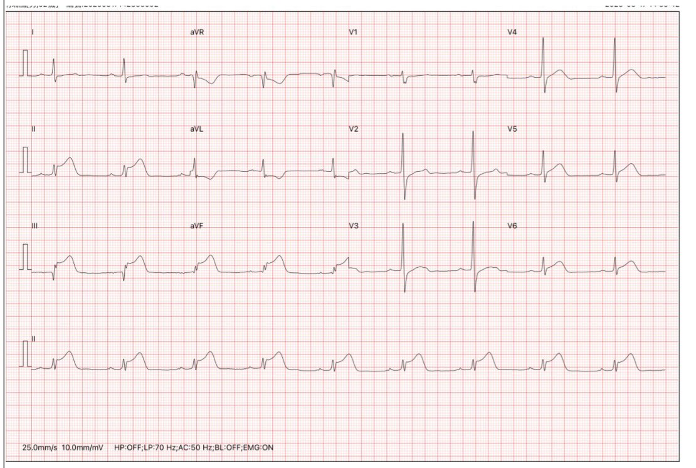

# 114 年度高級救護技術員甄試筆試 題目卷

> 單選題，共 100 題。答案在 [`答案_108-114年.md`](答案_108-114年.md)，作答完再對。

### 1. 關於「到院前救護單位的派遣與反應模式」的敘述，下列何者正確？

- (A) 派遣員僅負責派車，不需提供到達前指導（pre-arrival instruction）。
- (B) 採用英美模式的國家，會由派遣中心進行檢傷並分流輕重症後再決定是否派車。
- (C) 現代化指揮中心應以「速度優先」為最高指導原則，盡快抵達現場。
- (D) 派遣員透過關鍵問題詢問與優先派遣系統，可分辨案件輕重緩急並提供適當協助。

### 2. 無人飛行載具（Unmanned Aerial Vehicles）運用於緊急醫療救護中的優勢，何者最不適當？

- (A) 快速部署。
- (B) 降低風險。
- (C) 成本效益。
- (D) 技術門檻低。

### 3. 某地區近年推行「院前葉克膜（ECMO）啟動計畫」，主張對頑固性心室顫動（refractory VF）病人，在現場由救護技術員即時啟動葉克膜團隊，可顯著提升存活率。你查到《Lancet, 2020》ARREST Trial 研究指出，該措施能提升存活率6 倍，但《NEJM, 2023》INCEPTION Trial卻顯示無顯著差異。若你欲評估是否適用於你所在地區的EMS 系統，應優先考量下列哪一項？

- (A) 該研究的P 值是否小於0.05，代表具統計顯著性。
- (B) 研究採隨機控制試驗（Randomized Control Trial），因此結果可直接引用。
- (C) 研究族群與本地EMS 病人特性及系統環境是否相似。
- (D) 研究使用的儀器品牌與本地不同，結果應不具參考性。

### 4. 下列何者不是台灣緊急醫療救護體系中醫療指導醫師的核心任務？

- (A) 主要負責消防局內部救護流程變更之核可與監督。
- (B) 透過對救護技術員的教育訓練與預立醫療流程訂定。
- (C) 針對救護技術員在現場的特殊狀況提供即時通訊支援與授權。
- (D) 透過救護紀錄表回顧與案例檢討，進行品質監測與改善。

### 5. 當病人意識不清、病況危急時，執行救護行為時，依照《里斯本宣言》：「除非病人曾有明確的表達，否則在危急的狀態，法定代理人不可得時，可將病人的同意視為當然。」，下列社會責任的歸屬何者最適當？

- (A) 尊重權益。
- (B) 自由選擇權。
- (C) 公衛責任。
- (D) 公平正義。

### 6. 在面對緊急救護過程中的倫理困境時，下列哪一項做法最符合「倫理議題的解決」原則？

- (A) 立即依個人判斷行動，事後再向同事或醫療指導人員報告。
- (B) 參考過去類似經驗、請教同事或醫療指導，並透過無私試驗、普及試驗與答辯試驗評估決策。
- (C) 儘量遵從病人家屬意見，不需考慮救護技術員的專業判斷。
- (D) 在救護過程中避免任何決策，以防承擔倫理責任。

### 7. 醫事警消等人員因執行業務意外暴露愛滋病毒之處理流程建議，下列敘述何者最不適當？

- (A) 針扎後應以肥皂及水清潔傷口，並於24 小時內向工作單位通報。
- (B) 病人體液接觸到眼睛應沖水，並於24 小時內向工作單位通報。
- (C) 於發生暴露後須於1 週內將「醫事、警消等人員因執行業務意外暴露愛滋病毒通報單」送所在地衛生局備查。
- (D) 預防性投藥要愈早愈好，若已超過72 小時，則無預防性投藥之必要。

### 8. 救護技術員在出勤時接獲報案，現場一名45 歲男性在家中服用大量安眠藥，但仍有呼吸與意識反應。其妻表示，近來他常抱怨「工作壓力太大、活得沒意思」，並曾搜尋上吊與燒炭的資料。依據自殺相關名詞的區分，該病人目前的行為最接近下列何者？

- (A) 自殺意念。
- (B) 自我傷害。
- (C) 自殺企圖。
- (D) 自殺死亡。

### 9. 醫療優先派遣是目前有醫學實證的解決方案之一，它是一個提供派遣員使用的標準化流程，下列何者並非其流程的一部分？

- (A) 溝通（Communication）。
- (B) 派遣（Dispatch）。
- (C) 指導（Instruction）。
- (D) 詢問（Interrogation）。

### 10. 消防署在2015 年辦理了派遣員協助指導心肺復甦術訓練課程，並於2018 年建立品管評量指標如下，何者最不適當？

- (A) 所有報案電話的OHCA 辨識比率：設定指標為50%。
- (B) 可接觸之報案電話的OHCA 辨識比率：設定指標為80％。
- (C) 辨識出OHCA 之報案者接受DA-CPR 的壓胸比率：設定指標為60％。
- (D) 電話報案後至辨識出OHCA 時間的中位數：＜120 秒。

### 11. 品質管理分析中有常見的七種分析方式，以下何者最不適當？

- (A) 魚骨圖。
- (B) 柏拉圖。
- (C) 甘特圖。
- (D) 層別法。

### 12. 關於心臟傳導系統的敘述，下列何者正確？

- (A) 正常情況下，心臟的電氣傳導始於房室結。
- (B) 正常情況下，心跳速率由普金吉氏纖維主導。
- (C) 心搏過速可能是因為心臟存在額外的傳導路徑。
- (D) 心電圖中的P 波代表心室去極化。

### 13. 關於人體神經系統的解剖分類及其主要功能分區，下列敘述何者最適當？

- (A) 中樞神經系統由腦幹和12 對腦神經組成，主要負責將感覺訊息傳入並處理。
- (B) 周邊神經系統包含31 對脊神經，負責將運動指令傳達到肌肉或腺體產生動作。
- (C) 傳出分支包括體神經系統和自主神經系統，提供隨意與不隨意的控制。
- (D) 自主神經系統主要由乙醯膽鹼和腎上腺素組成，控制隨意肌的收縮。

### 14. 人生不同時期會面臨不同階段的心理變化，也會影響我們對於該傷病患應採取的照護模式；下列關於不同時期的傷病患照護的相關敘述，何者最為適當？

- (A) 在評估九個月大哭鬧不安的女嬰時，應暫時區隔父母與小孩讓幼童能平靜下來接受評估。
- (B) 當三歲大男童通報外傷時，適度觀察父母婚姻、經濟情況有助於評估兒虐風險之高低。
- (C) 十六歲少女主訴腹痛合併噁心，在病史詢問時建議邀請父母在側才能正確了解月經週期。
- (D) 七十歲女性院前心跳停止，現場建議與伴侶簡單解釋，安撫支持會導致伴侶更難走出傷痛。

### 15. 對於一位蜂螫嚴重過敏反應的OHCA 的患者上，在你準備插管時請以HEAVEN 法則判斷哪一個較符合？

- (A) 出血。
- (B) 困難解剖構造。
- (C) 頸部活動受限。
- (D) 低血容。

### 16. 肺臟通氣（V:Ventilation）與灌流（Q:Perfusion）對於身體組織是否可得到足夠的氧氣有很大的關係，一個正常的人V 除以Q 值（V/Q）約略等於0.8，試問下列疾病如果發生在同一個人身上（非同時發生），其V/Q 值由大到小為下列哪一個選項？甲：氣喘、乙：過度換氣、丙：肺栓塞、丁：氣管異物梗塞

- (A) 丁>甲>乙>丙。
- (B) 丙>甲>乙>丁。
- (C) 甲>丁>乙>丙。
- (D) 丙>乙>甲>丁。

### 17. 關於快速程序插管(RSI)的步驟 6P，下列敘述何者錯誤？

- (A) 在「前置給藥」步驟，給予Lidocaine 可防止顱內壓升高。
- (B) 在「給藥使病人麻痺」步驟，若血氧濃度分析儀低於90％，則必須停止輔助呼吸。
- (C) 在「給藥使病人麻痺」步驟，會先給鎮定劑再給肌肉麻痺劑。
- (D) 在「前置給氧」步驟，建議將血氧濃度拉升至盡可能接近100％。

### 18. 80 歲男性，過去病史為咽喉癌患者經放射線治療術後、病態性肥胖，今天早上家屬發現病人口吐鮮血，意識變差，使用非再吸入型面罩可維持在血氧100%但病患呼吸極為緩慢，你評估此病患已進展至呼吸衰竭，經聯絡醫療指導醫師，同意於現場執行氣管內管插管。請問下列哪一項處置方式對此病患順利完成氣管內管置入的幫助最少？

- (A) SALAD（Suction assisted laryngoscopy airway decontamination）技術。
- (B) 影像喉頭鏡。
- (C) 快速氧氣沖洗（Flush O2）。
- (D) 斜坡擺位（ramp position）。

### 19. 關於管制藥品使用及管理的敘述，何者最不適當？

- (A) 管制藥品減損時，管理人應於一個月內報請當地衛生主管機關查核。
- (B) 管制藥品使用後，必須於救護紀錄表詳細記載，由醫療指導醫師簽核。
- (C) 常使用於鎮靜的Ketamine 為第三級管制藥品。
- (D) 常使用於止痛的Tramadol 為第四級管制藥品。

### 20. 病人因胸悶痛叫救護車，使用NTG 舌下含片後出現劇烈頭痛與血壓下降，你應懷疑下列何者最適當？

- (A) 病人出現過敏反應。
- (B) 副交感神經被抑制。
- (C) 血管擴張過度造成顱內壓下降。
- (D) 硝酸鹽藥物導致顱內血管擴張。

### 21. 關於藥物給予及給藥途徑，下列敘述何者錯誤？

- (A) 當理學檢查發現要施打IV 部位有硬化、紅腫熱痛時，應考慮換部位施打。
- (B) IV 應避免施打在乳癌病患接受淋巴移除手術之患側肢體。
- (C) 糖尿病病人，IV 應該避免打在下肢。
- (D) 當病人有休克徵象，應選用較大號數的IV 針頭。

### 22. 根據Szasz 與Hollender 提出的三種醫病互動模式，下列何者最適合應用於慢性疾病（譬如：高血壓、糖尿病）的照護情境？

- (A) 主動—被動模式（Active–Passive Model）。
- (B) 指導—合作模式（Guidance–Cooperation Model）。
- (C) 共同參與模式（Mutual Participation Model）。
- (D) 父母—嬰兒模式（Parent–Infant Model）。

### 23. OHCA 急救現場家屬情緒激動，哭喊要求馬上送醫並大聲指責救護員動作太慢。若要應用HARD 溝通策略，以穩定家屬情緒並爭取後續急救時間，以下哪一項回應最適當地體現HARD 溝通策略中的「A：承認（Acknowledge）」步驟？

- (A)「我們在幫他急救，請配合讓我們儘快送醫，現場不適合討論」。
- (B)「我知道你現在非常難過，如果我是你，我也會覺得很焦急」。
- (C)「我了解急救的重要性與急迫性，我們是依照標準作業程序處理，做好病人的評估和處置是我的專業」。
- (D)「你這樣只會妨礙我們工作，請讓開讓我們好好做事」。

### 24. 下列哪個病人對於症狀加劇或緩解因素的描述，最符合心包膜炎（pericarditis）的臨床表現特徵？

- (A) 胸痛常在運動、飲食、或置身於寒冷環境中誘發。
- (B) 疼痛常會因為深吸氣而加劇。
- (C) 舌下含片治療後，胸痛會緩解。
- (D) 躺臥時會加劇胸痛的症狀，而身體前傾或坐姿時可緩解。

### 25. 一位病人以發燒合併右肩酸痛作為主訴，在身體診察中未發現肩部有明顯局部異常。依據體表轉移痛（referred pain）的概念，在鑑別診斷中，應優先考慮下列哪個內臟器官的病變可能性？

- (A) 心臟。
- (B) 胰臟。
- (C) 肝膽。
- (D) 腎臟。

### 26. 腹部視察與特殊觸診徵象（abdominal physical signs）可協助判斷病因部位與急重症類型，操作右上腹按壓時，患者因疼痛而無法深吸氣的特殊腹部徵象，何者最適當？

- (A) 洛辛氏徵象（Rovsing’s sign）。
- (B) 莫菲氏徵象（Murphy’s sign）。
- (C) 腰大肌徵象（Psoas sign）。
- (D) 麥氏點壓痛（McBurney’s point）。

### 27. 66 歲男性意識改變，觀察其呼吸型態發現病人出現極度的深吸氣後，維持一段時間的呼吸中止，之後再把氣呼出。下列哪一項「呼吸型態」最符合此描述？

- (A) 庫斯毛耳氏呼吸（Kussmaul respiration）。
- (B) 陳施氏呼吸（Cheyne-Stokes respiration）。
- (C) Biot’s 呼吸（Biot’s respiration）。
- (D) Apneustic 呼吸（Apneustic respiration）。

### 28. 關於醫用超音波（Medical Ultrasound）的基礎原理，下列敘述何者最適當？

- (A) 聲波發射頻率越高，其波長越長，對於深部組織的穿透力較佳。
- (B) 聲波發射頻率越低，其波長越短，對於淺層組織的解析度越好。
- (C) 醫用超音波是一種會產生輻射線（Radiation）的侵入性檢查工具。
- (D) 到院前超音波檢查多使用低頻率的扇形探頭（Phased Array Probe）。

### 29. 有關E-FAST 檢查在創傷病人到院前評估的描述，何者最適當？

- (A) 腹腔內無明顯低回音成像則代表無腹內出血。
- (B) 膀胱為身體最低的區域，若膀胱區周圍未見積液，則 Morrison’s pouch 的低回音區可能是假影。
- (C) E-FAST 檢查劍突下區域及心包膜腔時，肝臟是適當的聲波傳導介質。
- (D) 橫向掃描恥骨上區域發現有低回音成像，便可診斷為腹腔內積液。

### 30. 68 歲男性，主訴呼吸困難。意識清楚，呼吸 30 次/min，使用輔助呼吸肌；SpO2 89%，給予氧氣後提升至 94%，血壓 88/54 mmHg，心跳 132 次/min；聽診雙側均有哮喘音（wheezing），此時最適當的現場處置與後續決策為何？

- (A) 立即給予支氣管擴張劑霧化治療，觀察 15 分鐘後再決定是否送醫。
- (B) 判斷為哮喘急性發作，給予氧氣即可，持續監測。
- (C) 依臨床表現判斷為COPD 惡化，無需立即送醫。
- (D) 初步穩定呼吸後，因合併低血壓與頻脈，應立即送往急診並通報可能之重症。

### 31. 75 歲男性由鄰居報案，表示病人今早言語混亂、走路不穩且對時間、地點搞混。屋內空氣異常悶濁，暖爐運轉中。你發現其後腦勺有一處小擦傷，正持續滲血。藥袋上顯示他服用多種處方藥（含鎮靜劑與降壓藥）。根據上述情境，初步鑑別與處置中，何者最適當？

- (A) 現場應優先處理後腦出血點給予加壓止血，因其為最可能造成意識混亂的主因。
- (B) 若該老年人有失智症病史，可能症狀起起伏伏，評估後應送至附近本來長期就醫的精神專科醫院調整藥物。
- (C) 現場環境與病史提示可能有一氧化碳中毒，應考慮開窗通風，並給予病人高濃度氧氣。
- (D) 如病人有服用propranolol（beta blocker），低血糖時會有明顯心跳加快和手抖，有助於現場辨識。

### 32. 65 歲男性因昏厥冒冷汗叫救護車，EMT-P 進行病人評估為GCS E4V5M6、呼吸12 次/min、濕囉音（crackles）、血壓80/40mmHg、脈搏60 次/min、SpO2 92%、下肢水腫，病人於車上抽搐後呈現VF 心律。請問病人最可能是5H5T 哪個原因？

- (A) 低血容積（Hypovolemia）。
- (B) 張力性氣胸（Tension pneumothorax）。
- (C) 中毒（Toxins）。
- (D) 冠狀動脈血栓（Thrombosis/Coronary）。

### 33. 專業醫療或救護人員執行基本救命術時，大多採取 C-A-B 順序，下列哪兩種情境仍建議維持傳統的 A-B-C 順序？

- (A) 溺水病人與新生兒。
- (B) 心因性猝死病人與創傷病人。
- (C) 藥物過量病人和CO 中毒病人。
- (D) 雷擊病人和低體溫病人。

### 34. 根據最新的復甦後照護指引，目標體溫管理（TTM）的主要臨床目的，何者為是？

- (A) 減少大腦代謝與缺血再灌流傷害。
- (B) 降低血壓，避免腦部再灌流受損。
- (C) 預防低血氧，確保氧合足夠。
- (D) 增加藥物代謝速度以改善心肺功能。

### 35. 以下關於復甦後照護、目標體溫管理議題之敘述，何者最適當？

- (A) 目標體溫管理之溫度為：32-34ºC。達到目標溫度後，持續目標體溫達48 小時。
- (B) 復甦後血中CO2 濃度：45-55mmHg。研究顯示，輕度高碳酸血症相較於正常碳酸血症有更好的預後。
- (C) 復甦後的血氧濃度：建議在92~98%。臨床試驗結果表明，低血氧與較差的預後相關。
- (D) 血壓管理：建議SBP 維持120mmHg 以上、MAP 維持65mmHg 以上為宜。

### 36. 以下爆炸傷之描敘，何者最適當？

- (A) 爆裂飛散物擊中為第一級爆炸傷，中空器官受傷，包含耳膜破裂、肺挫傷等屬於此類。
- (B) 爆裂物的添加物造成的傷害為第二級爆炸傷，可能會導致細菌、化學物質或放射物質造成人體傷害。
- (C) 空氣震波或其他物體噴濺為第三級爆炸傷，常導致穿刺傷或鈍傷。
- (D) 爆炸產生的熱能及火焰為第四級爆炸傷，可能導致燒傷、壓碎傷、呼吸道的吸入性傷害。

### 37. 根據美國外科醫學會外傷委員會修訂 2021 外傷病人現場檢傷分類國家指引，關於重大外傷高風險病人，應送至最高等級外傷中心，以下何者最適當？

- (A) 3 歲男孩汽車車禍，未使用安全座椅，左手前臂變形，現場收縮壓80mmHg。
- (B) 20 歲男性遭機器捲入，左手第四指、第五指截肢傷。
- (C) 66 歲男性，騎腳踏車發生車禍，現場血壓100/60mmHg，心跳110 次/min。
- (D) 28 歲孕婦，懷孕超過20 週。汽車車禍，同車乘客死亡。

### 38. 以下創傷休克之急救處置，何者最適當？

- (A) 應該要予以適當的通氣及給氧，以維持血氧濃度（SpO2）大於90%。
- (B) 對於出血性休克之傷患，建議以溫暖的林格氏乳酸溶液為輸液首選。成人首次輸液量為2 公升。
- (C) 若大出血處無法做到確實止血前，「允許性低血壓（permissive hypotension）」是可接收之作法。
- (D) 若創傷患者合併合併腦損傷，為維持腦部灌流，建議收縮壓維持120mmHg。

### 39. 關於出血在院前的處置方式，下列敘述何者正確？

- (A) 執行加壓止血時，手持一般敷料於出血處加壓，3 到5 分鐘後須打開確認是否已止血。
- (B) 在到院前早期使用骨盆固定帶，雖能減少骨盆出血量，但無法改善病人預後。
- (C) 研究證實，出血病人即使在休克後再打上止血帶，存活率仍然相當良好。
- (D) 肢體出血致病人生命危急時，應盡快剪除衣服，快速打上止血帶以求確實止血。

### 40. 50 歲男性， 6 公尺高處墜落，有頭部外傷，身上無明顯外出血，意識不清，現場對痛刺激僅能發出呻吟聲，血壓190/60mmHg，心跳50 次/min，血氧88%，呼吸8 次/min 關於此病人的敘述下列何者最適當？

- (A) 低血氧是創傷性腦傷的危險因子，根據EPIC-TBI，建議血氧應維持在98%以上。
- (B) 維持呼吸道暢通部分，不建議使用聲門上呼吸道。
- (C) 若要進行氣管內管置入，可以考慮施打lidocaine，以避免顱內壓的上升。
- (D) 若病人沒有躁動，可以考慮解開頸圈。

### 41. 30 歲男性車禍，顏面鈍挫傷合併大量口鼻出血、口腔有血塊，發出咕嚕聲；生命徵象：對痛睜眼，無法正確定位，會發出呻吟聲，SpO2 84%，呼吸10 次/min、不規則；血壓 148/72mmHg，HR 72 次/min，根據以上資訊，下列處置何者最優先？

- (A) 徒手頸椎減移，建立聲門上呼吸道，進行輕度過度通氣，維持EtCO2 25–35 mmHg。
- (B) 徒手頸椎減移，以大口徑抽吸管清除血塊、 考慮準備插管保護呼吸道。
- (C) 徒手頸椎減移，抽吸血塊暢通呼吸道，置入鼻咽呼吸道 ，再以 BVM 正壓給氧。
- (D) 徒手頸椎減移，以 BVM 正壓給氧，血氧上升後，進行抽吸以暢通呼吸道。

### 42. 對於開放性氣胸的院前處置，下列何者最適當？

- (A) 以透氣敷料覆蓋傷口。
- (B) 使用不透氣敷料封三邊、留一邊開放。
- (C) 立即給予正壓通氣。
- (D) 將外露臟器推回胸腔。

### 43. 25 歲男性，在KTV 與人起口角，遭人使用水果刀襲擊，到場時發現頸部皮下氣腫、頸靜脈怒張，左前胸及左後背均有長而深的傷口，病人意識略為躁動，一直喊不舒服，呼吸困難，冒冷汗，生命徵象為血壓120/80mmHg，心跳130 次/min，血氧82%，關於此病人，下列處置最為適當？

- (A) 病人血氧不佳，應及早建立聲門上呼吸道及正壓通氣。
- (B) 須懷疑開放性氣胸，於左前胸、左後背傷口貼上胸封。
- (C) 病人已經頸靜脈怒張，故不建議再給予輸液。
- (D) 執行E-FAST 若有barcode sign，可以證實血胸的存在。

### 44. 30 歲男性騎乘機車自摔，主訴左上腹疼痛，理學檢查發現左側第十肋骨處壓痛變形，且疼痛轉移至左肩。此傷患最可能傷及下列哪個器官？

- (A) 肝臟。
- (B) 脾臟。
- (C) 腎臟。
- (D) 胰臟。

### 45. 32 歲男性機車車禍，病人躺在地上清醒但皮膚蒼白濕冷出汗，主訴下腹與會陰疼痛。身體檢查發現會陰及陰囊瘀青，無其他明顯外出血。此時最優先的處置為何？

- (A) 反覆測試確認骨盆不穩定後再使用骨盆固定帶。
- (B) 若有商品化骨盆固定帶，立即使用骨盆固定帶。
- (C) 先建立兩條大號靜脈管路給予大量輸液。
- (D) 若病人意識清醒且骨盆外觀無明顯變形可不急著固定。

### 46. 你抵達現場發現一名男子被貨車輪胎壓住右大腿超過 6 小時，現場準備脫困。以下哪一項處置最為適當？

- (A) 立即移開重物讓病人脫困，再開始輸液。
- (B) 儘可能在脫困前先給予大量靜脈輸液，再鬆開壓迫。
- (C) 優先給予止痛藥後再考慮輸液。
- (D) 等病人完全脫困後再觀察是否出現休克再給輸液。

### 47. 高壓電廠工人維修時發生爆炸，現場有多名傷者，關於現場敘述何者最適當？

- (A) 靠近現場時，遠離高壓電線或金屬物3~9 公尺，大於400 伏特的高壓電會使乾燥樹枝也導電，確定電流切斷前不可輕易接觸傷患。
- (B) 現場可能產生高壓電弧致發生爆炸，傷患可能有氣胸，到第四階段可能直接撞擊地面造成肝臟損傷。
- (C) 電傷害可引起廣泛的血管壞死，這種傷害立即的內出血，動脈或靜脈血管的血栓與隨後的病發生，在救護現場很容易被發現。
- (D) 身體檢查查看有無電流入口及出口，高壓電經過人體時可能有多處傷口，會在皮膚上產生親吻型灼傷，常見於腋下、前臂及手肘。

### 48. 35 歲男性廚師，前臂不慎被滾燙的熱油潑灑，產生數個巨大水泡，皮膚呈現紅色且傷患主訴劇烈疼痛。此類灼傷的深度分級為何者最適當？

- (A) 表淺性灼傷 (一度)。
- (B) 淺層灼傷 (二度) 。
- (C) 全層灼傷 (三度)。
- (D) 四度灼傷。

### 49. 35 歲女性，體重約50 公斤火場救出後經初步評估為整隻右手臂及整隻右腿的深度灼傷（皆為二度或三度灼傷），根據修正後布魯克公式(modified Brooke formula)前八小時應給予多少輸液量？

- (A) 1,350ml。
- (B) 1,800ml。
- (C) 2,700ml。
- (D) 3,600ml。

### 50. 為一位失去意識且無嘔吐反射的3 歲兒童放置口咽呼吸道（OPA），何者最適當？

- (A) 反向插入達軟顎後旋轉180 度。
- (B) 應使用壓舌板輔助平行置入。
- (C) 尺寸應選擇更大號避免脫落。
- (D) 兒童舌頭小不易造成呼吸道阻塞。

### 51. 照護老年外傷病人時，何者最適當？

- (A) 老年人的呼吸肌力減弱及脊椎彎曲駝背，都會導致胸壁順應性（compliance）降低，進而容易出現呼吸窘迫。
- (B) 老年人腦部萎縮，會使顱內出血或腦腫脹的症狀比一般成人更早、更明顯地表現出來。
- (C) 老年病人因血管硬化，脈壓平時較窄，這是休克初期的重要判斷依據。
- (D) 維持呼吸道時，應避免移除活動假牙，移除會造成臉部凹陷的情況，會容易導致BVM 通氣時密閉不完全漏氣。

### 52. 關於心電圖出現有意義ST-T 波變化的所在導極與心臟解剖位置的相關性配對，下列何者正確？

- (A) 中隔區為導極V3, V4。
- (B) 前壁為導極V5, V6。
- (C) 側壁為導極V1, V2。
- (D) 下壁為導極II, III, aVF。

### 53. 下列哪一種心電圖變化最符合「心室顫動 」(Ventricular Fibrillation, VF)的特徵？

- (A) 連續而快速，規律一致，寬QRS 波、無P 波。
- (B) 連續而快速，無規則節律，大小、寬窄不一的QRS 波。
- (C) 快而規則的連續波型，伴隨高尖ST 段。
- (D) 可見P 波與QRS 波一一對應。

### 54. 病人突發「撕裂樣胸痛、放射至背部」，到達現場評估發現雙側上肢血壓差異大於 20 mmHg，最需要考慮什麼診斷？

- (A) 急性心肌梗塞。
- (B) 主動脈剝離。
- (C) 張力性氣胸。
- (D) 心包填塞。

### 55. 56 歲男性餐後出現胸悶、血壓84/52mmHg、脈搏54 次/min、血氧96％、體溫36.5ºC。十二導程心電圖結果如下圖，依據此心電圖變化，對於判斷病變位置及正確的到院前處置下列何者最適當？

- (A) 前壁STEMI，立即給予硝化甘油與高流量氧氣。
- (B) 下壁STEMI，避免硝化甘油並維持靜脈輸液。
- (C) 前壁NSTEMI，給予腎上腺素與阿斯匹靈。
- (D) 下壁NSTEMI，給予硝化甘油並將病人採半坐臥姿勢。

### 56. 一名頻脈且有血行動力學「不穩定」的病人，依據最新版本的ACLS 建議，同步心臟整律(synchronized cardioversion)的初始劑量配對何者正確？

- (A) 窄波且規則：同步整律120J 雙相，或200J 單相。
- (B) 窄波且不規則：同步整律50~100J。
- (C) 寬波且規則：同步整律100J。
- (D) 寬波且不規則：同步整律150J。

### 57. 關於心包膜填塞（cardiac tamponade）的敘述，下列何者最適當？

- (A) 有可能出現頸靜脈怒張，如果血流動力學不穩定，可以給予靜脈輸液。
- (B) 心包膜腔積液過多，會先壓迫左心房以及左心室，造成無脈性的電氣活動（PEA）。
- (C) 低血壓的產生是因為在心臟收縮期時，影響到回心血流。
- (D) 典型的貝克氏三症狀(Beck's triad)於大多數心包膜填塞的病人都可見到。

### 58. 關於急性冠心症中「非ST 段上升心肌梗塞」與「不穩定心絞痛」之差異，下列何者正確？

- (A) 兩者心肌酵素皆不會上升。
- (B) 後者12 導程心電圖會出現Q 波。
- (C) 兩者皆需於到院90 分鐘內完成心導管治療。
- (D) 前者因心肌壞死，血中心肌酵素上升。

### 59. 呼吸系統疾病可歸因為通氣、擴散、灌流三大致病機轉，下列有關於三大致病機轉與所出現的呼吸系統疾病配對，何者正確？

- (A) 肌肉萎縮導致的呼吸衰竭為擴散所造成的問題。
- (B) 火災現場，一氧化碳中毒為擴散所造成的問題。
- (C) 急性肺水腫導致的低血氧為通氣所造成的問題。
- (D) 嚴重的肺動脈粥狀硬化為灌流所造成的問題。

### 60. 60 歲男性到院前心臟停止（OHCA），心電圖監視器有看到波形，但脈搏摸不到。施行重點式心臟超音波是發現病人右心室明顯擴大，下列何者為最可能診斷？

- (A) 心包膜填塞（cardiac tamponade）。
- (B) 張力性氣胸（tension pneumothorax）。
- (C) 急性心肌梗塞（myocardial infarction）。
- (D) 肺動脈栓塞（pulmonary embolism)。

### 61. 60 男性主訴呼吸困難，下列哪一項發現最需考慮是「張力性氣胸」？

- (A) 雙側呼吸音減弱，雙側扣診呈現為實音。
- (B) 單側呼吸音減弱，氣管偏移合併低血壓。
- (C) 雙側哮鳴音(wheezing)，有粉紅色泡沫痰。
- (D) 心音聽診時非常小聲，合併頸靜脈怒張。

### 62. 有關腦幹功能的理學檢查評估，下面敘述何者為非？

- (A) 照光的一眼瞳孔沒有如同另一眼同時縮小時，表示該側的第三對腦神經受損或是中腦、腦幹有病兆。
- (B) 洋娃娃眼徵象陽性是指，轉動頭部時眼球會往頭轉動方向對側移動，代表腦幹反射正常。
- (C) 巴賓斯基反射如果單側呈現陽性時，代表著對側的腦部有受損的情形。
- (D) 痛刺激後雙側的上、下肢皆呈伸張的僵直姿勢，代表大腦半球皮質受到傷害。

### 63. 有關重症肌無力(Myasthenia gravis)之敘述，下列敘述何者最不適當？

- (A) 是一種自體免疫疾病。
- (B) 有些病人會合併胸腺瘤（thymoma），治療時可能需要手術處理。
- (C) 如果發生肌無力危象時，會緊急進行血漿置換術和靜脈注射免疫球蛋白。
- (D) 眼皮下垂通常是對稱的，如果是單側眼皮下垂，則不考慮是重症肌無力。

### 64. 左側中大腦動脈第一分支阻塞的腦中風病人，下列何者為最可能出現的臨床表現？

- (A) 左側無力、眼睛往右看。
- (B) 右側無力、眼睛往左看。
- (C) 左側無力、眼睛往左看。
- (D) 右側無力、眼睛往右看。

### 65. 下列何者無法用來區分「中樞性顏面麻痺」與「周邊性顏面麻痺」？

- (A) 是否上下半部臉部肌群都受影響。
- (B) 是否有聽覺過敏或耳朵內部症狀。
- (C) 是否合併語言功能損傷症狀。
- (D) 症狀是否持續超過一週。

### 66. 關於腎上腺體急症的敘述，下列敘述何者最不適當？

- (A) 庫欣氏症候群是因為血液內存在過高的腎上腺髓質素。
- (B) 庫欣氏症候群最常見的是因為腎上腺腫瘤引發。
- (C) 庫欣氏症候群典型症狀包含月亮臉、水牛肩、皮膚變薄。
- (D) 愛迪生病臨床表現包含體重減輕、低血壓、低血鈉。

### 67. 68 歲女性，有糖尿病病史，朋友表示病人意識不清約4 小時。現場生命徵象如下：體溫36.4 度、脈搏112 bpm、CRT<2 秒、血壓100/70 mmHg、呼吸24 次/min、GCS：E4V4M5 、血氧93%。下列評估及處置，何者最不適當？

- (A) 病人意識不清，需排除低血糖或高滲透壓高血糖症候群導致。
- (B) 病人呼吸偏快，可進一步評估呼吸是否有丙酮味來鑑別糖尿病酮酸血症。
- (C) 病人脈搏偏快，CRT<2 秒，應先補充大量輸液再量測血糖。
- (D) 病人血氧偏低，可給予氧氣鼻導管2 L/min。

### 68. 60 歲男性，在家中突然吐血，到達時發現浴室滿地都是血，病人意識清楚，呼吸淺快、膚色蒼白，血壓為70/40mmHg，針對病患的評估及處置，下列敘述何者最適當？

- (A) 如果吐出的血為鮮紅色，則可判定為下消化道出血。
- (B) 如果病人有肝硬化病史，最可能為食道動脈破裂導致出血。
- (C) 可以讓病人呈半坐臥以保護呼吸道。
- (D) 若給予輸液無效，可以給予Transamine 靜脈滴注。

### 69. 在到院前評估和處置急性腹痛病人時，下列評估或處置何者最適當？

- (A) 腹痛超過6 小時應考慮給予止痛，避免病人因疼痛加劇而休克。
- (B) 即使生命徵象穩定，仍應囑咐病人禁食，以降低到院後緊急手術的麻醉風險。
- (C) 可以透過聽診腸音確定病因，例如腸音太快即表示腸胃炎，腸音太慢則表示腹膜炎。
- (D) 急性腹痛患者常有脫水或出血的風險，應積極給予20mL/kg 的等張溶液。

### 70. 對於血液疾病的敘述，下列敘述何者最適當？

- (A) 地中海型貧血屬於大球性貧血。
- (B) 缺乏第八因子稱為B 型血友病。
- (C) 血小板小於50,000/uL，就會引起重要器官自發性出血。
- (D) 非何杰金氏淋巴癌早期通常沒有明顯症狀。

### 71. 腫瘤溶解症候群（Tumor Lysis Syndrome, TLS）是腫瘤細胞快速被破壞後，細胞內物質大量釋放所導致的嚴重併發症，可能引起下列哪一組代謝性異常？

- (A) 低尿酸血症、低血鉀症、低磷酸血症、高血鈣症。
- (B) 高尿酸血症、高血鉀症、高磷酸血症、低血鈣症。
- (C) 高尿酸血症、低血鉀症、高磷酸血症、高血鈣症。
- (D) 低尿酸血症、高血鉀症、低磷酸血症、低血鈣症。

### 72. 40 歲男性，被蜜蜂螫傷後約5 分鐘，主訴：喉嚨緊、呼吸困難，並出現全身性蕁麻疹。初步評估：意識對聲音有反應但躁動不安，呼吸音有明顯喘鳴（Stridor），橈動脈微弱，皮膚潮紅、濕冷，下列何者為最優先的關鍵處置？

- (A) 建立靜脈輸液並快速輸注生理食鹽水1 至2 公升。
- (B) 將病人擺位後給予高濃度氧氣，並於大腿中外側肌肉注射腎上腺素。
- (C) 將病人送醫，同時監測生命徵象，並在送醫途中準備好氣管內管以防呼吸道完全阻塞。
- (D) 考慮給予抗組織胺藥物（如Diphenhydramine）緩解皮膚症狀。

### 73. 一名病人因不明原因導致嘴唇和舌頭腫大，但外觀皮膚顏色正常。下列敘述何者最適當？

- (A) 可能是血管性水腫，病人經常會主訴疼痛或壓力感。
- (B) 血管性水腫是因為組織胺刺激皮膚淺層血管擴張所致。
- (C) 由於沒有合併出現蕁麻疹，可以排除是過敏反應導致。
- (D) 由於病人腫脹位於臉部，發生上呼吸道阻塞的風險極低。

### 74. 68 歲男性，因末期腎病變每週一、三、五規律血液透析。今天（星期日）聚餐吃了火鍋與水果。晚間突然呼吸困難、出現口周麻木與手部肌肉顫抖。現場評估：病人意識清楚，呼吸28 次/min，心率52 次/min，血壓158/94 mmHg，SpO2 95%，肺部有濕囉音，下肢明顯水腫。心電圖顯示高尖 T 波、PR 間隔延長。下列何者為最合理的鑑別診斷？

- (A) 體液過量造成左心衰竭與急性肺水腫，繼發低氧性心搏過緩。
- (B) 代謝性酸中毒引起中樞性過度換氣與低血磷症狀。
- (C) 高血鉀合併體液過量，導致膜電位不穩與傳導遲滯。
- (D) 透析後不平衡症候群造成顱內壓上升與交感活化反射。

### 75. 58 歲男性，突發左側腰痛2 小時，疼痛劇烈，伴隨噁心、尿意頻繁但解尿量少。抵達時病人滿頭冷汗、面色蒼白。病人表示一週因呼吸道感染，有曾口服感冒藥但已停藥三日，左側後腰部敲痛，下腹輕度壓痛但無明顯腫脹。下列何者為最適當的鑑別診斷？

- (A) 服用感冒藥後誘發尿滯留導致膀胱脹痛。
- (B) 結石阻塞輸尿管造成腎絞痛，並出現反射性頻尿。
- (C) 泌尿道感染併發腎盂腎炎，導致單側腰痛與發燒。
- (D) 由長期攝護腺肥大引起慢性尿滯留急性惡化。

### 76. 疑似疥瘡的救護案件，在個人防護與後續除污方面，最為完整且正確的處理流程為何？

- (A) 佩戴N95 口罩與隔離衣，避免飛沫傳染；處置結束後，使用酒精性乾洗手消毒雙手，並將壓脈帶以低階滅菌法處理。
- (B) 佩戴外科口罩、長袖隔離衣與手套，避免皮膚直接接觸；處置結束後，立即使用清水與肥皂徹底洗手，並將壓脈帶以中階滅菌法處理。
- (C) 佩戴外科口罩與手套，避免體液接觸；處置結束後，將手套丟棄並使用酒精消毒雙手，將壓脈帶以清水擦拭。
- (D) 僅佩戴手套，減少皮膚接觸；處置結束後，立即用清水與肥皂洗手，並將所有與病人接觸的裝備以高階滅菌法處理。

### 77. 季節性流感每年都需要更新疫苗，主要是因為病毒發生了抗原漂變（Antigenic Drift）。關於抗原漂變與抗原轉變（Antigenic Shift）之間的病理差異，下列敘述何者最適當？

- (A) 漂變是病毒基因組發生大段落互換，轉變是基因的點突變。
- (B) 漂變是造成季節性流行的機制，轉變是造成世界性大流行的機制。
- (C) 漂變影響的是病毒的傳染力，轉變影響的是病毒的適應力。
- (D) 漂變是人類流感病毒株與動物流感病毒株的重新組合。

### 78. 關於鉤端螺旋體病感染、下列描述何者最不適當？

- (A) 我國為第四類法定傳染病，應於24 小時內通報。
- (B) 黃疸性比無黃疸性鉤端螺旋病死亡率高。
- (C) 病人可能出現結膜充血但無膿狀分泌物。
- (D) 病人必須在單人病室進行隔離。

### 79. 下列關於潛水急症之敘述何者較為適當？

- (A) 反擠壓性外傷之臨床表現包括頭痛、鼻或耳出血及失去方向感等。
- (B) 空氣栓塞最常見的表現與肺栓塞的發作相似，患者會出現喘不過氣的狀況。
- (C) 氮醉的症狀通常在深度30 公尺的水下開始出現，患者會出現欣快感。
- (D) 懷疑空氣栓塞的病人，部分專家建議以右側躺的姿勢運送，以減少氣泡到達心臟。

### 80. 您在環境溫度為零下3 度的高山上進行山難搜救，發現一名登山客倒臥在空曠處，中心體溫為攝氏30 度，下列處置步驟何者最適當？

- (A) 必須先採取被動回溫、減少病人的熱散失，同時動作應保持輕柔，避免誘發Vf。
- (B) 病人發生OHCA，AED 顯示為Vf，此時急救重點應該是心肺復甦術、回溫及去顫，並在每次分析需要電擊時都及時電擊、不可延誤。
- (C) 病人經過處置後中心體溫回升至攝氏32 度，若仍然OHCA，可每3 分鐘給予Epinephrine 1mg IVP。
- (D) 經過復甦後病人ROSC，但此時心律顯示為竇性心搏過緩，建議立即使用心臟節律器，避免再次OHCA。

### 81. 在野外救援中，決定是否立即接近病人做處置前，環境風險評估的三項（3P）原則及順序以下何者最適當？

- (A) Patient、Public、Personal。
- (B) Personal、Public、Patient。
- (C) Position、Pressure、Protection。
- (D) Pace、Plan、Proceed。

### 82. 考量野外醫療針對傷患的照護，下列敘述何者最適當？

- (A) 考量到傷患在抵達醫院時可能需要接受手術或檢查，在下撤的過程中不能讓傷患喝水或吃東西，水分補充可以透過靜脈輸液進行。
- (B) 傷患的眼睛被樹木穿刺傷，應使用輕巧的物品固定穿刺物；若傷患能自行行走，可僅包紮受傷單眼，另一未受傷眼睛保持直視。
- (C) 針對穿刺傷口伴隨有泥土髒汙，可採用1%優碘水搭配注射器和靜脈留置針軟管，在傷口上施加壓力往內灌洗，避免長途運送感染。
- (D) 對於腕關節的脫臼，因該處解剖構造單純，根據野外醫療協定，可以進行復位後，利用夾板固定避免再次脫臼。

### 83. EMT-P 出勤疑似藥物過量患者，病人表現與現實脫節及易怒衝動，伴隨自傷意圖，現場環境混亂。需配合動員警察及衛生人員處理護送就醫及穩定情勢。下列配合方式，何者最適當？

- (A) 病人失去理智，無法進行任何形式的交流，就應尋求警察額外的支援，採取必要的約束措施。
- (B) 約束患者時，至少3 人團隊，上肢約束時，一臂向上、一臂向下，通常左上右下。
- (C) 使用Haloperidol 注射對於安非他命中毒患者無益，會增加橫紋肌溶解、高血壓急症與心律不整的風險。
- (D) 抗精神病藥物（antipsychotic）是緊急醫療救護中常使用的藥物，但常常合併高成癮性風險。

### 84. 下列針對高齡患者的慢性阻塞性肺病（COPD），何者最適當？

- (A) COPD 在高齡病人的症狀包含過度焦慮、發紺、異常或消失的呼吸音。
- (B) COPD 的患者發現消失的呼吸音合併明顯呼吸困難，應考慮使用epinephrineinhalation。
- (C) 代謝性酸中毒及低血氧會使COPD 的病人病情迅速惡化。
- (D) 當患者意識改變時，應該考慮使用非侵襲性正壓給氧呼吸機（Non-Invasive PostivePressure Ventilator）。

### 85. 34 週新生兒急救，剛剛已經給過15 秒甦醒球正壓通氣，你發現雖然bagging 時新生兒胸部有起伏，但心跳數卻與正壓通氣前一樣約45 次/min，請問下一步急救措施何者最適當？

- (A) 抽吸口鼻分泌物。
- (B) 檢查面罩是否有漏氣。
- (C) 開始3:1 壓胸與吹氣。
- (D) 再bagging15 秒。

### 86. 院前急產38 週約3 公斤之新生兒進行急救，關於下列急救步驟的描述，何者最適當？

- (A) 若羊水為黃色，高度懷疑有胎便吸入症，須立即插管。
- (B) 正壓呼吸時建議給予低濃度氧氣（1-3 L/min）。
- (C) 雙手環抱壓胸時，拇指並排頂端切齊兩乳頭連線。
- (D) 從氣管內管給Epinephrine 時，以1:1,000 濃度給0.3cc。

### 87. 對於遭受性侵害女性病人之院前處置，下列何者最不適當？

- (A) 將病人移至救護車上再進行理學檢查，以提供病人隱私。
- (B) 溫柔詢問病人受侵害之身體部位有哪些，以利紀錄詳實可提供法院做為日後證據。
- (C) 除了骨盆腔之外傷，也要注意口腔或其他身體部位有無外傷。
- (D) 即使病人身上有抓傷與咬傷等易感染傷口，也不建議以生理食鹽水沖洗。

### 88. 一名農夫疑似有機磷（Organophosphate）中毒，出現流涎、縮瞳、支氣管分泌物增多。下列描述何者最適當？

- (A) 常見症狀為急性癲癇發作。
- (B) 以阿托品（Atropine）治療。
- (C) 給予活性碳協助吸附除汙。
- (D) 大量輸液以促進腎臟排毒。

### 89. 懷疑下列何者中毒時，使用活性碳(activated charcoal）最適當？

- (A) 氰化物（cyanide）。
- (B) 酒精中毒（ethanol intoxication）。
- (C) 甲醇（methanol）。
- (D) 鴉片類止痛藥（opioids）。

### 90. 對於氣切管（Tracheostomy tube）病人出現呼吸窘迫時，最優先處置為何？

- (A) 嘗試更換新的相同尺寸的氣切管。
- (B) 需要拔除氣切管利於觀察氣切口。
- (C) 移除所有配件確認氣切管是否阻塞。
- (D) 從口鼻給氧，氣切口能使用的機會很低。

### 91. 有關SALT 檢傷法之敘述，下列何者最適當？

- (A) 第一步先對病人進行整體分類，靜止不動以及有明顯生命垂危的病人應該列為最優先評估順位。
- (B) 個別評估實施有限的救命措施，係指僅可使用止血帶來控制大出血，其他處置待檢傷分類後再操作。
- (C) SALT 檢傷法將傷患分為立即、預期、延遲、輕微等4 個類別。
- (D) 當現有資源不足以應付病人傷勢而預期無法生存，則應將其分類為預期，並標記為黑色。

### 92. 指揮中心接獲核電廠反應槽墜落事件，現場一名疑似放射性污染合併外傷患者，下列應變措施何者最適當？

- (A) 在現場完成患者全身去污後再後送，避免輻射物質污染後送載具與接收醫院。
- (B) 進入熱區對患者進行救治時，救護人員須穿著鉛衣以減少輻射傷害。
- (C) 偵檢發現同仁防護裝備有輻射反應，應以大量溫水做沖洗除污。
- (D) 患者於後送途中陷入昏迷，應就近送至適當急救責任醫院，不限於核災急救責任醫院。

### 93. 戶外活動現場氣溫為33°C，相對濕度75%，多名觀眾出現中暑前兆。此時主辦單位詢問你是否應該暫停活動，請問下列選擇何者最適當？

- (A) 係數為 33 + 75×0.1 = 40.5，危險係數已達標準，應建議停止活動。
- (B) 係數為 33 + 75×0.1 = 40.5，僅需增加醫護人員與救護車數量即可。
- (C) 係數為 33 + 75×0.1 = 40.5，應設置冷水槽與冰袋降溫即可繼續活動。
- (D) 係數低於 45，屬可接受範圍，可正常進行活動。

### 94. 在一場全國大專院校田徑賽中，醫療救護站同時接獲三個傷病事件，在評估後，應採取何種處置策略及後送順序？完成 10,000 公尺長跑後倒臥終點，意識不清，全身溼透癱軟，嘔吐，個案甲疑似中暑或熱衰竭。個案乙在跳遠時發生右腳踝脫臼，疼痛劇烈，但生命徵象穩定。個案丙在場外摔車，臉部多處擦傷，但可自行走動。

- (A) 優先後送個案乙，因為脫臼會造成劇烈疼痛，應儘速送醫止痛後復位。
- (B) 優先後送個案丙，因摔車可能伴隨頭部外傷，雖然意識清醒，但潛在危險最高。
- (C) 應優先後送個案甲，因其意識不清且嘔吐，合併熱傷害風險，需立即後送至醫院。
- (D) 個案乙的脫臼應在現場嘗試復位以減少痛苦，個案甲應在場邊進行積極降溫，然後再將兩位病人一同後送。

### 95. 依據INSARAG Guideline，「由42 名以上搜救隊員組成，具備於1 個災害現場連續7 天每日24 小時，執行災點倒塌或失效的重型木造和鋼混結構搜索和救援的能力」為下列何者的標準？

- (A) 緊急醫療隊特殊照護小組（Specialized care teams）。
- (B) 緊急醫療隊第一型機動式（Type 1 Mobile）。
- (C) 城市搜救隊中型救援隊伍（Medium USAR teams）。
- (D) 城市搜救隊重型救援隊伍（Heavy USAR teams）。

### 96. 大型槍擊事件中倒地的傷患，意識不清、呼吸時伴隨明顯的鼾聲與血色泡沫。當您準備處理其呼吸道時，發現腹股溝處正迅速被鮮血浸濕，於地面形成一小灘血泊。根據戰術緊急病人救護（TECC）的原則，在當前「暖區」環境下，您的首要行動應為下列何者？

- (A) 執行環甲膜切開術，因為傷患的臉部創傷已無法使用基本或聲門上呼吸道處置。
- (B) 嘗試以含止血敷料的紗布對腹股溝的傷口進行加壓填塞。
- (C) 考量現場為暖區且傷患意識不清，優先將傷患快速拖行至後方更安全的集結點（冷區）再進行處置。
- (D) 使用鼻咽呼吸道並側臥傷患，以處理呼吸道阻塞，並準備BVM 給予輔助通氣。

### 97. 深夜發生規模7.3 地震，多棟建物倒塌，地區停電且道路受阻。部分傷患受困於瓦礫中，另有居民集中於臨時安全區。災難醫療救護隊到達後，關於初期緊急醫療運作，下列何者最適當？

- (A) 立即投入倒塌現場搜救，爭取受困傷患的黃金救援時間。
- (B) 優先架設臨時醫療區域，進行檢傷分類與公共衛生監測。
- (C) 立即通報區域指揮中心，等待後續專責搜救隊接手進駐。
- (D) 儘速協調收容所安置，防止疫情與群聚感染進一步擴散。

### 98. 一名多重外傷傷患需以空中後送至本島醫院，預計飛行高度約6,000 英呎。胸部X 光顯示有小量氣胸。依空中救護原則，下列處置何者最適當？

- (A) 直接以直昇機轉送，於途中密切觀察氣胸變化。
- (B) 先給予高濃度氧氣，並於飛行中持續監測血氧。
- (C) 改以加壓艙固定翼機轉送，可避免氣壓變化影響。
- (D) 縱使生命徵象穩定也應考慮在起飛前先置放胸管，以避免氣體膨脹造成惡化。

### 99. 從經驗中學習，找出成功之處以及需要改進的地方，以便未來的行動能夠更加有效。這個我們稱之為？

- (A) 突發狀況解決（Huddle）。
- (B) 分工說明（Brief）。
- (C) 狀況監測（Situation Monitoring）。
- (D) 事後反饋（Debrief）。

### 100. 某一EMT-P 訓練課程的核心目標是確保所有新進人員在執行救護時，都能達到一致且明確的標準化操作，以確保醫療品質與病人安全。下列哪一種課程設計模式最符合此次訓練課程的需求？

- (A) 歷程模式（Process model）。
- (B) 情境模式（Situation model）。
- (C) 目標模式（Objective model）。
- (D) ERCP 模式（ERCP model）。

---

## 作答區

| 題號 | 1 | 2 | 3 | 4 | 5 | 6 | 7 | 8 | 9 | 10 |
|---|---|---|---|---|---|---|---|---|---|---|
| 1–10 | | | | | | | | | | |
| 11–20 | | | | | | | | | | |
| 21–30 | | | | | | | | | | |
| 31–40 | | | | | | | | | | |
| 41–50 | | | | | | | | | | |
| 51–60 | | | | | | | | | | |
| 61–70 | | | | | | | | | | |
| 71–80 | | | | | | | | | | |
| 81–90 | | | | | | | | | | |
| 91–100 | | | | | | | | | | |
